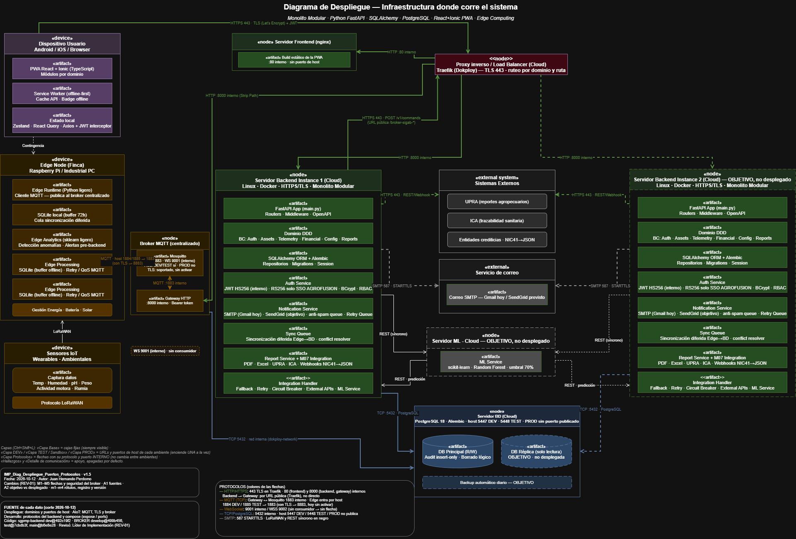

# Control del documento

| Campo | Detalle |
|---|---|
| Título | Documento de Ambiente de Trabajo — Área de Implementación (SGPMP) |
| Proyecto | Sistema de Gestión Pecuaria Multiespecie de Precisión (SGPMP) — Proyecto Integrador IV |
| Institución | Universidad Surcolombiana — Facultad de Ingeniería |
| Área | Implementación |
| Versión | 1.5 (segunda entrega, corrección de REV-02) |
| Fecha | Octubre de 2026 (fecha de corte del código: 2026-10-13) |
| Autores | Sebastián Sandoval Chavarro · Juan Hernando Perdomo Mosquera |
| Estado | Borrador para revisión REV-03 |
| Revisiones | REV-01 (2026-10-12) y REV-02 (2026-10-13), Líder de Implementación |
| Historia de usuario | HU-IMP-DOC-01 |
| Fuente | `historias/HU-IMP-DOC-01_documento-ambiente-trabajo/entregables/AMBIENTE-DE-TRABAJO-IMPLEMENTACION.md` en SGMP-Integracion. El Word se genera con `herramientas/md2docx.ps1`; no se edita a mano. |
| Rama de trabajo | `docs/ambiente-trabajo-v1.5` en SGMP-Integracion, creada desde `main` (`895d81c`) |

# Fuentes y fecha de corte

Toda afirmación técnica de este documento se verificó contra los commits de la tabla siguiente, fijados en el corte del 2026-10-13 a las 10:59:47 -0500 (`registros/entornos/corte-2026-10-13.md`). Si una rama avanza después del corte, el documento describe el estado del commit citado, no el de la rama.

| Repositorio (abreviatura) | Rama | Entorno | Commit | Fecha del commit |
|---|---|---|---|---|
| sgpmp-backend (BE) | dev | DEV | `bd8b6d4f` | 2026-10-13 00:55:40 -0500 |
| sgpmp-backend (BE) | test | TEST | `81487428` | 2026-10-12 17:58:22 -0500 |
| sgpmp-backend (BE) | main | PROD | `8a7e6327` | 2026-10-13 05:55:27 +0000 |
| SGPMP-FRONT-END-PWA (FE) | dev | DEV | `8c30fa3` | 2026-10-13 15:53:24 +0000 |
| SGPMP-FRONT-END-PWA (FE) | test | TEST | `95fa674` | 2026-10-12 18:05:06 -0500 |
| SGPMP-FRONT-END-PWA (FE) | main | PROD | `2132c62` | 2026-10-13 05:50:23 +0000 |
| BROKER-MQTT-SGPMP (BRK) | develop | DEV | `44e29b6` | 2026-10-12 17:37:32 -0500 |
| BROKER-MQTT-SGPMP (BRK) | test | TEST | `7cbdb3f` | 2026-10-09 21:40:46 -0500 |
| BROKER-MQTT-SGPMP (BRK) | main | PROD | `cebd430` | 2026-10-12 22:33:39 +0000 |
| SGMP-Integracion (INT) | main | — | `895d81c` | Base de la rama `docs/ambiente-trabajo-v1.5` |

Otras fuentes:

| Fuente | Qué aporta | Fecha |
|---|---|---|
| `decisiones/ADR-001-flujos-por-tipo-de-trabajo.md` | Los tres flujos del Camino B (Sección 5) | 2026-10-12 |
| `registros/seguridad/registro-SEG.md` | Estado de las directrices SEG por rama (Sección 7) | Corte 2026-10-13 |
| `registros/incidencias/registro.md` | Registro vivo de incidencias (Sección 11.4) | 2026-10-13 |
| `historias/HU-IMP-AMB-09_mapa-puertos-protocolos/entregables/` | Mapa de puertos y protocolos v1.5 (Diagrama 1) | 2026-10-12 |
| Despliegue (consola de Dokploy) | Dominios, rutas, puertos de host y valores no sensibles de las variables | Corte 2026-10-12 |

**Convención de citas.** `BE main@8a7e6327 docker-compose.prod.yml:67-68` significa: repositorio sgpmp-backend, rama `main`, commit `8a7e6327`, archivo `docker-compose.prod.yml`, líneas 67 a 68. Cuando una afirmación es información recibida de otro equipo, se indica el equipo y la fecha en lugar del commit.

\newpage

# 1. Introducción — Qué es el ambiente de trabajo

El ambiente de trabajo del equipo de Implementación se apoya, como el del resto de equipos del proyecto, en Git como sistema de control de versiones y en GitHub como plataforma de colaboración. En octubre de 2026 el líder del proyecto redefinió el rol del equipo: Implementación es responsable de las **imágenes** (Dockerfile, `.dockerignore` y compose), de los **entornos DEV, TEST y PROD**, de las **variables de entorno** (catálogo, nombres, plantillas y sensibilidad, nunca sus valores reales), del **nginx** del frontend, de las **incidencias de comunicación** entre componentes causadas por esos archivos y de aplicar las **directrices de seguridad** que define Análisis. No desarrolla funcionalidad (Desarrollo), no ejecuta las pruebas de aceptación (Pruebas) ni libera a producción (Despliegue).

Este documento describe cómo funciona ese ambiente: la estructura de ramas y roles, las entradas y salidas del equipo, los tres entornos de ejecución y su infraestructura en Dokploy, el catálogo de variables, la Sandbox de pruebas de base de datos, los tres flujos de trabajo del Camino B (ADR-001), las directrices de seguridad, la integración con AIoT, la comunicación entre equipos y el ambiente local. Incluye la trazabilidad con la metodología anterior (Sección 12) y el control de cambios (Sección 13).

Los entornos DEV y TEST están desplegados en Dokploy, con dominios, rutas y puertos definidos por Despliegue (Sección 3.8). Las afirmaciones técnicas se contrastaron con los commits de la tabla de fuentes (corte 2026-10-13). El rol de Implementación se resume así:

**Imágenes · Entornos · Variables · nginx · Incidencias de comunicación · Directrices SEG**

Implementación trabaja con ramas propias y Pull Requests hacia la rama de cada entorno; cada Pull Request lo aprueba el líder responsable de esa rama (Sección 2.2). El trabajo se organiza en los tres flujos del Camino B (Sección 5).

# 2. Cómo funciona — Estructura de ramas y roles

## 2.1 Tipos de rama

El backend del SGPMP es un monolito modular: un solo servicio sobre una única base PostgreSQL. Cada repositorio de código mantiene tres ramas de entorno de larga vida. Implementación no mantiene una rama de integración propia: trabaja con ramas cortas que se fusionan por Pull Request.

| Rama | Nace de | Función |
|---|---|---|
| `dev` · `test` · `main` (backend y frontend) | — (larga vida) | Ramas de entorno: `dev` → DEV, `test` → TEST, `main` → PROD (Sección 3.6). Reciben cambios solo por Pull Request; los aprobadores están en la Sección 2.2. |
| `develop` · `test` · `main` (broker de AIoT) | — (larga vida) | Ramas de entorno del repositorio BROKER-MQTT-SGPMP (Sección 8.1). Las promueve AIoT. |
| `feat/<descripción>` | La rama de entorno donde entra el cambio (normalmente `dev`) | Nueva capacidad de ambiente: compose, Dockerfile, nginx, variables o plantillas. |
| `fix/<descripción>` | Ídem | Corrección puntual de ambiente o de una incidencia de comunicación. |
| `chore/<descripción>` | Ídem | Mantenimiento sin cambio funcional. |
| `docs/<descripción>` | `main` de SGMP-Integracion | Documentación del ambiente (por ejemplo, este documento). |

SGMP-Integracion sigue la misma convención de prefijos (`FLUJO-GIT.md`), tiene una sola rama de larga vida (`main`) y no aloja código de aplicación.

## 2.2 Roles y aprobaciones

El equipo de Implementación tiene dos integrantes con roles distintos: el líder planifica, revisa y aprueba; el integrante ejecuta.

| Rol | Qué hace | Qué aprueba o entrega |
|---|---|---|
| Líder de Implementación (Sebastián Sandoval Chavarro) | Planifica el trabajo (historias de usuario), revisa el trabajo del integrante y emite los dictámenes de revisión (REV-xx); coordina prioridades con los demás equipos. | Aprueba los Pull Requests de SGMP-Integracion y el cierre de cada historia de usuario. No aprueba Pull Requests de los repositorios de código. |
| Integrante de Implementación (Juan Hernando Perdomo Mosquera) | Ejecuta: imágenes, compose, variables, nginx, incidencias de comunicación y documentación del ambiente. | Entrega ramas `feat/`, `fix/`, `chore/` o `docs/` con su Pull Request, las evidencias y la actualización de los registros. |

Aprobación de los Pull Requests según la rama destino:

| Repositorio | Rama destino | Aprueba el Pull Request |
|---|---|---|
| sgpmp-backend y SGPMP-FRONT-END-PWA | `dev` | Líder de Desarrollo |
| sgpmp-backend y SGPMP-FRONT-END-PWA | `test` | Líder de Pruebas |
| sgpmp-backend y SGPMP-FRONT-END-PWA | `main` | Líder de Despliegue |
| BROKER-MQTT-SGPMP | `develop`, `test`, `main` | Equipo AIoT |
| SGMP-Integracion | `main` | Líder de Implementación |
| DBIntegrador | — | DBA (Implementación solo lee) |

Implementación abre los Pull Requests; no los fusiona ni hace push directo a las ramas de entorno. Las revisiones formales (REV-01, REV-02…) se guardan en la carpeta `revisiones/` de cada historia.

## 2.3 Fronteras de responsabilidad con los demás equipos

**Pruebas** valida en TEST lo que Desarrollo e Implementación entregan. Implementación le entrega el ambiente TEST operativo, la Sandbox y el Contrato de entrega del ambiente TEST.

**Despliegue** opera Dokploy, ejecuta la liberación, define los dominios, rutas, reglas de Traefik y puertos de host de cada ambiente, y carga los valores de las variables. Implementación le entrega los artefactos de PROD (compose, plantilla de variables y contrato).

**AIoT** es responsable del gateway MQTT↔HTTPS (BROKER-MQTT-SGPMP), de Mosquitto y, con Desarrollo, de los protocolos y del contrato de mensajería. **Desarrollo** es responsable de los endpoints, de la conexión backend–frontend y de la lógica de aplicación. **Análisis** define las directrices de seguridad (SEG) que Implementación aplica en imágenes, nginx y compose. El **DBA** mantiene el esquema, los roles y el mecanismo de Sandbox (repositorio DBIntegrador).

## 2.4 Entradas y salidas del equipo de Implementación

Implementación es un punto de coordinación: recibe de Despliegue los dominios y puertos, de AIoT y Desarrollo los protocolos, de Análisis las directrices de seguridad y del DBA el esquema; entrega Dockerfiles, compose, plantillas de variables, nginx y los entornos montados. Cada dato se referencia desde su fuente (Sección 10).

### Entradas — lo que Implementación recibe

| Origen | Qué recibe | Dónde se usa |
|---|---|---|
| Despliegue | Dominios, rutas y puertos de host de DEV, TEST y PROD; valores no sensibles cargados en Dokploy. | Secciones 3.4 y 3.8 |
| AIoT | Gateway MQTT↔HTTPS y Mosquitto (ramas `develop`, `test` y `main`), convención de topics y protocolos MQTT y TLS. | Sección 8 |
| Desarrollo | Código de `dev`, `test` y `main` del backend y del frontend; endpoints y contrato de mensajería con el gateway. | Secciones 3.3 y 3.4 |
| DBA | Repositorio DBIntegrador (dump y esquemas `modulo1`–`modulo9`), roles por equipo y mecanismo de Sandbox. | Secciones 3.9 y 11.1 |
| Análisis | Directrices de seguridad (SEG) y sus criterios de aceptación. | Sección 7 |
| Pruebas | Hallazgos de la validación en TEST. | Secciones 5 y 6 |

### Salidas — lo que Implementación entrega

| Destino | Qué entrega | Artefacto o evidencia |
|---|---|---|
| Desarrollo | Incidencias de comunicación y discrepancias entre documento y código. | `registros/incidencias/registro.md` (Sección 11.4) |
| Pruebas | Ambiente TEST operativo, Sandbox y Contrato de entrega del ambiente TEST. | Secciones 3.8 y 3.9; `registros/entornos/CONTRATO-TEST.md` |
| Despliegue | Artefactos de PROD y fichas de variables. Backend: `docker-compose.prod.yml` y `.env.prod.example` (BE main@8a7e6327). Frontend: hoy `docker-compose.yml`, porque `main` no tiene compose de PROD (INC-FE-03). | `registros/entornos/CONTRATO-PROD.md`; `registros/variables/fichas/` |
| DBA | Solicitudes de roles y ajustes de esquema detectados durante la restauración. | INC-BD-01 e INC-BD-03 (Sección 11.4) |
| AIoT | Variables y compose del gateway por ambiente, e incidencias de comunicación. | Secciones 3.4 (Grupo E) y 8 |
| Interno | Catálogo de variables y registros vivos. | `registros/variables/VARIABLES-ENTORNO.md`, `registros/` |

\newpage

# 3. Los entornos de trabajo: DEV, TEST y PROD

## 3.1 Qué es cada entorno, quién lo monta y quién lo usa

Un entorno no es una rama: es dónde y con qué configuración corre el sistema. Implementación define y mantiene los archivos con que se monta cada entorno; Despliegue opera Dokploy.

**Estado de los entornos.** DEV y TEST están desplegados en Dokploy, con dominios, rutas y puertos asignados por Despliegue (Sección 3.8). PROD tiene definido su compose de backend con la base `sgpmp_prod` y el puerto de host 5449 publicado por defecto (BE main@8a7e6327 `docker-compose.prod.yml:67-68`); su dominio y su despliegue dependen de Despliegue y de la aprobación de Pruebas.

| Entorno | Quién define los archivos | Quién lo usa | Propósito |
|---|---|---|---|
| DEV | Implementación | Desarrollo · AIoT · Implementación | Construcción. Desarrollo codifica, AIoT conecta dispositivos a través del gateway e Implementación prueba sus cambios de imágenes, compose, variables y nginx. |
| TEST | Implementación | Pruebas | Validación funcional, de regresión, rendimiento, seguridad y UI/UX. Incluye la Sandbox de pruebas de base de datos (Sección 3.9). |
| PROD | Implementación (define; no opera) | Despliegue | Producción, tras la aprobación de Pruebas. Despliegue ejecuta los artefactos con Dokploy. |

### Las capas por entorno

Las capas están presentes en los tres entornos. Entre DEV, TEST y PROD cambian la rama de origen, el puerto de host y la política de exposición.

| Capa | Origen de la imagen | DEV | TEST | PROD |
|---|---|---|---|---|
| Base de datos | `Dockerfile.postgres` (PostgreSQL 18 con `postgresql-18-cron=1.6.8-1.pgdg13+1`) en el stack del backend (BE `Dockerfile.postgres:1,24`, igual en las tres ramas); esquema y roles del DBA. | Host 5447 → 5432 (BE dev@bd8b6d4f `docker-compose.yml:33-34`) | Host 5448 → 5432 (BE test@81487428 `docker-compose.test.yml:25-26`) | Host 5449 → 5432, publicado para el DBA y Despliegue; debe restringirse por firewall (BE main@8a7e6327 `docker-compose.prod.yml:57-68`; INC-BD-02) |
| Backend | `Dockerfile` (Python 3.13-slim, `USER 1000`, `EXPOSE 8000`; BE `Dockerfile:1,51,56,58`, igual en las tres ramas). Dokploy construye en cada despliegue. | Rama `dev` | Rama `test` | Rama `main` |
| Frontend | `Dockerfile` multietapa (`node:22-slim` → `nginx:1.27-alpine`; FE `Dockerfile:1,34`, igual en las tres ramas). Las `VITE_*` se incrustan al compilar. | Build propio de DEV | Build propio de TEST | Build propio de PROD (la imagen de TEST no se promueve) |
| Gateway AIoT | Recibido de AIoT (BRK `Dockerfile`). | Rama `develop` | Rama `test` | Rama `main` |
| Broker Mosquitto | `Dockerfile.mosquitto` sobre `eclipse-mosquitto:2` (BRK `docker-compose.yml:6-8`). | Host 1884 → 1883 | Host 1885 → 1883 | Puerto de host por asignar (Despliegue) |

El ambiente TEST debe exponer además lo que necesita el stack de herramientas de Pruebas (Cypress, Vitest, Pytest, Playwright, cypress-axe, Newman, k6 y OWASP ZAP). Esos requisitos se formalizan en `registros/entornos/CONTRATO-TEST.md` y `registros/entornos/REQUISITOS-PRUEBAS-TEST.md`; el análogo para PROD es `registros/entornos/CONTRATO-PROD.md`.

## 3.2 Principio de separación entre código y configuración

La misma versión del sistema debe ejecutarse en los tres entornos sin modificar el código fuente, variando solo la configuración externa (cadenas de conexión, credenciales, endpoints y parámetros de comportamiento). Esta separación permite pasar de DEV a TEST y a PROD de forma predecible y es la práctica que sigue Implementación al catalogar las variables (Sección 3.4), conforme al Secure Software Development Framework (SSDF) del NIST.

Excepción técnica: en el frontend, las variables `VITE_*` son argumentos de construcción. Vite las incrusta en el JavaScript al compilar; un cambio de valor exige reconstruir la imagen, y la imagen de TEST no puede promoverse a PROD (Sección 3.4, Grupo D).

## 3.3 Cómo se organiza técnicamente: orquestación local y orquestación en Dokploy

**Nivel 1 — Compose local (SGMP-Integracion).** Un `compose/docker-compose.yml` base más un archivo por entorno (`compose/compose.dev.yml`, `compose/compose.test.yml`, `compose/compose.prod.yml`). Orquesta backend, frontend, base de datos y la capa AIoT (gateway y Mosquitto) a partir de los repositorios clonados como carpetas hermanas. Se usa para el entorno local (Sección 11.2).

**Nivel 2 — Compose por repositorio (Dokploy).** Cada repositorio versiona, en la rama de cada entorno, el compose que Dokploy despliega. Dokploy construye las imágenes desde el `Dockerfile` en cada despliegue (`build:`, no `image:`). Qué archivo usa cada aplicación de Dokploy lo configura Despliegue; la tabla indica qué archivos existen en cada commit.

| Repositorio | DEV | TEST | PROD |
|---|---|---|---|
| sgpmp-backend | `docker-compose.yml` (dev@bd8b6d4f) | `docker-compose.test.yml` (test@81487428) | `docker-compose.prod.yml` (main@8a7e6327) |
| SGPMP-FRONT-END-PWA | `docker-compose.yml` (dev@8c30fa3) | `docker-compose.test.yml` (test@95fa674) | `docker-compose.yml` (main@2132c62). No existe `docker-compose.prod.yml`: lo eliminó la sincronización `c143fe5` (corte §2.2; INC-FE-03) |
| BROKER-MQTT-SGPMP | `docker-compose.yml` (develop@44e29b6) | `docker-compose.yml` y `docker-compose.test.yml` (test@7cbdb3f); cuál usa TEST está por confirmar con AIoT y Despliegue (INC-BRK-02) | `docker-compose.yml` (main@cebd430) |

El principio de construir una sola vez y ejecutar en todos los entornos sigue siendo el objetivo, pero hoy no se cumple: ningún workflow publica imágenes en un registro (INC-IMP-03).

### Diferencias entre DEV, TEST y PROD en el compose del backend

| Aspecto | DEV (`docker-compose.yml`, dev@bd8b6d4f) | TEST (`docker-compose.test.yml`, test@81487428) | PROD (`docker-compose.prod.yml`, main@8a7e6327) |
|---|---|---|---|
| Nombre de proyecto | Derivado del directorio | `sgpmp-backend-test` (l. 1) | `sgpmp-backend-prod` (l. 24) |
| Puerto de BD al host | `${DB_PORT:-5447}:5432` (l. 33-34) | `${DB_PORT:-5448}:5432` (l. 25-26) | `${DB_PORT:-5449}:5432` (l. 67-68), para el DBA y Despliegue, sin acceso SSH; restringir por firewall (INC-BD-02) |
| Variables obligatorias | Sin validación `:?` | `:?` en BD, `SECRET_KEY`, `FRONTEND_URL`, `ENV`, `RECAPTCHA_SECRET_KEY`, `MQTT_BROKER_URL` y `MQTT_BROKER_TOKEN` (l. 5-18, 41-42, 48-49, 56, 65-66) | `:?` en BD, `SECRET_KEY`, `FRONTEND_URL`, `ALLOWED_ORIGINS`, `SMTP_USER`, `SMTP_PASSWORD`, `RECAPTCHA_SECRET_KEY` y `COOKIE_*` (l. 34-56, 117-139). `MQTT_BROKER_URL` y `MQTT_BROKER_TOKEN` sin guarda (l. 152-153) |
| `ENV` | `${ENV}` (l. 50) | `${ENV:?}` (l. 49) | Literal `production` (l. 121) |
| Reinicio | `unless-stopped` (l. 42, 91) | `unless-stopped` (l. 34, 76) | `always` (l. 79, 190) |
| Límites y logs | No definidos | No definidos | BD 1 CPU / 1 GB; backend 2 CPU / 2 GB; `json-file` 10 MB × 3 (l. 84-95, 191-200) |
| Red | Red del proyecto; Dokploy agrega `dokploy-network` (comentario l. 3-9) | Ídem DEV | `dokploy-network` externa declarada (l. 223-225) |
| Healthcheck del backend | No definido | No definido | `/health` con Python `urllib`, `start_period` 40 s (l. 183-189) |
| Volúmenes | `sgpmp_pgdata`, `sgpmp_modelos` (l. 94-96) | Solo `sgpmp_pgdata_test` (l. 78-79) | `sgpmp_pgdata_prod`, `sgpmp_modelos_prod` (l. 227-229) |
| Publicación del backend | `expose: 8000` (l. 86-87) | `expose: 8000` (l. 71-72) | `expose: 8000` (l. 171-172) |

En los tres compose la base usa `container_name: ${POSTGRES_DB}-db` para no colisionar con el Postgres de otro proyecto en `dokploy-network` (BE dev `docker-compose.yml:3-10`). `pg_cron` queda precargado (`shared_preload_libraries=pg_cron`), pero `CREATE EXTENSION pg_cron;` es un paso manual del DBA tras cada despliegue nuevo.

El backend de PROD corre como un único proceso de Uvicorn a propósito: el limitador de tasa y el semáforo de llamadas al broker viven en memoria del proceso. No debe introducirse Gunicorn ni `--workers` sin migrar antes esos dos componentes a un almacén compartido (BE main@8a7e6327 `docker-compose.prod.yml:103-115`).

**Observación sobre el compose de PROD.** El comentario del bloque `networks:` (l. 217-219) dice que la base "NO está publicada al host", lo que contradice el mapeo de las líneas 67-68. Manda el mapeo; el comentario se corrige dentro de INC-BD-02.

### Compose del frontend

| Aspecto | DEV y PROD (`docker-compose.yml`, dev@8c30fa3 = main@2132c62) | TEST (`docker-compose.test.yml`, test@95fa674) |
|---|---|---|
| Nombre de proyecto | Derivado del directorio | `sgpmp-frontend-test` (l. 1) |
| Build args | Nueve `VITE_*` sin validación (l. 7-16) | Nueve `VITE_*`; `:?` en `VITE_API_BASE_URL` y `VITE_RECAPTCHA_SITE_KEY` (l. 10, 18) |
| Publicación | `expose: 80` (l. 17-18) | `expose: 80` (l. 19-20) |
| Reinicio | `unless-stopped` (l. 19) | `unless-stopped` (l. 21) |
| Red | Ninguna: solo sirve estáticos | Ídem |

PROD del frontend se despliega hoy con el mismo archivo que DEV: sin guardas `:?` y con `restart: unless-stopped` (INC-FE-03).

### Frontend: nginx y caché

El `Dockerfile` compila con pnpm en `node:22-slim` y sirve con `nginx:1.27-alpine`; antes de servir sustituye `${API_ORIGIN}` en `nginx.conf` con el origen de `VITE_API_BASE_URL` (FE main@2132c62 `Dockerfile:34-47`). El `nginx.conf` es idéntico en dev@8c30fa3, test@95fa674 y main@2132c62:

- SPA: `try_files $uri $uri/ /index.html` (l. 53-55).
- `Cache-Control` por URI mediante `map` (l. 5-22, 30): `no-cache` para `/index.html`, `/sw.js`, `/registerSW.js` y `/firebase-messaging-sw.js`; `public, immutable` para `/assets/*` con hash.
- Además, la `location` de extensiones estáticas aplica `expires 7d` (l. 57-59). Como `expires` también emite `Cache-Control`, los archivos de `/assets/*` reciben dos cabeceras `Cache-Control` (hallazgo conocido, REV-02 N-12). La misma `location` alcanza a los service workers `.js`, de modo que `sw.js` también recibe dos `Cache-Control` (INC-FE-04, relacionada con HU-IMP-SEG-02). Pendiente de comprobar con `curl -sSI` en un entorno desplegado.

El contenedor declara solo `expose: 80`, no publica `ports:` y no se une a ninguna red: las llamadas a la API las hace el navegador contra la URL pública HTTPS del backend. Las cabeceras de seguridad se describen en la Sección 3.8.

### Automatización existente (CI/CD del backend)

| Workflow | Se dispara con | Función | Existe en |
|---|---|---|---|
| `migrate-dev.yml` + `_migrate-template.yml` | Push a `dev` que toque `alembic/versions/**`, o manual | Verifica una única head de Alembic y ejecuta `alembic upgrade head` contra la base de DEV | dev@bd8b6d4f, main@8a7e6327 |
| `migrate-test.yml` + `_migrate-template.yml` | Push a `test` que toque `alembic/versions/**`, o manual | Ídem contra la base de TEST | test@81487428 |
| `migrate-prod.yml` + `_migrate-template.yml` | Push a `main` que toque `alembic/versions/**`, o manual | Ídem contra la base de PROD | dev, test y main |
| `validate-migrations.yml` | Pull Request a `dev`, `test` o `main` que toque migraciones | Verifica head único sin conectarse a ninguna base | dev, test y main |
| `sast.yml` | Pull Request a `dev`, `develop`, `main` o `test` que toque `src/**` o dependencias, o manual | Análisis estático de seguridad | dev, test y main |
| `release.yml` | Push a `main` o `dev` | Versionamiento semántico: `dev` publica release candidates y `main` la versión estable | dev, test y main |

Fuente: bloque `on:` de cada archivo en `.github/workflows/` de BE dev@bd8b6d4f, test@81487428 y main@8a7e6327. Ningún workflow publica imágenes (INC-IMP-03).

## 3.4 Catálogo de variables por tipo y sensibilidad

El catálogo vivo es `registros/variables/VARIABLES-ENTORNO.md`; esta sección resume las variables por grupo. Las columnas de entorno muestran valores no sensibles recibidos de Despliegue (consola de Dokploy, corte 2026-10-12) o el valor por defecto del compose o del código, con su cita. "Valor propio" indica una variable sensible cuyo valor existe solo en la consola de Dokploy y no se reproduce aquí.

| Tipo de variable | Qué controla | Tratamiento |
|---|---|---|
| Conexión | Cadenas de conexión, endpoints, URLs, rutas y orígenes permitidos. | Valor distinto en cada entorno. |
| Comportamiento | Vigencias de token, tolerancias, rutas de almacenamiento, banderas. | Puede compartir valor entre entornos. |
| Seguridad / sensible | Credenciales, llaves secretas y tokens. | Solo en Dokploy; nunca en texto. |
| AIoT | Parámetros del gateway y de Mosquitto. | Sensible si es credencial. |

### Grupo A — Backend: seguridad, sesión y CORS

| Variable | Tipo | DEV | TEST | PROD |
|---|---|---|---|---|
| `ENV` | Comportamiento | `production` | `production` | Literal `production` (BE main `docker-compose.prod.yml:121`) |
| `COOKIE_SECURE` | Seguridad | `true` | `true` | `true`; obligatoria (l. 138) |
| `COOKIE_SAMESITE` | Seguridad | `lax` | `lax` | Obligatoria (l. 139): `lax` si frontend y backend comparten dominio registrable; `none` si no (lo define Despliegue) |
| `JWT_LEEWAY_SECONDS` | Comportamiento | 30 | 30 | 30 por defecto (l. 132) |
| `JWT_EXPIRE_HOURS` | Comportamiento | 8 | 8 | 8 por defecto (l. 131) |
| `REFRESH_TOKEN_EXPIRE_DAYS` | Comportamiento | 7 | 7 | 7 por defecto (l. 133) |
| `SECRET_KEY` | Sensible | Valor propio | Valor propio | Valor propio, distinto de DEV y TEST; obligatoria (l. 122) |
| `ALLOWED_ORIGINS` | Conexión | `https://dev.inmero.co` | `https://api.inmero.co` | Origen HTTPS exacto del frontend, sin barra final (Despliegue); obligatoria (l. 124) |
| `FRONTEND_URL` | Conexión | `https://dev.inmero.co` | `https://api.inmero.co` | URL del frontend de PROD (Despliegue); obligatoria (l. 123) |
| `FORWARDED_ALLOW_IPS` | Comportamiento | Fijada en el Dockerfile: rangos privados RFC 1918 (BE `Dockerfile:66`) | Ídem | Ídem |
| `ROOT_PATH` | Conexión | `/api-sgpmp` | `/api-sgpmp-test` | `/api` por defecto (l. 125) |

`JWT_LEEWAY_SECONDS=30` evita errores `TOKEN_EXPIRADO` espurios cuando el reloj del servidor va por detrás del emisor del token. `COOKIE_SECURE` y `COOKIE_SAMESITE` controlan la cookie de refresh; con `ENV=production` son obligatorias y el backend se niega a arrancar si faltan (comentario BE main `docker-compose.prod.yml:134-137`). `ALLOWED_ORIGINS` debe ser el origen HTTPS exacto, sin barra final: un origen con `http://` o con barra final no coincide y el navegador bloquea la petición.

### Grupo B — Backend: datos y almacenamiento

| Variable | Tipo | DEV | TEST | PROD |
|---|---|---|---|---|
| `POSTGRES_USER` | Sensible | `sgpmp_app` | `sgpmp_app` | Provisto por el DBA; obligatoria (BE main `docker-compose.prod.yml:54`) |
| `POSTGRES_PASSWORD` | Sensible | Valor propio | Valor propio (hoy igual al de DEV; INC-IMP-04) | Provisto por el DBA; obligatoria (l. 55) |
| `POSTGRES_DB` | Conexión | `sgpmp_dev` | `sgpmp_test` | `sgpmp_prod` |
| `DB_PORT` | Conexión | 5447 | 5448 | 5449 por defecto, publicado (l. 67-68; INC-BD-02) |
| `MODELOS_STORAGE_PATH` | Comportamiento | `/app/storage/modelos` | `/tmp/sgpmp_modelos` por defecto, sin volumen (BE test `docker-compose.test.yml:58`; INC-BE-02) | `/app/storage/modelos` por defecto (l. 141) |
| `LOGOS_STORAGE_PATH` | Comportamiento | `/app/storage/modelos/logos` por defecto (BE dev `docker-compose.yml:69`) | No reenviada por el compose de TEST (INC-BE-02) | `/app/storage/modelos/logos` por defecto (l. 145) |
| `ALEMBIC_DATABASE_URL` | Conexión (sensible) | Opcional: si falta, las migraciones usan `DATABASE_URL` (BE `alembic/env.py:40`, igual en las tres ramas) | Ídem | Ídem |
| `AUDITORIA_M02_EVENTOS_POR_SEGUNDO` | Comportamiento | 100 por defecto (BE `src/biological_assets/application/use_cases/_registrar_evento_bitacora.py:87`, igual en las tres ramas); no la reenvía ningún compose | Ídem | Ídem |

`DATABASE_URL` no se carga como variable independiente: el compose la arma con `POSTGRES_USER`, `POSTGRES_PASSWORD` y `POSTGRES_DB`, contra el host interno `${POSTGRES_DB}-db:5432` (BE dev `docker-compose.yml:49`; test l. 41; main l. 117).

### Grupo C — Backend: servicios externos e integraciones

| Variable | Tipo | DEV | TEST | PROD |
|---|---|---|---|---|
| `SMTP_HOST` / `SMTP_PORT` | Conexión | `smtp.gmail.com` / 587 | `smtp.gmail.com` / 587 | `smtp.gmail.com` / 587 por defecto (BE main `docker-compose.prod.yml:126-127`) |
| `SMTP_USER` / `SMTP_PASSWORD` | Sensible | Valor propio | Valor propio (cuenta de TEST distinta de la de DEV) | Obligatorias (l. 128-129): sin ellas fallan en silencio la activación y la recuperación de cuenta |
| `RECAPTCHA_SECRET_KEY` | Sensible | Valor propio | Valor propio (hoy igual al de DEV; INC-IMP-04) | Obligatoria (l. 130; la provee Desarrollo) |
| `FIREBASE_CREDENTIALS_PATH` | Conexión | `/app/secrets/firebase.json` (archivo montado; BE dev `docker-compose.yml:85`) | Vacía (opcional) | Opcional; exige montar el archivo (l. 140, 169) |
| `AGROFUSION_SSO_PUBLIC_KEY_PATH` | Seguridad | Ruta local de un desarrollador, no montada en el contenedor (INC-BE-06) | Vacía: el SSO responde 503 | Vacía por defecto (l. 146) |
| `AGROFUSION_PROJECT_CODE` / `AGROFUSION_ISSUER` | Conexión | `SGPMP` / `agrofusion-auth` | Código vacío / `agrofusion-auth` | Vacío / `agrofusion-auth` por defecto (l. 147-148) |
| `AGROFUSION_HUB_CLIENT_ID` / `AGROFUSION_HUB_CLIENT_SECRET` | Sensible | Valor propio | Vacías: sin sincronización M2M | Vacías por defecto (l. 149-150) |
| `RF71_INTERNAL_KEY` | Sensible | Reenviada por el compose (BE dev `docker-compose.yml:75`); sin valor en la consola (Despliegue, 2026-10-12) | Vacía | Vacía por defecto (l. 151); la define Implementación |
| `MQTT_BROKER_URL` | Conexión | Endpoint del gateway de DEV (Sección 3.8) | Endpoint del gateway de TEST; obligatoria (BE test `docker-compose.test.yml:65`) | Endpoint del gateway de PROD (por asignar, Despliegue); sin guarda (l. 152) |
| `MQTT_BROKER_TOKEN` | Sensible | Valor propio (AIoT y DBA) | Valor propio; obligatoria (BE test l. 66) | Valor propio; sin guarda (l. 153) |
| `MQTT_BROKER_HTTP_TIMEOUT` | Comportamiento | 35 (valor por defecto del código; el compose no la reenvía) | Ídem | 35 por defecto (l. 160) |

Las variables `MQTT_HOST`, `MQTT_PORT`, `MQTT_USERNAME` y `MQTT_PASSWORD` no pertenecen al backend: ninguna rama las lee fuera de `tests/` y ningún compose del backend las reenvía (búsqueda de `os.getenv`/`os.environ` en BE dev@bd8b6d4f, test@81487428 y main@8a7e6327). Son del gateway (Grupo E).

**AgroFusion y M2M.** Si las variables de AgroFusion están vacías, el SSO responde 503 y la sincronización servidor a servidor no se monta; el backend funciona de forma autónoma. **Broker.** El hash SHA-256 de `MQTT_BROKER_TOKEN` debe existir en `modulo1.credenciales_servicio`; si no, el gateway rechaza las llamadas con 401. `MQTT_BROKER_HTTP_TIMEOUT=35` está acoplada a `MQTT_ACK_TIMEOUT_SECONDS=30` del broker y debe mantenerse por encima (comentario BE main `docker-compose.prod.yml:154-160`).

### Grupo D — Frontend (variables de construcción `VITE_*`)

| Variable | DEV | TEST | PROD |
|---|---|---|---|
| `VITE_API_BASE_URL` | `https://api.inmero.co/back-sigab-dev` | `https://api.inmero.co/back-sigab-test`; obligatoria (FE test `docker-compose.test.yml:10`) | URL HTTPS del backend de PROD, sin barra final (Despliegue) |
| `VITE_RECAPTCHA_SITE_KEY` | Site key de DEV | Site key de TEST; obligatoria (FE test l. 18) | Misma site key que DEV por ahora (Despliegue, 2026-10-12) |
| `VITE_FIREBASE_API_KEY` | Proyecto Firebase del equipo | Valor propio de TEST (público por diseño, ver Grupo D) | Proyecto Firebase de PROD por definir (Desarrollo y Despliegue) |
| `VITE_FIREBASE_AUTH_DOMAIN` | `<proyecto>.firebaseapp.com` | Ídem | Ídem |
| `VITE_FIREBASE_PROJECT_ID` | ID del proyecto | Ídem | Ídem |
| `VITE_FIREBASE_STORAGE_BUCKET` | `<proyecto>.firebasestorage.app` | Ídem | Ídem |
| `VITE_FIREBASE_MESSAGING_SENDER_ID` | Sender ID numérico | Ídem | Ídem |
| `VITE_FIREBASE_APP_ID` | App ID de la aplicación web | Ídem | Ídem |
| `VITE_VAPID_KEY` | Clave pública VAPID | Ídem | Ídem |
| `VITE_AGROFUSION_LOGIN_URL` | La lee el código (FE `src/auth/config/sso.ts:8`, `src/vite-env.d.ts:12`), pero no es `ARG` del Dockerfile (FE `Dockerfile:12-20`) ni `build.args` del compose: no llega a ningún build Docker (INC-FE-01) | Ídem (test@95fa674) | Ídem (main@2132c62) |

Las `VITE_*` son públicas por diseño: terminan en texto plano dentro del bundle. Ninguna credencial de servidor puede declararse con el prefijo `VITE_`; `RECAPTCHA_SECRET_KEY` pertenece solo al backend. Un cambio de valor exige reconstruir la imagen (nuevo despliegue en Dokploy); reiniciar el contenedor no tiene efecto. La imagen de TEST no puede promoverse a PROD porque lleva incrustada la URL del backend de TEST. Cada `VITE_*` debe existir como `ARG` en el Dockerfile, en `build.args` del compose y en `.env.example`.

### Grupo E — Gateway AIoT y Mosquitto (BROKER-MQTT-SGPMP)

Las tres ramas tienen el mismo `docker-compose.yml`, `.env.example` y `docker/` (BRK develop@44e29b6 = test@7cbdb3f = main@cebd430). El gateway recibe sus variables por `env_file: .env` (BRK `docker-compose.yml:74-75`), que Dokploy escribe con los valores de la consola.

| Variable | Tipo | DEV | TEST | PROD |
|---|---|---|---|---|
| `DATABASE_URL` (gateway) | Sensible | Hoy: host de Dokploy, puerto 5447 publicado, base `sgpmp_dev`, rol `dba` (Despliegue, 2026-10-12; INC-BD-01) | Hoy: puerto 5448 publicado, base `sgpmp_test`, rol `dba` (ídem) | Diseño: host interno `${POSTGRES_DB}-db:5432` en `dokploy-network` (BE main `docker-compose.prod.yml:57-59`); rol por definir (DBA) |
| `MQTT_HOST` / `MQTT_PORT` | Conexión interna | Fijadas en el compose: `mosquitto` / 1883 (BRK `docker-compose.yml:77,83`) | Ídem | Ídem |
| `MQTT_HOST_PORT` | Conexión (puerto de host) | 1884 | 1885 | Por asignar (Despliegue) |
| `MQTT_WS_HOST_PORT` | Conexión (puerto de host) | 9001 | 9002 | Por asignar (Despliegue) |
| `MQTT_PUERTO_PUBLICO` | Conexión | 1883 por defecto (`.env.example:56`; compose l. 20, 47); 8883 al activar TLS | Ídem | Ídem; la activación la decide Despliegue (INC-BRK-01) |
| `MQTT_WS_PUERTO_PUBLICO` | Conexión | 9001 por defecto (`.env.example:57`; compose l. 21, 48); 9002 al activar TLS | Ídem | Ídem |
| `MQTT_TLS_HOST_PORT` / `MQTT_WSS_HOST_PORT` | Conexión (puerto de host) | Solo en mapeos comentados, con 8883 y 9002 por defecto (compose l. 53-54) | Ídem | Ídem |
| `MQTT_TLS` | Comportamiento | `false` (`.env.example:48`; `app/config.py:27`) | `false` | `false` |
| `MQTT_USERNAME` / `MQTT_PASSWORD` | Sensible | Valor propio (administrador de dynamic-security = gateway; compose l. 10-15) | Valor propio | Valor propio |
| `MQTT_DEVICE_USERNAME` / `MQTT_DEVICE_PASSWORD` | Sensible | Valor propio (credencial compartida heredada; compose l. 16-17) | Valor propio | Valor propio |
| `MQTT_TOPIC_PREFIX` | Conexión | `sgpmp` (`.env.example:61`) | `sgpmp` | `sgpmp` |
| `MQTT_ACK_TIMEOUT_SECONDS` | Comportamiento | 30 (`.env.example:66`) | 30 | 30 |
| `MQTT_ACK_REQUIERE_ID_COMANDO` | Comportamiento | `false` (`.env.example:70`) | `false` | `false` (depende del firmware; AIoT) |

**`MQTT_TLS` no es el TLS hacia afuera.** `MQTT_TLS` controla el TLS del cliente del gateway hacia el Mosquitto interno (puerto 1883) y debe seguir en `false`. El TLS hacia los dispositivos depende de `MQTT_PUERTO_PUBLICO`: con 1883 (valor por defecto) se publica al host el listener en texto plano; con 8883 se publica el listener TLS (corte 2026-10-13 §2.6). `TLS_CERT` y `TLS_KEY` no son variables de entorno: son rutas fijas del entrypoint (`/mosquitto/certs/fullchain.pem` y `privkey.pem`; BRK `docker/mosquitto-entrypoint.sh:81-82`), y los certificados se montan desde `./docker/certs` (compose l. 60). Si se pide TLS sin certificados, el broker aborta el arranque (entrypoint l. 91-95).

El gateway ya no usa un token estático (`API_TOKEN` no aparece en el código de `develop`, `test` ni `main`): valida el Bearer contra `modulo1.credenciales_servicio`. Estas variables pertenecen al gateway y no deben declararse en el frontend. La rama `test` del broker tiene también `docker-compose.test.yml` (proyecto `sigab-broker-test`, puertos 1885 → 1883 y 9002 → 9001, sin montaje de certificados; BRK test@7cbdb3f `docker-compose.test.yml:1,28-32`); cuál de los dos usa TEST se confirma con AIoT y Despliegue (INC-BRK-02).

### Reglas de estandarización

1. **Un nombre, tres valores.** Cada variable se llama igual en DEV, TEST y PROD; solo cambia el valor.
2. **Plantillas sin valores reales.** Cada repositorio versiona `.env.example`, `.env.test.example` y `.env.prod.example` solo con nombres y valores ficticios. Los valores reales viven únicamente en la consola de Dokploy.
3. **Todo pasa por el compose.** Dokploy entrega al contenedor únicamente lo que el compose referencia en `environment:` (o `build.args` para las `VITE_*`); una variable cargada en la consola pero ausente en el compose no llega al servicio.
4. **Variables críticas con validación.** En TEST y PROD se usa `${VAR:?mensaje}` para que el despliegue falle de forma legible si falta un valor obligatorio.
5. **`ENV=production` en entornos HTTPS.** Activa las validaciones de cookie del backend; en PROD es un literal del compose.
6. **Puertos distintos por ambiente.** `DB_PORT` (5447, 5448, 5449) y los puertos MQTT (1884, 1885) no se repiten en el host compartido. Los puertos de host los asigna Despliegue; Implementación los parametriza.
7. **Los secretos no circulan.** Contraseñas, llaves y tokens no se escriben en documentos, chats ni archivos compartidos; si alguno se expuso, Despliegue lo rota (INC-IMP-04).

El catálogo se reconcilia con las plantillas `.env*.example` de cada repositorio; las discrepancias se registran en `registros/incidencias/registro.md` (INC-BE-04 e INC-BE-05).

## 3.5 Política de datos por entorno

Qué datos corren en cada entorno (de ejemplo, anonimizados o reales) es una decisión de gobernanza: afecta la validez de lo que se prueba en TEST y la protección de información si el sistema llega a manejar datos personales de productores. Implementación no prescribe esta política: cada equipo responsable de un entorno la define.

Como complemento técnico, en TEST los datos que generan las pruebas no persisten entre ciclos cuando se usa la Sandbox (Sección 3.9). Esta sección se actualizará cuando exista la definición de política de datos de cada equipo.

## 3.6 Relación con el flujo de ramas

| Rama | Entorno |
|---|---|
| `dev` del backend y del frontend; ramas `feat/`, `fix/` y `chore/` de Implementación con Pull Request a `dev` | DEV |
| `test` del backend y del frontend | TEST (Pruebas despliega ahí lo que va a validar) |
| `main` del backend y del frontend, tras la aprobación de Pruebas | PROD (Despliegue) |
| `develop` / `test` / `main` del repositorio de AIoT | DEV / TEST / PROD (Sección 8.1) |

## 3.7 Registro de la configuración de entorno

Cada variable que Implementación cataloga queda asociada a su entorno en `registros/variables/VARIABLES-ENTORNO.md`; los valores reales viven solo en Dokploy. Cuando una variable se crea, cambia de nombre o de obligatoriedad, se entrega a Despliegue una ficha en `registros/variables/fichas/`. El informe FR-IMP-CE-04 de la metodología anterior queda reemplazado por ese catálogo, las fichas, las plantillas `.env*.example` y el registro de incidencias (Sección 12).

## 3.8 Infraestructura en Dokploy: dominios, rutas y puertos

Dokploy, con Traefik como proxy inverso, aloja los ambientes DEV y TEST. Traefik termina el TLS en el puerto 443, enruta por dominio y por ruta (con "Strip Path" cuando el servicio vive bajo un prefijo) y entrega el tráfico a los contenedores por la red interna. Ni el frontend ni el backend publican puertos al host: solo declaran `expose`.

**Fuente.** Los dominios, rutas y puertos de host de esta sección son información recibida de Despliegue (corte 2026-10-12). Los criterios de exposición (`expose` en lugar de `ports`, puertos de la base de datos) son responsabilidad de Implementación y se citan contra el código.

### Servicios web: frontend, backend y gateway AIoT

| Componente | Puerto interno | DEV | TEST | PROD |
|---|---|---|---|---|
| Frontend nginx / PWA | 80 (`expose`) | `https://dev.inmero.co/` | `https://api.inmero.co/` | Dominio por definir (Despliegue) |
| Backend FastAPI / Uvicorn | 8000 (`expose`) | `https://api.inmero.co/back-sigab-dev` (`ROOT_PATH=/api-sgpmp`) | `https://api.inmero.co/back-sigab-test` (`ROOT_PATH=/api-sgpmp-test`) | Por definir (Despliegue); `ROOT_PATH` por defecto `/api` |
| Gateway AIoT | 8000 (`expose`; BRK `docker-compose.yml:86-87`) | `https://api.inmero.co/broker-sigab-dev` | `https://api.inmero.co/broker-sigab-test` | Por definir (Despliegue) |

### Datos y mensajería: PostgreSQL y Mosquitto

| Componente | Puerto interno | DEV | TEST | PROD |
|---|---|---|---|---|
| PostgreSQL 18 | 5432 | Host 5447; base `sgpmp_dev` | Host 5448; base `sgpmp_test` | Host 5449 publicado por defecto; base `sgpmp_prod` (BE main@8a7e6327 `docker-compose.prod.yml:67-68`; INC-BD-02) |
| Mosquitto MQTT | 1883 (texto plano); 8883 (TLS) | Host 1884 | Host 1885 | Por asignar (Despliegue) |
| Mosquitto WebSocket | 9001 (WS); 9002 (WSS) | Host 9001 | Host 9002 → 9001 | Por asignar (Despliegue) |

*Diagrama 1. Mapa de despliegue, puertos y protocolos v1.5. Fuente: `entregas/E1_2026-10-13_M01-M09-M02/documentos/img/imp_diag_despliegue_puertos_protocolos_v1.5.png` (HU-IMP-AMB-09, corte 2026-10-12).* **Nota:** este diagrama está en corrección (REV-02 de HU-IMP-AMB-09) en dos puntos: la base de datos de PROD (el diagrama dice "PROD sin puerto publicado"; el código publica 5449) y la ACL y el TLS de `main` del broker (el diagrama dice "PROD no"; `main@cebd430` ya tiene dynamic-security y soporte TLS, sin activar). Mientras no se publique la corrección, mandan el texto de esta sección y la Sección 8.

### Criterios de red y exposición

- **Enrutamiento por ruta.** El frontend de TEST comparte host con `/back-sigab-test` y `/broker-sigab-test`; Traefik resuelve cada petición con la regla más específica. El mismo patrón aplica en DEV para `/back-sigab-dev` y `/broker-sigab-dev` (Despliegue).
- **Cookies y mismo sitio.** `dev.inmero.co` y `api.inmero.co` comparten el dominio registrable `inmero.co`; son el mismo sitio y `COOKIE_SAMESITE=lax` es suficiente. `none` solo hace falta si frontend y backend viven en dominios registrables distintos y obliga a `COOKIE_SECURE=true`.
- **Red compartida.** Diseño: los stacks se conectan por `dokploy-network` y resuelven la base por su host interno `${POSTGRES_DB}-db:5432`, sin pasar por el puerto publicado (BE main@8a7e6327 `docker-compose.prod.yml:57-59, 204-215`). Hoy: el gateway de DEV y TEST se conecta por el host de Dokploy y el puerto publicado (5447 / 5448) con el rol `dba` (Despliegue, 2026-10-12; INC-BD-01).
- **Exposición de la base de datos.** DEV publica 5447 para desarrollo. TEST publica 5448 porque Pruebas y el DBA necesitan acceso directo con psql o DBeaver (BE test `docker-compose.test.yml:19-26`). PROD publica 5449 porque el equipo no tiene acceso SSH al servidor y es la única vía del DBA y Despliegue para restaurar y mantener la base (BE main `docker-compose.prod.yml:61-68`). En los tres casos el control real es restringir el puerto por firewall a IPs conocidas, nunca a `0.0.0.0/0`; en PROD, además, solo con roles de clave fuerte. Si llega a haber acceso SSH, el mapeo de PROD se retira (l. 66). La restricción del firewall la confirma Despliegue (INC-BD-02).
- **Aislamiento del frontend.** El contenedor de nginx no se une a ninguna red: solo entrega activos estáticos.

### Cabeceras de seguridad (nginx del frontend)

Las cabeceras las emite el `nginx.conf` del frontend (directriz SEG-FE-02, commit `ce0a3a4`), no Traefik. `ce0a3a4` es ancestro de `dev`, `test` y `main` (corte 2026-10-13 §2.3; en `main` entró con el merge `956347c`, 2026-10-12 20:49 -0500). Se emiten con `always`, también en respuestas 404 y 5xx. El despliegue en PROD está por verificar (Sección 7).

| Cabecera | Valor (FE `nginx.conf`, igual en las tres ramas) | Propósito |
|---|---|---|
| `X-Content-Type-Options` | `nosniff` (l. 34) | Evita el MIME sniffing. |
| `X-Frame-Options` | `DENY` (l. 35) | Impide incrustar la PWA en marcos de otros sitios. |
| `Referrer-Policy` | `strict-origin-when-cross-origin` (l. 36) | Limita la información de origen que se envía. |
| `Permissions-Policy` | `camera=(), microphone=(), geolocation=(), payment=(), usb=()` (l. 37) | Desactiva APIs del navegador que la PWA no usa. |
| `Strict-Transport-Security` | `max-age=31536000` (l. 41) | HSTS. Sin `includeSubDomains` ni `preload`, a propósito: el VPS de Dokploy comparte dominio con proyectos ajenos (l. 38-40). |
| `Content-Security-Policy-Report-Only` | `default-src 'self'`; `script-src` sin `'unsafe-inline'` (solo `'self'` y reCAPTCHA); `style-src` con `'unsafe-inline'` (Ionic); `connect-src` con `'self'`, el origen de la API y FCM; `frame-src` solo reCAPTCHA; `object-src 'none'`; `base-uri 'self'`; `frame-ancestors 'none'` (l. 49) | Limita de dónde carga y a dónde se conecta la PWA; en Report-Only reporta sin bloquear. |

## 3.9 Sandbox de pruebas de base de datos (ambiente TEST)

La Sandbox es un mecanismo del ambiente TEST para que los datos que inyectan las pruebas no contaminen ejecuciones posteriores. El compose de TEST la describe como "Sandbox transaccional de pruebas (rollback por `X-Test-Run-Id`)", apagada por defecto (BE test@81487428 `docker-compose.test.yml:67-70`). El mecanismo lo define el DBA; la limpieza se ejecuta al final de cada ciclo mediante un rollback o, en su defecto, un reinicio controlado del contenedor.

### Variables de entorno

| Variable | Valor | Tipo | Función |
|---|---|---|---|
| `ENABLE_TEST_SANDBOX` | `true` en TEST (`false` por defecto, l. 69) | Comportamiento | Habilita el modo Sandbox en el backend de TEST. |
| `TEST_SANDBOX_SECRET` | Valor propio (l. 70) | Sensible | Autoriza el uso del mecanismo. Existe solo en la consola de Dokploy de TEST y en poder de Pruebas. |

**Regla de alcance.** Ambas variables se definen únicamente en TEST. En PROD su presencia constituiría un riesgo, porque abriría un mecanismo de limpieza de datos sobre información real. Ningún compose de `dev` ni de `main` las reenvía.

### Mecanismo de rollback

1. Pruebas inicia un ciclo con la Sandbox habilitada sobre la base `sgpmp_test`, que tiene su propio volumen (`sgpmp_pgdata_test`) y credenciales propias.
2. Los datos que las pruebas inyectan durante el ciclo quedan dentro del ámbito de la Sandbox y no se consolidan como permanentes.
3. Al finalizar el ciclo, los cambios no confirmados se revierten.
4. Si el ciclo termina de forma anómala o el rollback no es posible, se aplica un reinicio controlado del contenedor.
5. El siguiente ciclo parte sin datos residuales del anterior.

### Garantías, límites y relación con la suite de pruebas

- **Aislamiento por base.** La suite de integración del backend usa `TEST_DATABASE_URL` y aborta si la base no es de pruebas (`BASES_PRUEBA_PERMITIDAS = {"pruebas", "pruebas-integrador"}`, BE test@81487428 `tests/integration/conftest.py:31`).
- **Mismo principio transaccional.** Los tests de integración corren bajo una transacción exterior con savepoints que se revierte al terminar; la Sandbox extiende ese principio al ambiente desplegado.
- **Alcance del rollback.** Cubre los datos de la base. Los efectos externos (correos SMTP, notificaciones FCM, comandos al gateway) no se revierten; por eso las pruebas en TEST deben apuntar al broker de TEST (puerto 1885) y a cuentas de prueba.
- **Custodia del secreto.** `TEST_SANDBOX_SECRET` es sensible: acceso restringido, rotación si se expone y prohibición de circular en texto plano.

### Responsabilidades

| Equipo | Responsabilidad respecto de la Sandbox |
|---|---|
| DBA | Define el mecanismo y mantiene el esquema y los roles de la base de TEST. |
| Pruebas | Ejecuta los ciclos sobre la Sandbox y custodia el secreto. |
| Desarrollo | Mantiene el código de la Sandbox en el backend. |
| Implementación | Reenvía las variables en el compose de TEST, verifica la disponibilidad y la documenta en el Contrato de entrega del ambiente TEST. |

**Verificación (corte 2026-10-13).** El compose de TEST reenvía `ENABLE_TEST_SANDBOX` y `TEST_SANDBOX_SECRET` (l. 69-70). El código de la Sandbox existe solo en la rama `test`: `src/shared/rollback/` tiene 4 archivos en test@81487428 y ninguno en dev@bd8b6d4f ni en main@8a7e6327, y `ENABLE_TEST_SANDBOX` solo se lee en `test` (`main.py`, `src/shared/database.py`). Si `test` se reconstruye desde `dev`, la Sandbox desaparece (INC-BE-01).

\newpage

# 4. Alcance de la verificación de Implementación

La verificación de Implementación no repite las pruebas de Desarrollo ni las de Pruebas. Desarrollo prueba por dentro (pruebas unitarias y de integración); Pruebas prueba por fuera (flujos completos en TEST). Implementación verifica que lo que construye y configura (imágenes, compose, variables, nginx y comunicación entre componentes) funcione en cada entorno.

| Verificación | Qué verifica | Objetivo |
|---|---|---|
| Imágenes y compose | Que las imágenes de backend, frontend y base de datos construyan y arranquen con el compose de cada rama (Dockerfiles, healthchecks). | Cada entorno levanta con el compose de su rama. |
| Variables de entorno | Que cada variable del catálogo llegue al contenedor (el compose la referencia) y tenga valor en Dokploy. | El sistema corre en cada entorno cambiando solo la configuración. |
| nginx y cabeceras | Que el nginx del frontend emita las cabeceras de la Sección 3.8 y sirva la SPA y los activos con la caché prevista. | Estado de SEG-FE-02 por rama y entorno. |
| Comunicación | Que backend, gateway, Mosquitto y base de datos se alcancen por los puertos y protocolos del mapa (HTTPS por Traefik, MQTT 1883, TCP 5432). | Detectar y registrar incidencias de comunicación. |
| Seguridad (SEG) | Estado de cada directriz de Análisis por rama y entorno (Sección 7). | Evidencia completa antes de pedir el cierre. |
| TEST y Sandbox | Que TEST exponga lo que necesita Pruebas y que la Sandbox esté disponible (Sección 3.9). | Entregar a Pruebas un TEST operativo. |

Para esta verificación se usan Swagger/OpenAPI (contratos REST publicados por FastAPI), una colección de Postman o Bruno y los healthchecks (`/health` del backend y `/v1/healthz` del gateway). En los ambientes desplegados, Swagger se publica bajo el prefijo de cada backend (INC-BE-03, sobre `ROOT_PATH`).

# 5. Flujos de trabajo del Camino B (ADR-001)

ADR-001 (`decisiones/ADR-001-flujos-por-tipo-de-trabajo.md`, aceptada el 2026-10-12) reemplaza el pipeline E1→E7 por tres flujos según el tipo de trabajo. La unidad de trabajo es la **solicitud de cambio sobre la infraestructura**, no el módulo. La promoción DEV → TEST → PROD es el eje común de los tres.

### Ciclo común a los tres flujos

1. El líder redacta la historia de usuario (responsable, criterios de aceptación, verificación y definición de terminado) y la crea en Taiga.
2. El integrante ejecuta en una rama propia y abre el Pull Request; lo aprueba el líder de la rama destino (Sección 2.2).
3. El líder revisa el trabajo contra los criterios (dictamen REV-xx en `historias/<HU>/revisiones/`) y aprueba el cierre de la historia.
4. Se actualizan los registros vivos que correspondan y, si hubo una decisión de diseño, se crea un ADR en `decisiones/`.

| Flujo (ADR-001) | Pasos | Qué cubre | Registro o evidencia |
|---|---|---|---|
| **Cambio de configuración** | Solicitud → cambio en DEV → promoción a TEST → promoción a PROD | Dockerfile, `.dockerignore`, compose, variables de entorno, plantillas `.env*.example` y `nginx.conf` | Pull Requests por rama, `historias/<HU>/evidencias/`, `registros/variables/VARIABLES-ENTORNO.md`, `registros/variables/fichas/`, `registros/contenedores/` |
| **Directriz de seguridad** | Plan → implementación por rama → evidencia → cierre con Análisis | Issues `SEG-*` de Análisis, incluidos los bloques `permissions:` de los workflows cuando la directriz los exige | `registros/seguridad/registro-SEG.md` y comentario de cierre en el issue |
| **Incidencia de comunicación** | Síntoma → triage → causa → corrección o derivación | Fallas entre frontend, backend, base de datos, gateway y Mosquitto | `registros/incidencias/registro.md` |

### Flujo 1 — Cambio de configuración

1. **Solicitud.** Llega como historia de usuario, issue o hallazgo de otro equipo, con criterios de aceptación verificables.
2. **Cambio en DEV.** Rama `feat/`, `fix/` o `chore/` desde `dev`; Pull Request a `dev` (aprueba el Líder de Desarrollo). Tras la fusión, Dokploy reconstruye DEV y se verifica el cambio.
3. **Promoción a TEST.** Pull Request a `test` (aprueba el Líder de Pruebas); se verifica en TEST.
4. **Promoción a PROD.** Pull Request a `main` (aprueba el Líder de Despliegue); Despliegue despliega PROD y se verifica.

Si el cambio crea o renombra una variable, se entrega la ficha a Despliegue antes de la promoción. Un cambio en una `VITE_*` exige reconstruir la imagen en cada entorno.

### Flujo 2 — Directriz de seguridad

1. **Plan.** Cada criterio del issue `SEG-*` se convierte en un criterio de aceptación de la historia; se identifica en qué ramas debe quedar.
2. **Implementación por rama.** Se aplica en cada rama exigida siguiendo la promoción del Flujo 1.
3. **Evidencia.** Cada criterio se evidencia por rama (commit, salida de comando o ejecución del workflow). Las desviaciones se documentan con su motivo técnico.
4. **Cierre con Análisis.** Se propone el cierre en el issue con la tabla de evidencia; Análisis confirma. Una directriz no está cerrada mientras falte evidencia en alguna rama exigida.

### Flujo 3 — Incidencia de comunicación

1. **Síntoma.** Se registra en `registros/incidencias/registro.md` con estado `detectado`.
2. **Triage.** Se ubica la capa (frontend, backend, base de datos, gateway, Mosquitto, Traefik) y se reúne evidencia.
3. **Causa.** Se identifica la causa (estado `diagnosticado`).
4. **Corrección o derivación.** Si la causa está en archivos de Implementación (Dockerfile, compose, variables, nginx), se corrige con el Flujo 1 (estado `en HU (ID)`); si está en otro equipo, se redacta el issue y se deriva (estado `derivado (equipo)`). Tras la corrección, `resuelto` y, con evidencia en el entorno, `verificado`.

# 6. Flujos alternos: rechazo e incidencias

## 6.1 Si una verificación o un Pull Request falla

Cuando un Pull Request es rechazado o una verificación falla, se corrige en la misma rama o en una rama `fix/<descripción>` y se vuelve a someter, sin retroceder de flujo. Si la falla afecta la comunicación entre componentes, se registra en `registros/incidencias/registro.md` (Flujo 3).

## 6.2 Si la incidencia depende de otro equipo

Si la causa está fuera de Implementación (código de Desarrollo, protocolo de AIoT, dominio, puerto o valor de Despliegue, directriz de Análisis o esquema del DBA), la incidencia se registra con su impacto, se redacta el issue para el equipo responsable y queda en estado `derivado (equipo)` hasta que ese equipo la resuelva. Ante divergencia entre documento y código, manda el código (Sección 10).

# 7. Directrices de seguridad (SEG) de Análisis

Análisis define las directrices de seguridad; Implementación las aplica en las imágenes, el compose, el nginx del frontend y, cuando la directriz lo exige, en los workflows, y mantiene el estado de cada una por rama. El detalle por criterio vive en `registros/seguridad/registro-SEG.md` (corte 2026-10-13); esta tabla lo resume.

| Código | Tema | dev / develop | test | main | Estado global | Historia |
|---|---|---|---|---|---|---|
| SEG-CICD-01 (sgpmp-backend #266) | `permissions:` en workflows de migración; endurecimiento de Dockerfiles | Cumple | Cumple | `permissions:` en `main@8a7e6327`; criterios 2, 3 y 8 pendientes | En curso | HU-IMP-SEG-01 |
| SEG-FE-02 (SGPMP-FRONT-END-PWA #113) | Cabeceras de seguridad en el nginx del frontend | Código (`ce0a3a4`) | Código | Código (`main@2132c62`); despliegue en PROD por verificar | En curso (falta evidencia de la CSP y del despliegue en PROD) | HU-IMP-SEG-02 |
| SEG-BROKER-01 | ACL con `acl_file` | Reemplazada por SEG-BROKER-03 | Ídem | Ídem | Por confirmar con Análisis | — |
| SEG-BROKER-02 | TLS del broker hacia afuera (MQTT 8883, WSS 9002) | Código, sin activar | Código, sin activar | Código, sin activar (`main@cebd430`) | En curso: la activación depende de `MQTT_PUERTO_PUBLICO=8883` en Dokploy (INC-BRK-01) | HU-IMP-SEG-03 |
| SEG-BROKER-03 | Autenticación y ACL con dynamic-security | Código | Código | Código (`main@cebd430`) | Por confirmar con Análisis | — |

Las ACL y el soporte TLS del broker están en las tres ramas (corte 2026-10-13 §2.4–§2.6). El TLS no está activado por defecto en ninguna: cada entorno lo activa con los valores de Dokploy, que Implementación no lee.

# 8. Integración con AIoT

El SGPMP debe garantizar en los módulos M03, M04 y M09 la comunicación con el equipo de AIoT, responsable de los dispositivos y del firmware que capturan datos en campo y ejecutan comandos.

Esa comunicación no es directa: pasa por el gateway (repositorio BROKER-MQTT-SGPMP), que traduce entre MQTT y HTTPS. Mosquitto es el broker de mensajería y el gateway es el único servicio del sistema que dialoga con él por MQTT, a través de `mosquitto:1883` (BRK `docker-compose.yml:77,83`). El backend no habla MQTT: envía los comandos por HTTPS (`POST {MQTT_BROKER_URL}/v1/commands`) a través de Traefik. El gateway persiste la telemetría y el registro de dispositivos en la base compartida (esquemas `modulo3` y `modulo9`). En diseño lo hace por la red interna; hoy, en DEV y TEST, por el host y el puerto publicado con el rol `dba` (INC-BD-01). El contrato de mensajería lo definen Desarrollo y AIoT.

## 8.1 Ramas y ambientes del repositorio de AIoT

| Rama de AIoT | Commit del corte | Propósito | Entorno SGPMP |
|---|---|---|---|
| `develop` | `44e29b6` | Integración previa del gateway y de Mosquitto. Dynamic-security (SEG-BROKER-03) y soporte TLS presentes. | DEV |
| `test` | `7cbdb3f` | Versión del gateway y de Mosquitto para TEST. Dynamic-security y soporte TLS presentes; TLS sin activar por defecto. | TEST |
| `main` | `cebd430` | Versión estable para producción. Dynamic-security y soporte TLS presentes desde el merge `1b5fd84` (PR #30, 2026-10-12 17:33 -0500); TLS sin activar por defecto. | PROD |

Fuente: corte 2026-10-13 §2.4–§2.6. El repositorio de AIoT se consume por rama y la promoción entre ramas la coordina AIoT; Implementación aporta las variables y el compose de cada ambiente (Sección 3.4, Grupo E).

## 8.2 Endpoints y puertos del broker por ambiente

| Ambiente | MQTT (host → contenedor) | WebSocket (host → contenedor) | Puertos internos | Endpoint HTTPS del gateway |
|---|---|---|---|---|
| DEV | 1884 → 1883 | 9001 → 9001 | Mosquitto 1883 · gateway 8000 | `https://api.inmero.co/broker-sigab-dev` |
| TEST | 1885 → 1883 | 9002 → 9001 | Mosquitto 1883 · gateway 8000 | `https://api.inmero.co/broker-sigab-test` |
| PROD | Por asignar (Despliegue) | Por asignar (Despliegue) | Mosquitto 1883 · gateway 8000 | Por definir (Despliegue) |

Los puertos de host y los endpoints los asigna Despliegue (corte 2026-10-12); los protocolos los definen AIoT y Desarrollo; Implementación mantiene las variables, el compose y la coordinación. El backend despacha comandos a `${MQTT_BROKER_URL}/v1/commands` con `MQTT_BROKER_TOKEN`, cuyo hash debe estar registrado en `modulo1.credenciales_servicio`. Los dispositivos Edge llegan por el puerto de host del ambiente (1884 en DEV, 1885 en TEST), que apunta al 1883 del contenedor; al activar TLS (`MQTT_PUERTO_PUBLICO=8883`) el mismo puerto de host apuntará al 8883 y el texto plano quedará solo dentro de la red de Docker (BRK `docker-compose.yml:38-47`). El compose advierte que en el host 8883 ya lo ocupa otro proyecto (EMQX) y 9002 el WebSocket de TEST (l. 49-52), por lo que el WSS de TEST no podrá publicarse en el host 9002. La espera HTTP del backend (`MQTT_BROKER_HTTP_TIMEOUT=35`) se mantiene por encima de `MQTT_ACK_TIMEOUT_SECONDS=30` del broker para recibir el veredicto `NO_CONF`.

## 8.3 Rol de Implementación

El rol de Implementación frente a AIoT es de coordinación: mantiene las variables del gateway por ambiente (Sección 3.4, Grupo E), el compose que lo despliega y el registro de las incidencias de comunicación entre backend, gateway, Mosquitto y base de datos. Los flujos IoT y los protocolos son de AIoT y Desarrollo.

**Pendientes con AIoT y Despliegue.** La ACL con dynamic-security y el soporte TLS están en `develop`, `test` y `main`. Falta activar TLS hacia afuera en TEST y PROD (`MQTT_PUERTO_PUBLICO=8883`, certificados montados; HU-IMP-SEG-03 e INC-BRK-01), confirmar qué compose usa TEST (INC-BRK-02), asignar los puertos de host de PROD (Despliegue) y cerrar la convención final de topics (AIoT).

# 9. Seguimiento y retroalimentación

El trabajo de Implementación no sigue sprints ni fechas fijas: cada cambio entra por su historia de usuario y su Pull Request, de forma asíncrona respecto de los demás equipos.

El avance se gestiona en el tablero de Taiga del equipo y en `historias/README.md`, registrando la apertura y el cierre de cada historia; las incidencias abiertas se siguen en `registros/incidencias/registro.md` y las directrices en `registros/seguridad/registro-SEG.md`. El líder y el integrante sostienen puntos de control periódicos para revisar el estado y ajustar el proceso.

# 10. Comunicación entre equipos

Implementación actúa como punto de coordinación entre lo que Desarrollo construye, lo que Pruebas valida, lo que Despliegue libera, lo que AIoT y el DBA mantienen y lo que Análisis exige en seguridad. Su labor es que los entornos, las imágenes y la configuración permitan que todo eso coexista.

Esa coexistencia se sostiene con dos principios: **referenciar en vez de copiar** (cada dato tiene una sola fuente de verdad y este documento guarda un puntero, no una copia) y **ante divergencia manda el código** (el código de la rama del entorno es la fuente principal; si un documento difiere, la diferencia se registra como hallazgo).

La comunicación con Pruebas es de doble vía: Implementación entrega TEST y la Sandbox y recibe hallazgos. Con Desarrollo es de ida y vuelta sobre imágenes, compose y variables; las causas en el código se le derivan como issue. Con AIoT es de coordinación sobre el gateway, el broker, TLS y ACL. Con el DBA es de solicitud y verificación: esquema, roles y Sandbox. Con Despliegue, Implementación recibe dominios y puertos y entrega los artefactos de PROD y las fichas de variables; no participa del acto de liberar. Con Análisis recibe las directrices de seguridad y reporta su estado con evidencia.

\newpage

# 11. Ambiente local, repositorios y herramientas

Orquestar el ambiente donde se ejecuta la verificación, y no solo definir el proceso, es parte del entregable de Implementación.

## 11.1 Repositorios del proyecto

| Repositorio | Contenido | Stack |
|---|---|---|
| sgpmp-backend (Arekkazu) | API del sistema (M01–M09), Dockerfiles, compose por ambiente y workflows de CI/CD. Ramas `dev`, `test` y `main`. | FastAPI · SQLAlchemy · PostgreSQL 18 |
| SGPMP-FRONT-END-PWA (Arekkazu) | Interfaz de usuario (PWA), Dockerfile multietapa y `nginx.conf`. Ramas `dev`, `test` y `main`. | React 19 · Ionic · Vite · Capacitor · nginx |
| DBIntegrador (SamuelPR21; copia de trabajo en el fork Chebaztian/DBIntegrador) | Contenedor y documentación de la base de datos, del DBA. Implementación solo lee. | PostgreSQL · Docker |
| BROKER-MQTT-SGPMP (SerBy48) | Gateway MQTT↔HTTPS y Mosquitto (AIoT). Ramas `develop`, `test` y `main`. | Python · MQTT · HTTPS |
| SGMP-Integracion (Juanher01) | Documentación, registros y orquestación local de Implementación (sin código de aplicación). Rama `main`. | Docker · documentación |

**Fork de la base de datos.** La copia local de DBIntegrador apunta al fork `Chebaztian/DBIntegrador`, creado para que el equipo trabaje sin depender de que el DBA otorgue acceso individual. El fork no se actualiza solo: antes de cada restauración se trae lo último del repositorio del DBA y se registra el commit usado. El repositorio del DBA sigue siendo la fuente canónica del esquema y del dump.

## 11.2 Entorno local y despliegue en Dokploy (orden de levantamiento)

### A. Entorno local (DEV compartido por Desarrollo, AIoT e Implementación)

**Supuesto operativo (repositorios hermanos).** El compose base y su archivo de DEV construyen las imágenes de backend, frontend y gateway desde el código de sus repositorios, referenciados como carpetas hermanas de SGMP-Integracion (rutas `../../<repo>`, por ejemplo INT `compose/compose.dev.yml:27,37`). Antes de levantar el ambiente deben estar clonados en el mismo directorio padre: sgpmp-backend, SGPMP-FRONT-END-PWA, BROKER-MQTT-SGPMP y DBIntegrador.

**Levantamiento:** `docker compose -f compose/docker-compose.yml -f compose/compose.dev.yml --env-file .env.dev up --build`

El comando construye y levanta la base de datos (externa, desde DBIntegrador), el backend (con recarga en caliente), el frontend (servidor Vite) y la capa AIoT (gateway y Mosquitto). La colisión del puerto 8000 entre backend y gateway se resuelve publicando puertos de host distintos en este compose local: backend 8000 y gateway 8002 en DEV (INT `compose/compose.dev.yml:80,45`); backend 8001 y gateway 8003 en TEST (INT `compose/compose.test.yml:60,33`). En Dokploy ninguno de los dos publica puerto, por lo que la colisión no existe.

**Observación.** Los archivos locales `compose/compose.dev.yml:43`, `compose/compose.test.yml:31` y `compose/compose.prod.yml:30` todavía pasan `API_TOKEN` al gateway, que ya no la lee (Sección 3.4, Grupo E). No rompe el arranque; se limpia en el próximo cambio del compose local.

**Evidencia (20 de agosto de 2026, rama `feat/ambiente-dev`).** Las capas se verificaron activas y saludables en conjunto: backend y frontend respondieron HTTP 200, el gateway respondió HTTP 200 en `/v1/healthz`, la publicación y suscripción MQTT contra Mosquitto se confirmó de punta a punta y el barrido de logs no arrojó errores críticos. Las salidas de comandos están en `historias/HU-IMP-AMB-06_ambiente-dev/evidencias/`.

### B. Despliegue en Dokploy (DEV y TEST)

La operación de Dokploy es de Despliegue; estos pasos describen lo que Implementación entrega y verifica.

1. Despliegue crea en Dokploy la aplicación Compose del servicio apuntando al repositorio, a la rama del ambiente y al archivo de compose de la Sección 3.3.
2. Despliegue carga en la consola los valores de las variables del catálogo. Implementación verifica que cada variable esté referenciada en el compose; si no lo está, no llega al contenedor.
3. Despliegue asigna dominio y ruta según la Sección 3.8, con "Strip Path" cuando el servicio vive bajo un prefijo, hacia el puerto interno 80 (frontend) u 8000 (backend y gateway).
4. Dokploy construye la imagen en cada despliegue; en el frontend, cualquier cambio de una `VITE_*` exige un nuevo build.
5. En un despliegue nuevo de la base de datos, el DBA ejecuta `CREATE EXTENSION pg_cron;` y confirma la restauración del esquema (`modulo1`–`modulo9`).
6. Implementación verifica: el backend responde en `/health`; el frontend responde HTTP 200 en su dominio; el gateway responde en `/v1/healthz`; un cliente MQTT conecta al puerto del ambiente (1884 en DEV, 1885 en TEST).
7. En TEST se confirma además que la Sandbox esté habilitada (Sección 3.9) y, con Despliegue, que el firewall restrinja el puerto 5448 a IPs conocidas.

## 11.3 Estado del ambiente de trabajo

El ambiente se considera listo cuando los nueve elementos siguientes están resueltos:

| Elemento | Estado | Observación |
|---|---|---|
| 1. Repositorios | En progreso | Los cinco repositorios son clonables; el código vive en `dev`, `test` y `main` (backend y frontend) y en `develop`, `test` y `main` (AIoT). Queda la sincronización del fork de DBIntegrador (Sección 11.1). |
| 2. Ramas de entorno | Listo | Las ramas de entorno existen en los tres repositorios de código (tabla de fuentes) y el trabajo se hace con ramas propias y Pull Request (Sección 2.1). |
| 3. Entorno local | Listo | Verificado el 20 de agosto de 2026 (`historias/HU-IMP-AMB-06_ambiente-dev/evidencias/`). Persiste INC-BD-01 sobre el rol de conexión. |
| 4. Docker y compose | En progreso | Dockerfiles de backend (`USER 1000`), frontend (multietapa) y base de datos (PostgreSQL 18 con `pg_cron`); compose por repositorio y entorno (Sección 3.3). Abiertos: el frontend no tiene compose de PROD (INC-FE-03) y el compose de TEST del backend no persiste el almacenamiento (INC-BE-02). |
| 5. Puertos y dominios (Despliegue) | En progreso | Información recibida de Despliegue (corte 2026-10-12): PostgreSQL 5447 (DEV), 5448 (TEST) y 5449 (PROD, publicado por defecto según BE main@8a7e6327 `docker-compose.prod.yml:67-68`, con firewall por confirmar, INC-BD-02); Mosquitto 1884 (DEV) y 1885 (TEST); backend, frontend y gateway con `expose`. Pendientes de Despliegue: dominio de PROD y puertos MQTT de PROD. |
| 6. Variables de entorno | En progreso | Catálogo por grupos (Sección 3.4) reconciliado con el código al corte. Pendientes: valores de PROD (Despliegue y DBA), plantillas desalineadas (INC-BE-04), catálogo vivo sin dos variables (INC-BE-05) e INC-FE-01. |
| 7. Base de datos y Sandbox | En progreso | Restauración validada contra DBIntegrador (187 tablas en `modulo1`–`modulo9`, PostgreSQL 18 y los roles del DBA), pendiente de integrar a `main` (INC-IMP-02). Sandbox disponible en TEST (Sección 3.9), con el riesgo de INC-BE-01. Creación de PROD desde cero bloqueada por INC-BD-03. |
| 8. Herramientas de prueba | En progreso | Swagger operativo; los scripts de Vitest y Cypress existen en el frontend; la colección Postman/Bruno está pendiente de publicación. El stack de Pruebas se formaliza en el Contrato de entrega del ambiente TEST. |
| 9. Flujos de trabajo (Camino B) | Listo | Los tres flujos de ADR-001 están descritos en la Sección 5 y sus registros existen en `registros/`. |

## 11.4 Supuestos y salvedades técnicas

Las salvedades técnicas se gestionan en el registro vivo `registros/incidencias/registro.md`, con ID, fecha, entorno, capa, responsable y estado. Esta sección conserva el resumen y la correspondencia con los identificadores provisionales `SAL-IMP-xx` de la primera entrega de la v1.5. El único supuesto que no es una incidencia (repositorios hermanos, SAL-IMP-02) se describe en la Sección 11.2.

### Resumen (mismo contenido que el registro)

| ID | Resumen | Responsable | Estado |
|---|---|---|---|
| INC-FE-01 | `VITE_AGROFUSION_LOGIN_URL` no llega a ningún build Docker | Por confirmar (Implementación: Dockerfile y compose) | detectado — pendiente de triage |
| INC-FE-02 | El service worker podría servir la app en rutas del backend o del gateway que comparten host en TEST | Por confirmar (Desarrollo: `vite.config.ts`; Despliegue: hosts) | detectado — pendiente de triage |
| INC-FE-03 | `main` del frontend no tiene compose de PROD; PROD usa `docker-compose.yml` sin guardas | Implementación | diagnosticado |
| INC-FE-04 | `sw.js` recibe dos `Cache-Control` (`no-cache` del `map` y el de `expires 7d`) | Implementación | detectado |
| INC-BE-01 | El código de la Sandbox existe solo en la rama `test` del backend | Desarrollo (informar a Pruebas) | detectado — confirmar con Desarrollo |
| INC-BE-02 | El compose de TEST no reenvía `LOGOS_STORAGE_PATH` y `MODELOS_STORAGE_PATH` cae a `/tmp` sin volumen | Implementación | diagnosticado |
| INC-BE-03 | `ROOT_PATH` difiere del prefijo público; afecta los enlaces de `/docs` | Implementación (confirmar con Desarrollo) | detectado — verificar |
| INC-BE-04 | `.env.test.example` desalineada con el compose de TEST | Implementación | diagnosticado |
| INC-BE-05 | `AUDITORIA_M02_EVENTOS_POR_SEGUNDO` y `ALEMBIC_DATABASE_URL` faltaban en el catálogo vivo; agregadas a `registros/variables/VARIABLES-ENTORNO.md` | Implementación | resuelto |
| INC-BE-06 | `AGROFUSION_SSO_PUBLIC_KEY_PATH` de DEV apunta a una ruta local no montada | Desarrollo (valor: Despliegue) | detectado — por confirmar |
| INC-BE-07 | El compose de PROD del backend no tiene guarda `:?` en `MQTT_BROKER_URL` ni en `MQTT_BROKER_TOKEN` | Implementación | detectado |
| INC-BD-01 | Rol de conexión: `member_app` no existe; el gateway usa `dba` por host y puerto publicado | DBA y AIoT | diagnosticado |
| INC-BD-02 | La BD de PROD publica 5449; depende de la restricción del firewall | Despliegue (firewall) e Implementación (compose) | diagnosticado |
| INC-BD-03 | `alembic upgrade head` falla en una base vacía con un `POSTGRES_USER` distinto de `postgres` | Desarrollo y DBA | diagnosticado |
| INC-BD-04 | PostgreSQL sin TLS: ningún `DATABASE_URL` fija `sslmode` y la imagen de la base no configura certificados | DBA + Implementación (`sslmode` del compose y certificados de la imagen) | diagnosticado |
| INC-BRK-01 | MQTT en texto plano publicado al host mientras Dokploy no fije `MQTT_PUERTO_PUBLICO=8883` | Despliegue + AIoT | detectado |
| INC-BRK-02 | Sin confirmar qué compose y qué rama del broker alimentan TEST | AIoT y Despliegue | detectado — confirmar con AIoT |
| INC-BRK-03 | La ACL dynamic-security de Mosquitto no estaba en `main` del broker; resuelta en código (`main@cebd430`) | AIoT | resuelto |
| INC-IMP-01 | El compose local de TEST montaba Mosquitto desde `BROKER-MQTT-SGPMP-develop` | Implementación | resuelto |
| INC-IMP-02 | Restauración de la BD validada en una rama divergente, sin integrar a `main` | Implementación | detectado — por confirmar |
| INC-IMP-03 | Ningún repositorio publica imágenes; Dokploy construye en cada despliegue | Implementación y Desarrollo | diagnosticado |
| INC-IMP-04 | Credenciales circularon fuera de Dokploy; DEV y TEST comparten contraseña de BD y clave de reCAPTCHA | Despliegue (rotación) e Implementación | diagnosticado — rotación pendiente |
| INC-IMP-05 | `compose/` de SGMP-Integracion todavía pasa `API_TOKEN` al gateway, que ya no lo lee | Implementación | detectado |

### Correspondencia con los identificadores provisionales

| Provisional | Definitivo | Nota |
|---|---|---|
| SAL-IMP-01 | INC-BD-01 | — |
| SAL-IMP-02 | No se migra | Supuesto operativo, no incidencia (Sección 11.2) |
| SAL-IMP-03 | INC-IMP-01 | Resuelta: INT@895d81c `compose/compose.test.yml:23` monta `../../BROKER-MQTT-SGPMP/docker/mosquitto.conf` |
| SAL-IMP-04 | INC-IMP-02 | — |
| SAL-IMP-05 | INC-IMP-03 | — |
| SAL-IMP-06 | INC-BE-01 | Ya existía en el registro |
| SAL-IMP-07 | INC-BE-02 | — |
| SAL-IMP-08 | INC-BE-03 | — |
| SAL-IMP-09 | INC-BD-02 | Reabierta como riesgo: la v1.5 la daba por aclarada y el código publica 5449 |
| SAL-IMP-10 | INC-BRK-02 | Ampliada con la existencia de `docker-compose.test.yml` en `test` |
| SAL-IMP-11 | INC-BD-03 | — |
| SAL-IMP-12 | INC-IMP-04 | — |
| SAL-IMP-13 | INC-BE-04 | Precisada (REV-02 N-20) |
| SAL-IMP-14 | INC-FE-01 | Ya existía en el registro |
| SAL-IMP-15 | INC-BE-05 | Valores por defecto ya documentados en la Sección 3.4 |
| SAL-IMP-16 | INC-BRK-01 | Ya existía en el registro; la ACL y el soporte TLS ya están en las tres ramas |
| SAL-IMP-17 | INC-BE-06 | — |
| — | INC-FE-03 | Nueva (REV-02 N-02) |
| — | INC-FE-02 | Ya existía en el registro; no proviene de una salvedad |
| CN-001 | INC-BD-04 | Hallazgo del mapa de puertos (HU-IMP-AMB-09) |
| CN-002 | INC-BRK-03 | Hallazgo del mapa de puertos; resuelto en código (`main@cebd430`) |
| CN-003 | INC-BRK-01 | Hallazgo del mapa de puertos; misma incidencia, sin fila nueva |

# 12. Trazabilidad con la metodología anterior (v1.4)

ADR-001 reemplazó el pipeline E1→E7, que procesaba módulos (M01…M09) y cuyas etapas E1–E3 verificaban endpoints, contratos, puertos y protocolos, por tres flujos según el tipo de trabajo. La tabla relaciona cada elemento de la metodología anterior con su equivalente vigente.

| Metodología anterior (v1.4) | Equivalente vigente (ADR-001) | Justificación |
|---|---|---|
| E1 Recepción (ramas `recep/m0X`) | Paso "solicitud" del flujo **Cambio de configuración**: historia de usuario y rama propia con Pull Request (Sección 5) | La unidad de trabajo pasa a ser la solicitud de cambio sobre la infraestructura, no el módulo. |
| E2 Arquitectura lógica y DOC-02 (dependencias, interfaces, incidencias) | Flujo **Incidencia de comunicación** y `registros/incidencias/registro.md` | Las incidencias pasan a un registro vivo; el catálogo de interfaces entre módulos es de Desarrollo. |
| E3 Validación de datos y DOC-03A (orden topológico, restricciones R-001 a R-010) | Retirado como etapa. Esquema y datos: DBA; restauración: Sección 11.3, elemento 7 | Implementación ya no integra módulo por módulo; el esquema y los datos son del DBA. |
| E4 Configuración y DOC-04 §2-3 | Flujo **Cambio de configuración**: catálogo de variables (Sección 3.4), plantillas, fichas a Despliegue y `nginx.conf` | Las variables y la configuración siguen siendo de Implementación. |
| DOC-03B (flujos IoT) | Retirado de Implementación: flujos IoT y protocolos de AIoT y Desarrollo (Sección 8) | Los protocolos pasaron a Desarrollo y AIoT. |
| E5 Pruebas sistémicas | Pruebas en TEST (Contrato de entrega del ambiente TEST) | La verificación de punta a punta es de Pruebas. |
| E6 Estabilización | Paso "corrección o derivación" del flujo **Incidencia de comunicación** (Secciones 5 y 6) | Se mantiene como ciclo de corrección sobre el registro de incidencias. |
| E7 Entrega y DOC-04 §4 (compuerta de entrega) | Paso "promoción a PROD" del flujo **Cambio de configuración**: Pull Request a `main` aprobado por el Líder de Despliegue y artefactos de PROD (Sección 2.4) | La compuerta se reemplaza por la aprobación del Pull Request de cada rama. |
| DOC-01 Superficies expuestas | Retirado | Endpoints → Desarrollo; puertos → Despliegue; protocolos → Desarrollo y AIoT. Implementación conserva los criterios de exposición (Sección 3.8). |
| FR-IMP-CE-04 Informe de configuración de entorno | `registros/variables/VARIABLES-ENTORNO.md`, fichas y plantillas `.env*.example` (Sección 3.7) | El catálogo vivo reemplaza al informe. |
| Verificación de seguridad (sin flujo propio en v1.4) | Flujo **Directriz de seguridad** y `registros/seguridad/registro-SEG.md` (Sección 7) | Las directrices SEG de Análisis entran al alcance de Implementación. |

# 13. Control de cambios

### Versiones

| Versión | Fecha | Autores | Descripción |
|---|---|---|---|
| 1.4 | Octubre de 2026 | Sebastián Sandoval Chavarro · Juan Hernando Perdomo Mosquera | Versión con el rol anterior (pipeline E1→E7). |
| 1.5, primera entrega | 2026-10-12 | Juan Hernando Perdomo Mosquera | Respuesta a REV-01: rol vigente, flujos del Camino B y correcciones C1–C10. Word editado a mano. |
| 1.5, segunda entrega | 2026-10-13 | Sebastián Sandoval Chavarro · Juan Hernando Perdomo Mosquera | Corrección de REV-02: fuente en Markdown, corte 2026-10-13 y salvedades migradas al registro de incidencias. |

### Cambios de la versión 1.4 a la 1.5

| Sección | Cambio | Origen |
|---|---|---|
| Portada y control del documento | Versión 1.5; dos autores; revisión, fecha de corte y rama de trabajo. | REV-01 C10 |
| 1. Introducción | Rol vigente; se retira el flujo Desarrollo → Pruebas → Integración → Pruebas → Despliegue. | REV-01 B |
| 2.1 – 2.4 | Ramas `feat/`, `fix/`, `chore/` y `docs/` con Pull Request; dos roles; entradas y salidas. | REV-01 B |
| 3.1 y 3.6 | Sin ramas `integration` ni `recep/*`; AIoT con `develop`, `test` y `main`. | REV-01 B y C8 |
| 3.4 | Se retira `API_TOKEN`; se agregan variables de TLS y ACK del gateway, `VITE_AGROFUSION_LOGIN_URL` y variables del backend. | REV-01 C4–C7 |
| 3.7 | Registro de la configuración de entorno en lugar de la guía del pipeline E1→E7. | REV-01 B |
| 3.8 | Dominios y puertos como información recibida de Despliegue; cabeceras emitidas por el nginx del frontend. | REV-01 C1 y B |
| 3.9 | Las variables de la Sandbox se reenvían en TEST; el código existe solo en `test`. | REV-01 C3 |
| 4 – 7 | Alcance de verificación, flujos del Camino B, flujos alternos y directrices SEG en lugar de E1→E7. | REV-01 B |
| 8 | Backend → gateway por HTTPS y gateway ↔ Mosquitto por MQTT; ramas de AIoT. | REV-01 C8 |
| 11 – 13 | Estado del ambiente con nueve elementos, salvedades en el registro vivo, trazabilidad y control de cambios. | REV-01 B; HU-IMP-DOC-01 CA-4, CA-5 y CA-8 |

### Corrección de la segunda entrega (REV-02, 2026-10-13)

| Sección | Cambio | Origen |
|---|---|---|
| Todo el documento | Fuente única en Markdown (`AMBIENTE-DE-TRABAJO-IMPLEMENTACION.md`) y Word generado con `md2docx.ps1`; portada e índice automáticos. Tabla de fuentes con los commits del corte 2026-10-13 y cita de rama, archivo y línea en cada afirmación técnica. | REV-02 N-07, N-18; CA-1, CA-7 |
| 2.1 y 2.2 | Las ramas `docs/` nacen de `main` de SGMP-Integracion; tabla de aprobadores por rama; el Líder de Implementación aprueba solo los Pull Requests de SGMP-Integracion y el cierre de las historias. | REV-02 N-06, B.2 §2.1, N-16 |
| 2.4, 3.1, 11.2, 11.3 | Rutas actualizadas (`registros/entornos/CONTRATO-*.md`, evidencias de AMB-06). | REV-02 N-14 |
| 3.1, 3.3, 3.4, 3.8, 11.3 | La BD de PROD publica 5449 para el DBA y Despliegue, restringida por firewall; se retira "túnel SSH". | REV-02 N-01, D-2 |
| 3.3 | Compose por repositorio y rama corregido: el frontend no tiene `docker-compose.prod.yml` en `main`. Tabla del compose del frontend, caché de nginx tal como está y workflows `migrate-test`, `migrate-prod` y `sast`. | REV-02 N-02, N-11, N-12; REV-01 C9 |
| 3.4 | Grupo C sin variables del gateway; Grupo E completo con `MQTT_TLS` (TLS del cliente interno), puertos TLS y `MQTT_ACK_TIMEOUT_SECONDS`; valores por defecto de `AUDITORIA_M02_EVENTOS_POR_SEGUNDO` y `ALEMBIC_DATABASE_URL`; columna PROD de `VITE_FIREBASE_API_KEY` corregida; puertos de PROD del broker asignados por Despliegue. | REV-02 N-09, N-10, N-17, C7, D-1 |
| 3.5 | Sin referencias al pipeline E1→E7. | REV-02 N-16 |
| 3.8 | SEG-FE-02 en `dev`, `test` y `main`; tabla de cabeceras con `X-Frame-Options` y `payment=(), usb=()`; Diagrama 3 reemplazado por el mapa de AMB-09 con nota de corrección. | REV-02 N-03, N-12, D-4 |
| 5 y 12 | Los tres flujos de ADR-001 con sus pasos; trazabilidad rehecha contra ellos. | REV-02 N-05; CA-4 |
| 6.2 | Estados del registro de incidencias en lugar de "bloqueada por tercero". | Coherencia con `registros/incidencias/registro.md` |
| 7 | Estado SEG al corte 2026-10-13, con SEG-CICD-01 y SEG-BROKER-01/03. | REV-02 N-03, N-04, N-19 |
| 8 | ACL y soporte TLS en las tres ramas del broker; gateway → BD por host y puerto publicado; puertos de PROD por Despliegue; aclaración de `MQTT_TLS`. | REV-02 N-04, N-13, D-1, D-3, D-5 |
| 11.4 | Salvedades migradas a `registros/incidencias/registro.md` con identificadores definitivos; correspondencia SAL-IMP → INC; SAL-IMP-03 resuelta y SAL-IMP-09 reabierta. | REV-02 N-08, N-15, N-20; CA-5 |
| Portada, 3.3, 3.4, 3.8, 8, 11.4 | Institución en la portada; se retiran las leyendas de los diagramas sin imagen fuente y el mapa de AMB-09 pasa a ser el Diagrama 1; `VITE_FIREBASE_API_KEY` de TEST como valor propio de TEST; INC-FE-04, INC-BE-07 e INC-IMP-05 nuevas; INC-BE-05 resuelta en el catálogo vivo. | Indicaciones del líder sobre la corrección de REV-02 |
