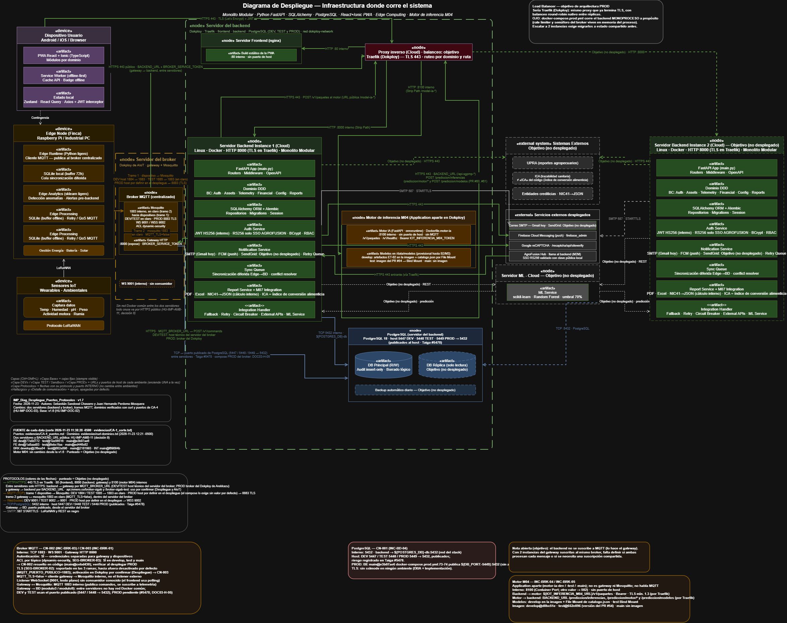

# Control del documento

| Campo | Detalle |
|---|---|
| Título | Documento de Ambiente de Trabajo — Área de Implementación (SGPMP) |
| Proyecto | Sistema de Gestión Pecuaria Multiespecie de Precisión (SGPMP) — Proyecto Integrador IV |
| Institución | Universidad Surcolombiana — Facultad de Ingeniería |
| Área | Implementación |
| Versión | 1.7 (cuarta entrega, E4) |
| Fecha | Noviembre de 2026 (fecha de corte del código: 2026-11-23) |
| Autores | Sebastián Sandoval Chavarro · Juan Hernando Perdomo Mosquera |
| Estado | Versión para la entrega E4 |
| Revisiones | REV-01 y REV-02 de HU-IMP-DOC-03 (2026-11-23), Líder de Implementación |
| Historia de usuario | HU-IMP-DOC-03 (Taiga #6071) |
| Fuente | `entregas/E4_2026-11-24_M07-M08-final/documentos/AMBIENTE-DE-TRABAJO-IMPLEMENTACION.md` en SGMP-Integracion. El Word se genera con `herramientas/md2docx.ps1`; no se edita a mano. |
| Rama de trabajo | `docs/hu-imp-doc-03` (secciones de la v1.7, desde `main` `f69094b`) e integración sobre la v1.6 en `docs/ambiente-v1.7-final` (desde `main` `034c1f0`) |

# Fuentes y fecha de corte

Toda afirmación técnica de este documento se verificó contra los commits de la tabla siguiente, fijados en el corte del 2026-11-23 a las 11:38:28 -0500 (`entregas/E4_2026-11-24_M07-M08-final/propio/HU-IMP-DOC-03_ambiente-v1.7/evidencias/CA-1_corte.txt`). Si una rama avanza después del corte, el documento describe el estado del commit citado, no el de la rama.

> **Corte del motor M04 (2026-11-02 19:48 -0500, v1.6).** Las secciones sobre el motor de inferencia M04 (3.3, Grupos C y F de 3.4, 8.1, 8.4, 11.2 y 11.4) no cambian en E4 y conservan su corte: BRK develop@d0bc51e (merge del PR \#61), BRK test@662e096 (merge del PR \#55, develop → test), BE dev@c3dc633 (merge del PR \#909), BE test@a2b56273 y BE main@0abbeee. Las demás secciones que no actualizó HU-IMP-DOC-03 conservan el corte del 2026-10-13 e indican su corte.

| Repositorio (abreviatura) | Rama | Entorno | Commit | Fecha del commit |
|---|---|---|---|---|
| sgpmp-backend (BE) | dev | DEV | `77e0d772` | 2026-11-22 20:07:50 -0500 |
| sgpmp-backend (BE) | test | TEST | `1ee56516` | 2026-11-22 20:50:44 -0500 |
| sgpmp-backend (BE) | main | PROD | `e3b07ae6` | 2026-11-22 20:10:12 -0500 |
| SGPMP-FRONT-END-PWA (FE) | dev | DEV | `1a8aad03` | 2026-11-22 20:24:15 -0500 |
| SGPMP-FRONT-END-PWA (FE) | test | TEST | `6ebc1faa` | 2026-11-23 08:59:50 -0500 |
| SGPMP-FRONT-END-PWA (FE) | main | PROD | `ed446c62` | 2026-11-22 20:25:45 -0500 |
| BROKER-MQTT-SGPMP (BRK) | develop | DEV | `2f8ea54` | 2026-11-21 20:18:35 -0500 |
| BROKER-MQTT-SGPMP (BRK) | test | TEST | `662e096` | 2026-11-01 00:29:27 -0500 |
| BROKER-MQTT-SGPMP (BRK) | main | PROD | `2181993` | 2026-11-21 20:19:59 -0500 |
| SGMP-Integracion (INT) | main | — | `f69094b` | Base de la rama `docs/hu-imp-doc-03` |

Otras fuentes:

| Fuente | Qué aporta | Fecha |
|---|---|---|
| `evidencias/curl-dominios.txt` (HU-IMP-DOC-03) | Código HTTP de cada dominio público y ETag del frontend de TEST y PROD (Secciones 3.8 y 8.2) | 2026-11-23 12:21 -0500 |
| `evidencias/CA-4_puertos.md` (HU-IMP-DOC-03) | Cada puerto citado, con rama, commit, archivo y líneas | Corte 2026-11-23 |
| `registros/variables/VARIABLES-ENTORNO.md` | Catálogo vivo de variables (Sección 3.4) | INT@`13cd3aa`, 2026-11-23 |
| `entregas/E4_2026-11-24_M07-M08-final/prs/BRK-PR35_compose-prod-broker/HU-IMP-AMB-11_catalogo-broker-mqtt-tls/` | Broker en otro servidor y `BACKEND_URL` pública (decisión 9); comparación con Dokploy (`evidencias/ST-05_comparacion-dokploy.md`) | 2026-11-23 |
| `entregas/E4_2026-11-24_M07-M08-final/issues/BACK-1180_sgpmp-entorno-test/HU-IMP-CFG-04_variables-m04-entorno-test/` | Variables M04 del entorno TEST | 2026-11-20 |
| `registros/seguridad/registro-SEG.md` | Estado de SEG-BROKER-02 (TLS hacia los dispositivos) | Corte 2026-11-23 |
| Taiga #5478 | Puerto publicado de PostgreSQL | 2026-11-14 |
| Hallazgos DOC03-H-01 a DOC03-H-06 de HU-IMP-DOC-03, adjuntos a la subtarea ST-01 (Taiga #6072) | Irregularidades encontradas en el corte (Sección 11.4) | 2026-11-23 |
| `insumos-2026-11-23.md` (HU-IMP-DOC-03), parte b | Gateway que usa el backend de cada entorno, según las variables de Dokploy compartidas por Despliegue (resumidas sin valores en `ST-05_comparacion-dokploy.md`) | 2026-11-23 |
| `decisiones/ADR-001-flujos-por-tipo-de-trabajo.md` | Los tres flujos del Camino B (Sección 5) | 2026-10-12 |
| `registros/seguridad/registro-SEG.md` | Estado de las directrices SEG por rama (Sección 7) | Corte 2026-10-13 |
| `registros/incidencias/registro.md` | Registro vivo de incidencias (Sección 11.4) | 2026-10-13 |
| `documentos/IMP_Diag_Despliegue_Puertos_Protocolos_v1.7.drawio` (HU-IMP-DOC-03; base: v1.6 de HU-IMP-DOC-02) | Mapa de puertos y protocolos v1.7 (Diagrama 1) | 2026-11-23 |
| Despliegue (consola de Dokploy) | Dominios, rutas, puertos de host y valores no sensibles de las variables | Corte 2026-10-12 |
| PR \#54 de BROKER-MQTT-SGPMP (`feat(motor-ia): despliegue E2`) | Imagen, `.dockerignore`, compose local y plantilla de variables del motor M04 (Sección 3.3 y Grupo F de 3.4) | 2026-11-01 |
| PR \#909 de sgpmp-backend (`fix(rf-66)`) | Variables `IOT_INFERENCIA_*` en el compose del backend (Grupo C de 3.4) | 2026-11-01 |
| `docs/MOTOR_IA_MODELOS_DOKPLOY.md` (BRK develop@d0bc51e) | Carga de modelos: artefactos en la imagen con `catalogo.json` por File Mount, o Bind Mount (Sección 8.4) | 2026-11-02 |
| PR \#55 de BROKER-MQTT-SGPMP (develop → test) | Llegada de la imagen del motor a la rama `test` (Secciones 3.1 y 8.1) | 2026-11-01 |
| PR \#57 y \#58 de BROKER-MQTT-SGPMP (artefactos de ET-02 en la imagen) | Artefactos de BOV-001 y TER-001 dentro de la imagen y `catalogo.json` por File Mount (Secciones 3.3 y 8.4) | 2026-11-01 |
| PR \#60 y \#61 de BROKER-MQTT-SGPMP (catálogo automático y reentrenador RF-71) | Cinco variables opcionales del motor y el argumento de construcción `MOTOR_IA_EXTRAS` (Secciones 3.3 y 3.4, Grupo F; Sección 8.4) | 2026-11-02 |

**Convención de citas.** `BE main@e3b07ae6 docker-compose.prod.yml:73-74` significa: repositorio sgpmp-backend, rama `main`, commit `e3b07ae6`, archivo `docker-compose.prod.yml`, líneas 73 a 74. Cuando una afirmación viene de una evidencia de comandos, se cita el archivo de evidencia.

\newpage

# 1. Introducción — Qué es el ambiente de trabajo

El ambiente de trabajo del equipo de Implementación se apoya, como el del resto de equipos del proyecto, en Git como sistema de control de versiones y en GitHub como plataforma de colaboración. En octubre de 2026 el líder del proyecto redefinió el rol del equipo: Implementación es responsable de las imágenes (Dockerfile, `.dockerignore` y compose), de los entornos DEV, TEST y PROD, de las variables de entorno (catálogo, nombres, plantillas y sensibilidad, nunca sus valores reales), del nginx del frontend, de las incidencias de comunicación entre componentes causadas por esos archivos y de aplicar las directrices de seguridad que define Análisis. No desarrolla funcionalidad (Desarrollo), no ejecuta las pruebas de aceptación (Pruebas) ni libera a producción (Despliegue). Entre las imágenes que Implementación construye está la del motor de inferencia M04 (RF-66), que se despliega como servicio aparte del gateway (Secciones 3.3 y 8.4).

Este documento describe cómo funciona ese ambiente: la estructura de ramas y roles, las entradas y salidas del equipo, los tres entornos de ejecución y su infraestructura en Dokploy, el catálogo de variables, la Sandbox de pruebas de base de datos, los tres flujos de trabajo del Camino B (ADR-001), las directrices de seguridad, la integración con AIoT, la comunicación entre equipos y el ambiente local. Incluye la trazabilidad con la metodología anterior (Sección 12) y el control de cambios (Sección 13).

Los entornos DEV, TEST y PROD están desplegados en dos servidores con Dokploy: el del backend y el del broker (Sección 3.1). Sus dominios, rutas y puertos se describen en la Sección 3.8. Las afirmaciones técnicas se contrastaron con los commits de la tabla de fuentes (corte 2026-11-23). El rol de Implementación se resume así:

**Imágenes · Entornos · Variables · nginx · Incidencias de comunicación · Directrices SEG**

Implementación trabaja con ramas propias y Pull Requests hacia la rama de cada entorno; cada Pull Request lo aprueba el líder responsable de esa rama (Sección 2.2). El trabajo se organiza en los tres flujos del Camino B (Sección 5).

# 2. Cómo funciona — Estructura de ramas y roles

## 2.1 Tipos de rama

El backend del SGPMP es un monolito modular: un solo servicio sobre una única base PostgreSQL. Cada repositorio de código mantiene tres ramas de entorno de larga vida. Implementación no mantiene una rama de integración propia: trabaja con ramas cortas que se fusionan por Pull Request.

| Rama | Nace de | Función |
|:---|----|----|
| `dev` · `test` · `main` (backend y frontend) | — (larga vida) | Ramas de entorno: dev → DEV, test → TEST, main → PROD (Sección 3.6). Reciben cambios solo por Pull Request; los aprobadores están en la Sección 2.2. |
| `develop` · `test` · `main` (broker de AIoT) | — (larga vida) | Ramas de entorno del repositorio BROKER-MQTT-SGPMP (Sección 8.1). Las promueve AIoT. |
| `feat/<descripción>` | La rama de entorno donde entra el cambio (normalmente `dev`) | Nueva capacidad de ambiente: compose, Dockerfile, nginx, variables o plantillas. |
| `fix/<descripción>` | Ídem | Corrección puntual de ambiente o de una incidencia de comunicación. |
| `chore/<descripción>` | Ídem | Mantenimiento sin cambio funcional. |
| `docs/<descripción>` | `main` de SGMP-Integracion | Documentación del ambiente (por ejemplo, este documento). |

SGMP-Integracion sigue la misma convención de prefijos (`FLUJO-GIT.md`), tiene una sola rama de larga vida (`main`) y no aloja código de aplicación.

## 2.2 Roles y aprobaciones

El equipo de Implementación tiene dos integrantes con roles distintos: el líder planifica, revisa y aprueba; el integrante ejecuta.

| Rol | Qué hace | Qué aprueba o entrega |
|:---|----|----|
| Líder de Implementación (Sebastián Sandoval Chavarro) | Planifica el trabajo (historias de usuario), revisa el trabajo del integrante y emite los dictámenes de revisión (REV-xx); coordina prioridades con los demás equipos. | Aprueba los Pull Requests de SGMP-Integracion y el cierre de cada historia de usuario. No aprueba Pull Requests de los repositorios de código. |
| Integrante de Implementación (Juan Hernando Perdomo Mosquera) | Ejecuta: imágenes, compose, variables, nginx, incidencias de comunicación y documentación del ambiente. | Entrega ramas `feat/`, `fix/`, `chore/` o `docs/` con su Pull Request, las evidencias y la actualización de los registros. |

Aprobación de los Pull Requests según la rama destino:

| Repositorio | Rama destino | Aprueba el Pull Request |
|:---|----|----|
| sgpmp-backend y SGPMP-FRONT-END-PWA | dev | Líder de Desarrollo |
| sgpmp-backend y SGPMP-FRONT-END-PWA | test | Líder de Pruebas |
| sgpmp-backend y SGPMP-FRONT-END-PWA | main | Líder de Despliegue |
| BROKER-MQTT-SGPMP | develop, test, main | Equipo AIoT |
| SGMP-Integracion | main | Líder de Implementación |
| DBIntegrador | — | DBA (Implementación solo lee) |

Implementación abre los Pull Requests; no los fusiona ni hace push directo a las ramas de entorno. Las revisiones formales (REV-01, REV-02…) se guardan en la carpeta `revisiones/` de cada historia.

## 2.3 Fronteras de responsabilidad con los demás equipos

**Pruebas** valida en TEST lo que Desarrollo e Implementación entregan. Implementación le entrega el ambiente TEST operativo, la Sandbox y el Contrato de entrega del ambiente TEST.

**Despliegue** opera Dokploy, ejecuta la liberación, define los dominios, rutas, reglas de Traefik y puertos de host de cada ambiente, y carga los valores de las variables. Implementación le entrega los artefactos de PROD (compose, plantilla de variables y contrato).

**AIoT** es responsable del gateway MQTT↔HTTPS (BROKER-MQTT-SGPMP), de Mosquitto y, con Desarrollo, de los protocolos y del contrato de mensajería. **Desarrollo** es responsable de los endpoints, de la conexión backend–frontend y de la lógica de aplicación. **Análisis** define las directrices de seguridad (SEG) que Implementación aplica en imágenes, nginx y compose. El **DBA** mantiene el esquema, los roles y el mecanismo de Sandbox (repositorio DBIntegrador).

## 2.4 Entradas y salidas del equipo de Implementación

Implementación es un punto de coordinación: recibe de Despliegue los dominios y puertos, de AIoT y Desarrollo los protocolos, de Análisis las directrices de seguridad y del DBA el esquema; entrega Dockerfiles, compose, plantillas de variables, nginx y los entornos montados. Cada dato se referencia desde su fuente (Sección 10).

**Entradas — lo que Implementación recibe**

| Origen | Qué recibe | Dónde se usa |
|:---|----|----|
| Despliegue | Dominios, rutas y puertos de host de DEV, TEST y PROD; valores no sensibles cargados en Dokploy. | Secciones 3.4 y 3.8 |
| AIoT | Gateway MQTT↔HTTPS y Mosquitto (ramas develop, test y main), convención de topics y protocolos MQTT y TLS. | Sección 8 |
| Desarrollo | Código de dev, test y main del backend y del frontend; endpoints y contrato de mensajería con el gateway. | Secciones 3.3 y 3.4 |
| Desarrollo | Código del motor de inferencia (`motor_ia/`, RF-66), ya en `develop` por los PR \#49, \#50, \#51 y \#52 del broker. | Secciones 3.3 y 8.4 |
| DBA | Repositorio DBIntegrador (dump y esquemas modulo1–modulo9), roles por equipo y mecanismo de Sandbox. | Secciones 3.9 y 11.1 |
| Análisis | Directrices de seguridad (SEG) y sus criterios de aceptación. | Sección 7 |
| Pruebas | Hallazgos de la validación en TEST. | Secciones 5 y 6 |

**Salidas — lo que Implementación entrega**

| Destino | Qué entrega | Artefacto o evidencia |
|:---|----|----|
| Desarrollo | Incidencias de comunicación y discrepancias entre documento y código. | `registros/incidencias/registro.md` (Sección 11.4) |
| Pruebas | Ambiente TEST operativo, Sandbox y Contrato de entrega del ambiente TEST. | Secciones 3.8 y 3.9; `registros/entornos/CONTRATO-TEST.md` |
| Despliegue | Artefactos de PROD y fichas de variables. Backend: `docker-compose.prod.yml` y `.env.prod.example` (BE main@8a7e6327). Frontend: hoy `docker-compose.yml`, porque main no tiene compose de PROD (INC-FE-03). | `registros/entornos/CONTRATO-PROD.md`; `registros/variables/fichas/` |
| DBA | Solicitudes de roles y ajustes de esquema detectados durante la restauración. | INC-BD-01 e INC-BD-03 (Sección 11.4) |
| AIoT | Variables y compose del gateway por ambiente, e incidencias de comunicación. | Secciones 3.4 (Grupo E) y 8 |
| Despliegue y AIoT | Imagen del motor M04: `Dockerfile.motor-ia`, `Dockerfile.motor-ia.dockerignore`, `docker-compose.motor-ia.yml` (solo local) y `.env.motor-ia.example`. Variables del cliente hacia el motor en el compose del backend. | BRK develop@d0bc51e (PR \#54, \#57, \#58 y \#61); BE dev@c3dc633 (PR \#909) |
| Interno | Catálogo de variables y registros vivos. | `registros/variables/VARIABLES-ENTORNO.md`, `registros/` |

# 3. Los entornos de trabajo: DEV, TEST y PROD

## 3.1 Qué es cada entorno, quién lo monta y quién lo usa

Un entorno no es una rama: es dónde y con qué configuración corre el sistema. Implementación define y mantiene los archivos con que se monta cada entorno; Despliegue opera Dokploy.

**Estado de los entornos.** DEV, TEST y PROD están desplegados y responden por sus dominios públicos (Sección 3.8; `evidencias/curl-dominios.txt`).

| Entorno | Quién define los archivos | Quién lo usa | Propósito |
|:---|----|----|----|
| DEV | Implementación | Desarrollo · AIoT · Implementación | Construcción. Desarrollo codifica, AIoT conecta dispositivos a través del gateway e Implementación prueba sus cambios de imágenes, compose, variables y nginx. |
| TEST | Implementación | Pruebas | Validación funcional, de regresión, rendimiento, seguridad y UI/UX. Incluye la Sandbox de pruebas de base de datos (Sección 3.9). |
| PROD | Implementación (define; no opera) | Despliegue | Producción, tras la aprobación de Pruebas. Despliegue ejecuta los artefactos con Dokploy. |

### Los dos servidores

El sistema corre en dos servidores, cada uno con su propio Dokploy. No comparten red Docker: lo que cruza de un servidor al otro va por la URL pública del servicio, a través de Traefik y en HTTPS (HU-IMP-AMB-11, decisión 9; `ST-05_comparacion-dokploy.md`).

| Servidor | Qué aloja | Red Docker | Cómo lo alcanza el otro servidor |
|---|---|---|---|
| Servidor del backend | Traefik, frontend (nginx), backend (FastAPI) y PostgreSQL de DEV, TEST y PROD | `dokploy-network` (BE main@e3b07ae6 `docker-compose.prod.yml:251-252`) | Por la URL pública del backend de cada entorno (`BACKEND_URL` del gateway) |
| Servidor del broker | Gateway HTTP y Mosquitto de DEV, TEST y PROD (Dokploy de AIoT; `ST-05_comparacion-dokploy.md`) | Red interna del stack del broker (`broker-interna` en PROD; BRK main@2181993 `docker-compose.prod.yml:327`) | `MQTT_BROKER_URL` del backend: DEV y TEST: host técnico del servidor del broker · PROD: broker del Dokploy de Arekkazu, en un servidor por confirmar (Despliegue; Sección 11.4) (insumos 2026-11-23, parte b; ST-05) |

### Las capas por entorno

| Capa | Servidor | Origen de la imagen | DEV | TEST | PROD |
|---|---|---|---|---|---|
| Base de datos | Backend | `Dockerfile.postgres` (PostgreSQL 18 con `pg_cron`) en el stack del backend | Host 5447 → 5432 (BE dev@77e0d772 `docker-compose.yml:40-41`) | Host 5448 → 5432 (BE test@1ee56516 `docker-compose.test.yml:29-30`) | Host 5449 → 5432 (BE main@e3b07ae6 `docker-compose.prod.yml:73-74`) |
| Backend | Backend | `Dockerfile` del backend; Dokploy construye en cada despliegue | Rama `dev` · `expose: 8000` | Rama `test` · `expose: 8000` | Rama `main` · `expose: 8000` |
| Frontend | Backend | `Dockerfile` multietapa (`node` → `nginx`); `VITE_*` y `VITE_BASE_PATH` se incrustan al compilar (FE dev@1a8aad03 / test@6ebc1faa / main@ed446c62 `Dockerfile:13, 45-54`, idéntico en las tres) | Build de `dev` · `expose: 80` | Build de `test` · `expose: 80` | Build de `main` · `expose: 80` |
| Gateway AIoT | Broker | `Dockerfile` del broker | Rama `develop` | Rama `test` | Rama `main` |
| Broker Mosquitto | Broker | Imagen de Mosquitto del broker | Host 1884 → 1883 (BRK develop@2f8ea54 `docker-compose.yml:46-47`) | Host 1885 → 1883 (BRK test@662e096 `docker-compose.test.yml:28-29`) | Host por definir en el despliegue; el compose los exige sin valor por defecto → 8883 (BRK main@2181993 `docker-compose.prod.yml:91-92`) |
| Motor de inferencia M04 | Por confirmar (AIoT) | `Dockerfile.motor-ia` en la raíz de BRK: multietapa sobre `python:3.13-slim` fijada por digest (3.13.18, Debian trixie), usuario 1001, `EXPOSE 8100`, healthcheck sobre `/v1/healthz` (BRK develop@102b2c5). Es un servicio aparte del gateway y de Mosquitto; el PR \#54 no modifica el `Dockerfile` ni los compose del broker. Desde el PR \#57 la imagen de develop incluye los artefactos de ET-02 (BRK develop@d0bc51e). | Application `motor-ia-dev` (rama develop) | Application `motor-ia-test` (rama test; la imagen llegó con el PR \#55 en su versión del PR \#54, sin artefactos de ET-02) | Application `motor-ia-main` (rama main; la imagen aún no llegó a esa rama) |

Los nombres de las Applications del motor vienen del PR \#54; su creación y configuración en Dokploy es de Despliegue (INC-BRK-05). La fila del motor no cambia en E4 (corte 2026-11-02); su servidor está por confirmar (AIoT).

El ambiente TEST expone además lo que necesita el stack de herramientas de Pruebas. Esos requisitos se formalizan en `registros/entornos/CONTRATO-TEST.md`; el análogo para PROD es `registros/entornos/CONTRATO-PROD.md`.

## 3.2 Principio de separación entre código y configuración

La misma versión del sistema debe ejecutarse en los tres entornos sin modificar el código fuente, variando solo la configuración externa (cadenas de conexión, credenciales, endpoints y parámetros de comportamiento). Esta separación permite pasar de DEV a TEST y a PROD de forma predecible y es la práctica que sigue Implementación al catalogar las variables (Sección 3.4), conforme al Secure Software Development Framework (SSDF) del NIST.

**Excepción técnica:** en el frontend, las variables `VITE_*` son argumentos de construcción. Vite las incrusta en el JavaScript al compilar; un cambio de valor exige reconstruir la imagen, y la imagen de TEST no puede promoverse a PROD (Sección 3.4, Grupo D).

## 3.3 Cómo se organiza técnicamente: orquestación local y orquestación en Dokploy

*Corte de esta sección: 2026-10-13 y, para el motor M04, 2026-11-02 (v1.6). Sin cambios en E4; pendiente de actualizar en la v1.8 (volúmenes y migraciones, Sección 13). Los puertos vigentes están en la Sección 3.8.*

**Nivel 1 — Compose local (SGMP-Integracion).** Un `compose/docker-compose.yml` base más un archivo por entorno (`compose/compose.dev.yml`, `compose/compose.test.yml`, `compose/compose.prod.yml`). Orquesta backend, frontend, base de datos y la capa AIoT (gateway y Mosquitto) a partir de los repositorios clonados como carpetas hermanas. Se usa para el entorno local (Sección 11.2).

**Nivel 2 — Compose por repositorio (Dokploy).** Cada repositorio versiona, en la rama de cada entorno, el compose que Dokploy despliega. Dokploy construye las imágenes desde el Dockerfile en cada despliegue (`build:`, no `image:`). Qué archivo usa cada aplicación de Dokploy lo configura Despliegue; la tabla indica qué archivos existen en cada commit.

| Repositorio | DEV | TEST | PROD |
|:---|----|----|----|
| sgpmp-backend | `docker-compose.yml` (dev@bd8b6d4f) | `docker-compose.test.yml` (test@81487428) | `docker-compose.prod.yml` (main@8a7e6327) |
| SGPMP-FRONT-END-PWA | `docker-compose.yml` (dev@8c30fa3) | `docker-compose.test.yml` (test@95fa674) | `docker-compose.yml` (main@2132c62). No existe `docker-compose.prod.yml`: lo eliminó la sincronización c143fe5 (corte §2.2; INC-FE-03) |
| BROKER-MQTT-SGPMP | `docker-compose.yml` (develop@44e29b6) | `docker-compose.test.yml` (test@662e096; HU-IMP-AMB-11) | `docker-compose.yml` (main@cebd430) |

El motor M04 no usa compose en Dokploy: se despliega como Application construida desde `Dockerfile.motor-ia`. El archivo `docker-compose.motor-ia.yml` existe solo para desarrollo local (BRK develop@102b2c5).

El principio de construir una sola vez y ejecutar en todos los entornos sigue siendo el objetivo, pero hoy no se cumple: ningún workflow publica imágenes en un registro (INC-IMP-03).

### Diferencias entre DEV, TEST y PROD en el compose del backend

| Aspecto | DEV (`docker-compose.yml`, dev@bd8b6d4f) | TEST (`docker-compose.test.yml`, test@81487428) | PROD (`docker-compose.prod.yml`, main@8a7e6327) |
|:---|----|----|----|
| Nombre de proyecto | Derivado del directorio | `sgpmp-backend-test` (l. 1) | `sgpmp-backend-prod` (l. 24) |
| Puerto de BD al host | `${DB_PORT:-5447}:5432` (l. 33-34) | `${DB_PORT:-5448}:5432` (l. 25-26) | `${DB_PORT:-5449}:5432` (l. 67-68), para el DBA y Despliegue, sin acceso SSH; riesgo en Taiga #5478 |
| Variables obligatorias | Sin validación | `:?` en BD, SECRET_KEY, FRONTEND_URL, ENV, RECAPTCHA_SECRET_KEY, MQTT_BROKER_URL y MQTT_BROKER_TOKEN (l. 5-18, 41-42, 48-49, 56, 65-66) | `:?` en BD, SECRET_KEY, FRONTEND_URL, ALLOWED_ORIGINS, SMTP_USER, SMTP_PASSWORD, RECAPTCHA_SECRET_KEY y COOKIE\_\* (l. 34-56, 117-139). MQTT_BROKER_URL y MQTT_BROKER_TOKEN sin guarda (l. 152-153) |
| ENV | `${ENV}` (l. 50) | `${ENV:?}` (l. 49) | Literal `production` (l. 121) |
| Reinicio | `unless-stopped` (l. 42, 91) | `unless-stopped` (l. 34, 76) | `always` (l. 79, 190) |
| Límites y logs | No definidos | No definidos | BD 1 CPU / 1 GB; backend 2 CPU / 2 GB; json-file 10 MB × 3 (l. 84-95, 191-200) |
| Red | Red del proyecto; Dokploy agrega `dokploy-network` (comentario l. 3-9) | Ídem DEV | `dokploy-network` externa declarada (l. 223-225) |
| Healthcheck del backend | No definido | No definido | `/health` con Python urllib, start_period 40 s (l. 183-189) |
| Volúmenes | `sgpmp_pgdata`, `sgpmp_modelos` (l. 94-96) | Solo `sgpmp_pgdata_test` (l. 78-79) | `sgpmp_pgdata_prod`, `sgpmp_modelos_prod` (l. 227-229) |
| Publicación del backend | `expose: 8000` (l. 86-87) | `expose: 8000` (l. 71-72) | `expose: 8000` (l. 171-172) |

En los tres compose la base usa `container_name: ${POSTGRES_DB}-db` para no colisionar con el Postgres de otro proyecto en `dokploy-network` (BE dev `docker-compose.yml:3-10`). `pg_cron` queda precargado (`shared_preload_libraries=pg_cron`), pero `CREATE EXTENSION pg_cron;` es un paso manual del DBA tras cada despliegue nuevo.

El backend de PROD corre como un único proceso de Uvicorn a propósito: el limitador de tasa y el semáforo de llamadas al broker viven en memoria del proceso. No debe introducirse Gunicorn ni `--workers` sin migrar antes esos dos componentes a un almacén compartido (BE main@8a7e6327 `docker-compose.prod.yml:103-115`).

**Observación sobre el compose de PROD.** El comentario del bloque `networks:` (l. 217-219) dice que la base “NO está publicada al host”, lo que contradice el mapeo de las líneas 67-68. Manda el mapeo; el comentario se corrige dentro de INC-BD-02.

### Compose del frontend

| Aspecto | DEV y PROD (`docker-compose.yml`, dev@8c30fa3 = main@2132c62) | TEST (`docker-compose.test.yml`, test@95fa674) |
|:---|----|----|
| Nombre de proyecto | Derivado del directorio | `sgpmp-frontend-test` (l. 1) |
| Build args | Nueve `VITE_*` sin validación (l. 7-16) | Nueve `VITE_*`; `:?` en VITE_API_BASE_URL y VITE_RECAPTCHA_SITE_KEY (l. 10, 18) |
| Publicación | `expose: 80` (l. 17-18) | `expose: 80` (l. 19-20) |
| Reinicio | `unless-stopped` (l. 19) | `unless-stopped` (l. 21) |
| Red | Ninguna: solo sirve estáticos | Ídem |

PROD del frontend se despliega hoy con el mismo archivo que DEV: sin guardas `:?` y con `restart: unless-stopped` (INC-FE-03).

### Frontend: nginx y caché

El Dockerfile compila con pnpm en `node:22-slim` y sirve con `nginx:1.27-alpine`; antes de servir sustituye `${API_ORIGIN}` en `nginx.conf` con el origen de `VITE_API_BASE_URL` (FE main@2132c62 `Dockerfile:34-47`). El `nginx.conf` es idéntico en dev@8c30fa3, test@95fa674 y main@2132c62:

- SPA: `try_files $uri $uri/ /index.html` (l. 53-55).
- Cache-Control por URI mediante `map` (l. 5-22, 30): `no-cache` para `/index.html`, `/sw.js`, `/registerSW.js` y `/firebase-messaging-sw.js`; `public, immutable` para `/assets/*` con hash.
- Además, la location de extensiones estáticas aplica `expires 7d` (l. 57-59). Como `expires` también emite Cache-Control, los archivos de `/assets/*` reciben dos cabeceras Cache-Control (hallazgo conocido, REV-02 N-12). La misma location alcanza a los service workers `.js`, de modo que `sw.js` también recibe dos Cache-Control (INC-FE-04, relacionada con HU-IMP-SEG-02). Pendiente de comprobar con `curl -sSI` en un entorno desplegado.

El contenedor declara solo `expose: 80`, no publica `ports:` y no se une a ninguna red: las llamadas a la API las hace el navegador contra la URL pública HTTPS del backend. Las cabeceras de seguridad se describen en la Sección 3.8.

### Imagen del motor de inferencia M04 (PR \#54)

*Sin cambios en E4; pendiente de actualizar en la v1.8.*

El motor (`motor_ia/`, RF-66) se construye con cuatro archivos nuevos en la raíz de BRK, sin tocar los del gateway:

| Archivo | Qué es |
|:---|----|
| `Dockerfile.motor-ia` | Multietapa. El builder instala `".[motor-ia]"` en un venv (`/opt/venv`) y la imagen final copia solo ese venv: sin `gcc` y sin `pip`. Corre como usuario 1001 (`motoria`), escucha en el puerto 8100 y tiene `HEALTHCHECK` sobre `/v1/healthz` con el puerto leído de `PORT`. Desde el PR \#57 copia `artefactos_et02/` a `/data/modelos/`. Desde el PR \#61 acepta el argumento de construcción `MOTOR_IA_EXTRAS` (por defecto `motor-ia`; con `motor-ia,motor-ia-entrenamiento` agrega unos 250 MB para el reentrenador RF-71). |
| `Dockerfile.motor-ia.dockerignore` | Exclusiones propias de esta imagen (BuildKit). Excluye `modelos/` y `**/*.onnx`; desde el PR \#57 deja entrar `artefactos_et02/*.onnx`. |
| `docker-compose.motor-ia.yml` | Solo desarrollo local. Monta `./modelos` del host (solo lectura) en `/data/modelos`; publica `8100:8100` fijo en el host; límites de 1 CPU y 1 GB, con reserva de 256 MB. Se usa con `--env-file .env.motor-ia`. |
| `.env.motor-ia.example` | Plantilla con los nombres de las variables del motor, sin valores (Grupo F de la Sección 3.4). |

**Decisiones de diseño que conviene conservar:**

- **Puerto 8100** (`PORT`, `EXPOSE`, healthcheck y compose). Una versión intermedia (`789eb7b`) lo había cambiado a 8000 y se revirtió en `3fe7839`, porque el puerto y los prefijos ya estaban definidos desde el PR \#49 y el backend arma la URL del motor con ellos. En Dokploy, el dominio de la Application debe tener **Container Port = 8100**; con otro valor Traefik responde 502.
- **Modelos: fuera de git y de la imagen como regla, con una excepción provisional.** Son binarios que cambian por ambiente y versión, y la regla es montarlos por volumen. Como en el servidor de Dokploy no hay acceso para un Bind Mount, desde el PR \#57 los artefactos de ET-02 de BOV-001 y TER-001 van en git (`artefactos_et02/`) y dentro de la imagen, y `catalogo.json` se monta como File Mount (Sección 8.4).
- `MOTOR_IA_DIR_MODELOS` **no se fija en la imagen:** con el volumen vacío el motor no arranca (`CatalogoInvalidoError`) y el contenedor entra en bucle de reinicios.
- **Base fijada por digest** en lugar de una etiqueta móvil, para que el build sea reproducible.

**Verificación (local, PR \#54):** `hadolint` sin avisos; `trivy` (CRITICAL/HIGH) con 0 CRITICAL y 0 en paquetes Python, y 44 HIGH del sistema Debian 13 sin corrección publicada. Sin modelos, el contenedor queda `healthy`; `POST /v1/paquetes` responde 401 sin token y 503 `MOTOR_SIN_MODELOS` con token. Con el modelo de prueba BOV-001, `/v1/healthz` informa `modelos_cargados: 1`. `docker inspect` confirma usuario 1001 y los límites. La entrega del resultado al backend no se probó en local porque exige HTTPS; se verifica en DEV.

Esta verificación corresponde a la imagen del PR \#54. Los PR \#57, \#58 y \#61 cambiaron la imagen después, por lo que `hadolint` y `trivy` deben repetirse sobre BRK develop@d0bc51e.

Como el resto de imágenes, Dokploy la construye en cada despliegue y ningún workflow la publica en un registro (INC-IMP-03).

### Automatización existente (CI/CD del backend)

| Workflow | Se dispara con | Función | Existe en |
|:---|----|----|----|
| `migrate-dev.yml` + `_migrate-template.yml` | Push a dev que toque `alembic/versions/**`, o manual | Verifica una única head de Alembic y ejecuta `alembic upgrade head` contra la base de DEV | dev@bd8b6d4f, main@8a7e6327 |
| `migrate-test.yml` + `_migrate-template.yml` | Push a test que toque `alembic/versions/**`, o manual | Ídem contra la base de TEST | test@81487428 |
| `migrate-prod.yml` + `_migrate-template.yml` | Push a main que toque `alembic/versions/**`, o manual | Ídem contra la base de PROD | dev, test y main |
| `validate-migrations.yml` | Pull Request a dev, test o main que toque migraciones | Verifica head único sin conectarse a ninguna base | dev, test y main |
| `sast.yml` | Pull Request a dev, develop, main o test que toque `src/**` o dependencias, o manual | Análisis estático de seguridad | dev, test y main |
| `release.yml` | Push a main o dev | Versionamiento semántico: dev publica release candidates y main la versión estable | dev, test y main |

Fuente: bloque `on:` de cada archivo en `.github/workflows/` de BE dev@bd8b6d4f, test@81487428 y main@8a7e6327. Ningún workflow publica imágenes (INC-IMP-03).

## 3.4 Catálogo de variables por tipo y sensibilidad

El catálogo vivo es `registros/variables/VARIABLES-ENTORNO.md` (INT@`13cd3aa`, 2026-11-23); ante cualquier diferencia con las tablas de esta sección, manda el catálogo. "Valor propio (Dokploy)" indica una variable sensible cuyo valor existe solo en la consola de Dokploy y no se reproduce aquí.

**Cambios de E4 registrados en el catálogo:**

| Variable | Cambio | Componente |
|---|---|---|
| `BROKER_SERVICE_TOKEN` | Reemplaza a `GATEWAY_API_TOKEN`, que se retira. Es el Bearer del gateway hacia el backend: el mismo valor en el broker y en el backend de cada entorno. Valor propio (Dokploy). | Gateway y backend |
| `MQTT_TLS` | `false` en DEV, TEST y PROD. Es el TLS del gateway hacia `mosquitto:1883` por la red interna, que es un listener en claro; no es el TLS de los dispositivos (Sección 8.2) (BRK main@2181993 `docker-compose.prod.yml:217`). | Gateway |
| `BACKEND_URL` | URL pública del backend de cada entorno, con su prefijo y sin `/` final, porque el broker está en otro servidor (HU-IMP-AMB-11, decisión 9). | Gateway |
| `ALLOWED_ORIGINS` y `FRONTEND_URL` | Un valor por entorno. En PROD las dos son obligatorias (BE main@e3b07ae6 `docker-compose.prod.yml:129-130`); en TEST, `FRONTEND_URL` es obligatoria y `ALLOWED_ORIGINS` es opcional (BE test@1ee56516 `docker-compose.test.yml:52, 54`). | Backend |
| `VITE_BASE_PATH` | Subruta pública del frontend: DEV `/sigab-dev`, TEST `/sigab-test`, PROD `/sigab`. Define el `base` de Vite y la regla `location ^~` de nginx (FE dev@1a8aad03 / test@6ebc1faa / main@ed446c62 `Dockerfile:13, 45-54`, idéntico en las tres). | Frontend (argumento de build) |

*Las tablas por grupo conservan el corte de la v1.6 (2026-10-13; motor M04: 2026-11-02), salvo las filas marcadas con el corte 2026-11-23; su revisión completa es parte de la v1.8 (Sección 13).*

| Tipo de variable | Qué controla | Tratamiento |
|:---|----|----|
| Conexión | Cadenas de conexión, endpoints, URLs, rutas y orígenes permitidos. | Valor distinto en cada entorno. |
| Comportamiento | Vigencias de token, tolerancias, rutas de almacenamiento, banderas. | Puede compartir valor entre entornos. |
| Seguridad / sensible | Credenciales, llaves secretas y tokens. | Solo en Dokploy; nunca en texto. |
| AIoT | Parámetros del gateway y de Mosquitto. | Sensible si es credencial. |

### Grupo A — Backend: seguridad, sesión y CORS

| Variable | Tipo | DEV | TEST | PROD |
|---|---|---|---|---|
| `ENV` | Comportamiento | `production` | `production` | Literal `production` (BE main `docker-compose.prod.yml:121`) |
| `COOKIE_SECURE` | Seguridad | `true` | `true` | `true`; obligatoria (l. 138) |
| `COOKIE_SAMESITE` | Seguridad | `lax` | `lax` | Obligatoria (l. 139): `lax` si frontend y backend comparten dominio registrable; `none` si no (lo define Despliegue) |
| `JWT_LEEWAY_SECONDS` | Comportamiento | 30 | 30 | 30 por defecto (l. 132) |
| `JWT_EXPIRE_HOURS` | Comportamiento | 8 | 8 | 8 por defecto (l. 131) |
| `REFRESH_TOKEN_EXPIRE_DAYS` | Comportamiento | 7 | 7 | 7 por defecto (l. 133) |
| `SECRET_KEY` | Sensible | Valor propio | Valor propio | Valor propio, distinto de DEV y TEST; obligatoria (l. 122) |
| `ALLOWED_ORIGINS` | Conexión | `https://inmero.co` (origen del frontend; corte 2026-11-23, Sección 3.8) | `https://api.inmero.co` (ST-05) | `https://inmero.co`; obligatoria (BE main@e3b07ae6 `docker-compose.prod.yml:130`) |
| `FRONTEND_URL` | Conexión | URL del frontend de DEV: `https://inmero.co/sigab-dev` (corte 2026-11-23) | URL del frontend de TEST: `https://api.inmero.co/sigab-test` (ST-05); obligatoria (BE test@1ee56516 `docker-compose.test.yml:52`) | URL del frontend de PROD: `https://inmero.co/sigab`; obligatoria (BE main@e3b07ae6 `docker-compose.prod.yml:129`) |
| `FORWARDED_ALLOW_IPS` | Comportamiento | Fijada en el Dockerfile: rangos privados RFC 1918 (BE `Dockerfile:66`) | Ídem | Ídem |
| `ROOT_PATH` | Conexión | `/api-sgpmp` | `/api-sgpmp-test` | `/api` por defecto (l. 125) |

`JWT_LEEWAY_SECONDS=30` evita errores `TOKEN_EXPIRADO` espurios cuando el reloj del servidor va por detrás del emisor del token. `COOKIE_SECURE` y `COOKIE_SAMESITE` controlan la cookie de refresh; con `ENV=production` son obligatorias y el backend se niega a arrancar si faltan (comentario BE main `docker-compose.prod.yml:134-137`). `ALLOWED_ORIGINS` debe ser el origen HTTPS exacto, sin barra final: un origen con `http://` o con barra final no coincide y el navegador bloquea la petición.

### Grupo B — Backend: datos y almacenamiento

| Variable | Tipo | DEV | TEST | PROD |
|:---|----|----|----|----|
| `POSTGRES_USER` | Sensible | sgpmp_app | sgpmp_app | Provisto por el DBA; obligatoria (BE main `docker-compose.prod.yml:54`) |
| `POSTGRES_PASSWORD` | Sensible | Valor propio | Valor propio (hoy igual al de DEV; INC-IMP-04) | Provisto por el DBA; obligatoria (l. 55) |
| `POSTGRES_DB` | Conexión | sgpmp_dev | sgpmp_test | sgpmp_prod |
| `DB_PORT` | Conexión | 5447 | 5448 | 5449 por defecto, publicado (l. 67-68; INC-BD-02) |
| `MODELOS_STORAGE_PATH` | Comportamiento | /app/storage/modelos | /tmp/sgpmp_modelos por defecto, sin volumen (BE test `docker-compose.test.yml:58`; INC-BE-02) | /app/storage/modelos por defecto (l. 141) |
| `LOGOS_STORAGE_PATH` | Comportamiento | /app/storage/modelos/logos por defecto (BE dev `docker-compose.yml:69`) | No reenviada por el compose de TEST (INC-BE-02) | /app/storage/modelos/logos por defecto (l. 145) |
| `ALEMBIC_DATABASE_URL` | Conexión (sensible) | Opcional: si falta, las migraciones usan `DATABASE_URL` (BE `alembic/env.py:40`, igual en las tres ramas) | Ídem | Ídem |
| `AUDITORIA_M02_EVENTOS_POR_SEGUNDO` | Comportamiento | 100 por defecto (BE `src/biological_assets/application/use_cases/_registrar_evento_bitacora.py:87`, igual en las tres ramas); no la reenvía ningún compose | Ídem | Ídem |

`DATABASE_URL` no se carga como variable independiente: el compose la arma con `POSTGRES_USER`, `POSTGRES_PASSWORD` y `POSTGRES_DB`, contra el host interno `${POSTGRES_DB}-db:5432` (BE dev `docker-compose.yml:49`; test l. 41; main l. 117).

### Grupo C — Backend: servicios externos e integraciones

| Variable | Tipo | DEV | TEST | PROD |
|---|---|---|---|---|
| `SMTP_HOST` / `SMTP_PORT` | Conexión | `smtp.gmail.com` / 587 | `smtp.gmail.com` / 587 | `smtp.gmail.com` / 587 por defecto (BE main `docker-compose.prod.yml:126-127`) |
| `SMTP_USER` / `SMTP_PASSWORD` | Sensible | Valor propio | Valor propio (cuenta de TEST distinta de la de DEV) | Obligatorias (l. 128-129): sin ellas fallan en silencio la activación y la recuperación de cuenta |
| `RECAPTCHA_SECRET_KEY` | Sensible | Valor propio | Valor propio (hoy igual al de DEV; INC-IMP-04) | Obligatoria (l. 130; la provee Desarrollo) |
| `FIREBASE_CREDENTIALS_PATH` | Conexión | `/app/secrets/firebase.json` (archivo montado; BE dev `docker-compose.yml:85`) | Vacía (opcional) | Opcional; exige montar el archivo (l. 140, 169) |
| `AGROFUSION_SSO_PUBLIC_KEY_PATH` | Seguridad | Ruta local de un desarrollador, no montada en el contenedor (INC-BE-06) | Vacía: el SSO responde 503 | Vacía por defecto (l. 146) |
| `AGROFUSION_PROJECT_CODE` / `AGROFUSION_ISSUER` | Conexión | `SGPMP` / `agrofusion-auth` | Código vacío / `agrofusion-auth` | Vacío / `agrofusion-auth` por defecto (l. 147-148) |
| `AGROFUSION_HUB_CLIENT_ID` / `AGROFUSION_HUB_CLIENT_SECRET` | Sensible | Valor propio | Vacías: sin sincronización M2M | Vacías por defecto (l. 149-150) |
| `RF71_INTERNAL_KEY` | Sensible | Reenviada por el compose (BE dev `docker-compose.yml:75`); sin valor en la consola (Despliegue, 2026-10-12) | Vacía | Vacía por defecto (l. 151); la define Implementación |
| `MQTT_BROKER_URL` | Conexión | Host técnico del servidor del broker (insumos 2026-11-23, parte b; BE dev@77e0d772 `docker-compose.yml:83`) | Host técnico del servidor del broker; obligatoria (BE test@1ee56516 `docker-compose.test.yml:69`) | Broker del Dokploy de Arekkazu (insumos 2026-11-23, parte b; BE main@e3b07ae6 `docker-compose.prod.yml:158`) |
| `MQTT_BROKER_TOKEN` | Sensible | Valor propio (AIoT y DBA) | Valor propio; obligatoria (BE test l. 66) | Valor propio; sin guarda (l. 153) |
| `MQTT_BROKER_HTTP_TIMEOUT` | Comportamiento | 35 (valor por defecto del código; el compose no la reenvía) | Ídem | 35 por defecto (l. 160) |
| `IOT_INFERENCIA_M04_URL` | Conexión | URL base del motor de DEV (ejemplo de plantilla: `https://api.inmero.co/model-ia-dev`, sin `/v1/paquetes`). Vacía hasta que el motor tenga modelos (BE dev@c3dc633 `docker-compose.yml`) | Ídem, con `/model-ia-test`. **El compose de TEST no la reenvía (INC-BE-08, confirmada en BE test@a2b56273)** | Ídem, con `/model-ia`; dominio por definir (Despliegue). Reenviada en el `docker-compose.prod.yml` de dev y test (PR \#909), sin guarda `:?`; `main` aún no la tiene (BE main@0abbeee) |
| `IOT_INFERENCIA_M04_TOKEN` | Sensible | Valor propio (el motor valida el mismo nombre; Grupo F) | Valor propio; no reenviada por el compose de TEST (INC-BE-08, confirmada en BE test@a2b56273) | Valor propio; reenviada en el `docker-compose.prod.yml` de dev y test; `main` aún no la tiene |
| `IOT_INFERENCIA_CA_FILE` | Conexión | Vacía por defecto (certificado de CA propio, opcional) | Ídem | Ídem |
| `IOT_INFERENCIA_TLS_MIN` | Comportamiento | `1.3` por defecto | `1.3` por defecto | `1.3` por defecto |

Las variables `MQTT_HOST`, `MQTT_PORT`, `MQTT_USERNAME` y `MQTT_PASSWORD` no pertenecen al backend: ninguna rama las lee fuera de `tests/` y ningún compose del backend las reenvía (búsqueda de `os.getenv`/`os.environ` en BE dev@bd8b6d4f, test@81487428 y main@8a7e6327). Son del gateway (Grupo E).

**AgroFusion y M2M.** Si las variables de AgroFusion están vacías, el SSO responde 503 y la sincronización servidor a servidor no se monta; el backend funciona de forma autónoma. **Broker.** El hash SHA-256 de `MQTT_BROKER_TOKEN` debe existir en `modulo1.credenciales_servicio`; si no, el gateway rechaza las llamadas con 401. `MQTT_BROKER_HTTP_TIMEOUT=35` está acoplada a `MQTT_ACK_TIMEOUT_SECONDS=30` del broker y debe mantenerse por encima (comentario BE main `docker-compose.prod.yml:154-160`).

**Motor de inferencia M04 (backend).** Antes del PR \#909 los compose del backend no reenviaban las variables `IOT_INFERENCIA_*`: cargadas en Dokploy, no llegaban al contenedor y el backend seguía con el adaptador de prueba (`MotorInferenciaStubAdapter`). Es un caso concreto de la regla 3 de estandarización. Con los valores por defecto vacíos el comportamiento no cambia. `IOT_INFERENCIA_M04_URL` **se carga al final**, cuando el motor del ambiente ya tenga modelos (`/v1/healthz` con `modelos_cargados > 0`): con un motor sin modelos, los paquetes quedan en estado FALLIDO tras 5 intentos. La plantilla `.env.prod.example` incluye las cuatro, sin valores.

### Grupo D — Frontend (variables de construcción VITE\_\*)

| Variable | DEV | TEST | PROD |
|---|---|---|---|
| `VITE_API_BASE_URL` | `https://www.api.inmero.co/api-sgpmp-dev` (ST-05) | `https://api.inmero.co/api-sgpmp-test`; obligatoria (FE test `docker-compose.test.yml:10`) | `https://www.api.inmero.co/sigab` (ST-05) |
| `VITE_RECAPTCHA_SITE_KEY` | Site key de DEV | Site key de TEST; obligatoria (FE test l. 18) | Misma site key que DEV por ahora (Despliegue, 2026-10-12) |
| `VITE_FIREBASE_API_KEY` | Proyecto Firebase del equipo | Valor propio de TEST (público por diseño, ver Grupo D) | Proyecto Firebase de PROD por definir (Desarrollo y Despliegue) |
| `VITE_FIREBASE_AUTH_DOMAIN` | `<proyecto>.firebaseapp.com` | Ídem | Ídem |
| `VITE_FIREBASE_PROJECT_ID` | ID del proyecto | Ídem | Ídem |
| `VITE_FIREBASE_STORAGE_BUCKET` | `<proyecto>.firebasestorage.app` | Ídem | Ídem |
| `VITE_FIREBASE_MESSAGING_SENDER_ID` | Sender ID numérico | Ídem | Ídem |
| `VITE_FIREBASE_APP_ID` | App ID de la aplicación web | Ídem | Ídem |
| `VITE_VAPID_KEY` | Clave pública VAPID | Ídem | Ídem |
| `VITE_AGROFUSION_LOGIN_URL` | La lee el código (FE `src/auth/config/sso.ts:8`, `src/vite-env.d.ts:12`), pero no es `ARG` del Dockerfile (FE `Dockerfile:12-20`) ni `build.args` del compose: no llega a ningún build Docker (INC-FE-01) | Ídem (test@95fa674) | Ídem (main@2132c62) |

Las `VITE_*` son públicas por diseño: terminan en texto plano dentro del bundle. Ninguna credencial de servidor puede declararse con el prefijo `VITE_`; `RECAPTCHA_SECRET_KEY` pertenece solo al backend. Un cambio de valor exige reconstruir la imagen (nuevo despliegue en Dokploy); reiniciar el contenedor no tiene efecto. La imagen de TEST no puede promoverse a PROD porque lleva incrustada la URL del backend de TEST. Cada `VITE_*` debe existir como `ARG` en el Dockerfile, en `build.args` del compose y en `.env.example`.

### Grupo E — Gateway AIoT y Mosquitto (BROKER-MQTT-SGPMP)

Las tres ramas tienen el mismo `docker-compose.yml`, `.env.example` y `docker/` (BRK develop@44e29b6 = test@7cbdb3f = main@cebd430). El gateway recibe sus variables por `env_file: .env` (BRK `docker-compose.yml:74-75`), que Dokploy escribe con los valores de la consola.

| Variable | Tipo | DEV | TEST | PROD |
|---|---|---|---|---|
| `DATABASE_URL` (gateway) | Sensible | Hoy: host de Dokploy, puerto 5447 publicado, base `sgpmp_dev`, rol `dba` (Despliegue, 2026-10-12; INC-BD-01) | Hoy: puerto 5448 publicado, base `sgpmp_test`, rol `dba` (ídem) | Diseño: host interno `${POSTGRES_DB}-db:5432` en `dokploy-network` (BE main `docker-compose.prod.yml:57-59`); rol por definir (DBA) |
| `MQTT_HOST` / `MQTT_PORT` | Conexión interna | Fijadas en el compose: `mosquitto` / 1883 (BRK `docker-compose.yml:77,83`) | Ídem | Ídem |
| `MQTT_HOST_PORT` | Conexión (puerto de host) | 1884 | 1885 | Por definir en el despliegue; el compose los exige sin valor por defecto (BRK main@2181993 `docker-compose.prod.yml:92`; DOC03-H-06) |
| `MQTT_WS_HOST_PORT` | Conexión (puerto de host) | 9001 | 9002 | Por definir en el despliegue; el compose los exige sin valor por defecto (BRK main@2181993 `docker-compose.prod.yml:93`; DOC03-H-06) |
| `MQTT_PUERTO_PUBLICO` | Conexión | 1883 por defecto (`.env.example:56`; compose l. 20, 47); 8883 al activar TLS | Ídem | Ídem; la activación la decide Despliegue (INC-BRK-01) |
| `MQTT_WS_PUERTO_PUBLICO` | Conexión | 9001 por defecto (`.env.example:57`; compose l. 21, 48); 9002 al activar TLS | Ídem | Ídem |
| `MQTT_TLS_HOST_PORT` / `MQTT_WSS_HOST_PORT` | Conexión (puerto de host) | Solo en mapeos comentados, con 8883 y 9002 por defecto (compose l. 53-54) | Ídem | Ídem |
| `MQTT_TLS` | Comportamiento | `false` (`.env.example:48`; `app/config.py:27`) | `false` | `false` |
| `BACKEND_URL` | Conexión | Por `env_file` | URL pública del backend de TEST, por `env_file` (HU-IMP-AMB-11, decisión 9; corte 2026-11-23) | URL pública del backend de PROD; obligatoria (BRK main@2181993 `docker-compose.prod.yml:246`) |
| `BROKER_SERVICE_TOKEN` | Sensible | Valor propio (Dokploy); mismo valor en broker y backend | Ídem | Ídem; obligatoria (l. 247). Reemplaza a `GATEWAY_API_TOKEN` (corte 2026-11-23) |
| `MQTT_USERNAME` / `MQTT_PASSWORD` | Sensible | Valor propio (administrador de dynamic-security = gateway; compose l. 10-15) | Valor propio | Valor propio |
| `MQTT_DEVICE_USERNAME` / `MQTT_DEVICE_PASSWORD` | Sensible | Valor propio (credencial compartida heredada; compose l. 16-17) | Valor propio | Valor propio |
| `MQTT_TOPIC_PREFIX` | Conexión | `sgpmp` (`.env.example:61`) | `sgpmp` | `sgpmp` |
| `MQTT_ACK_TIMEOUT_SECONDS` | Comportamiento | 30 (`.env.example:66`) | 30 | 30 |
| `MQTT_ACK_REQUIERE_ID_COMANDO` | Comportamiento | `false` (`.env.example:70`) | `false` | `false` (depende del firmware; AIoT) |

**`MQTT_TLS` no es el TLS hacia afuera.** `MQTT_TLS` controla el TLS del cliente del gateway hacia el Mosquitto interno (puerto 1883) y debe seguir en `false`. El TLS hacia los dispositivos depende de `MQTT_PUERTO_PUBLICO`: con 1883 (valor por defecto) se publica al host el listener en texto plano; con 8883 se publica el listener TLS (corte 2026-10-13 §2.6). `TLS_CERT` y `TLS_KEY` no son variables de entorno: son rutas fijas del entrypoint (`/mosquitto/certs/fullchain.pem` y `privkey.pem`; BRK `docker/mosquitto-entrypoint.sh:81-82`), y los certificados se montan desde `./docker/certs` (compose l. 60). Si se pide TLS sin certificados, el broker aborta el arranque (entrypoint l. 91-95).

El gateway ya no usa un token estático (`API_TOKEN` no aparece en el código de `develop`, `test` ni `main`): valida el Bearer contra `modulo1.credenciales_servicio`. Estas variables pertenecen al gateway y no deben declararse en el frontend. La rama `test` del broker tiene también `docker-compose.test.yml` (proyecto `sigab-broker-test`, puertos 1885 → 1883 y 9002 → 9001, sin montaje de certificados; BRK test@7cbdb3f `docker-compose.test.yml:1,28-32`); cuál de los dos usa TEST se confirma con AIoT y Despliegue (INC-BRK-02).

### Grupo F — Motor de inferencia M04 (`.env.motor-ia.example`, BRK develop@d0bc51e)

*Sin cambios en E4; pendiente de actualizar en la v1.8.*

| Variable | Tipo | DEV | TEST | PROD |
|:---|----|----|----|----|
| `IOT_INFERENCIA_M04_TOKEN` | Sensible | Valor propio. Obligatoria: el compose local la interpola desde la shell, y con ella vacía el motor lanza `RuntimeError` y no arranca | Valor propio | Valor propio |
| `BACKEND_URL` | Conexión | `https://api.inmero.co/api-sgpmp-dev` según la plantilla; el motor entrega el resultado en `{BACKEND_URL}/prediccion/inferencias`. Obligatoria si hay modelos en el catálogo. Valor por confirmar con Despliegue (INC-BE-03 sobre el prefijo) | `https://api.inmero.co/api-sgpmp-test` según la plantilla | `https://api.inmero.co/sigab` según la plantilla; por confirmar (Despliegue) |
| `MOTOR_IA_DIR_MODELOS` | Comportamiento | `/data/modelos`. En develop la imagen trae los artefactos de ET-02 y `catalogo.json` llega por File Mount; definirla solo con el File Mount puesto | `/data/modelos` con Bind Mount de la carpeta de modelos: la imagen de test (PR \#54) no trae artefactos | Por definir: la imagen aún no está en `main` |
| `UVICORN_ROOT_PATH` | Conexión | `/model-ia-dev` | `/model-ia-test` | `/model-ia` |
| `MOTOR_IA_SINCRONIZACION_S` | Comportamiento | Opcional. Cada cuántos segundos el motor arma su catálogo desde el backend (60 recomendado); requiere un backend con `/prediccion/motor`. 0 o vacía = catálogo fijo de `MOTOR_IA_DIR_MODELOS` (PR \#60) | Ídem | Ídem |
| `MOTOR_IA_CALIBRACION_HORAS` | Comportamiento | Opcional, solo con la sincronización. Horas de lecturas para la línea base propia de cada animal; 168 por defecto, 2 en DEV para la demostración (PR \#60) | 168 por defecto | 168 por defecto |
| `MOTOR_IA_REENTRENAMIENTO_S` | Comportamiento | Opcional. Cada cuántos segundos pide al backend un reentrenamiento pendiente (60 recomendado); 0 o vacía = apagado. Exige la imagen construida con el extra de entrenamiento (PR \#61) | 0 (apagado) por defecto | 0 (apagado) por defecto |
| `MOTOR_IA_RF71_KEY` | Sensible | Valor propio. Obligatoria con el reentrenador: la misma clave `X-RF71-Internal-Key` del backend (`RF71_INTERNAL_KEY`, Grupo C) (PR \#61) | Valor propio, si se activa el reentrenador | Valor propio, si se activa el reentrenador |
| `MOTOR_IA_ENTRENAMIENTO_DIAS_CALIBRACION` | Comportamiento | Opcional, solo con el reentrenador. Días de lecturas para entrenar (14, el de ET-02) (PR \#61) | No se usa | No se usa |

**Notas del grupo.**

- `MOTOR_IA_DIR_MODELOS`: no se fija en la imagen. Si no se define, el motor arranca con `modelos_cargados: 0`. Si se define, la carpeta debe tener `catalogo.json`, como mínimo `{"modelos": []}`.
- `UVICORN_ROOT_PATH` reemplaza a `MOTOR_IA_ROOT_PATH` (retirada en el PR \#50) y a `ROOT_PATH`, que el motor no lee. Debe coincidir con el prefijo con “Strip Path” que Despliegue configura en Traefik.
- `PORT` (8100) y `OMP_NUM_THREADS` los fija la imagen; no son variables de despliegue. El compose local publica `8100:8100` fijo.
- Las cinco variables de los PR \#60 y \#61 son opcionales: vacías, el motor se comporta como en el PR \#54.
- `MOTOR_IA_EXTRAS` es un argumento de construcción, no una variable de ejecución: el reentrenador exige construir la imagen con `MOTOR_IA_EXTRAS=motor-ia,motor-ia-entrenamiento`, y cambiarlo exige reconstruir. La plantilla recomienda correr el reentrenador en un contenedor aparte con la misma imagen, para que un entrenamiento no frene la inferencia.
- `IOT_INFERENCIA_M04_TOKEN` tiene el mismo nombre en el motor (Grupo F) y en el backend (Grupo C). Un token distinto en cada lado hace que el motor responda 401.
- Estas variables pertenecen al motor y no deben declararse en el frontend.

### Reglas de estandarización

1.  **Un nombre, tres valores.** Cada variable se llama igual en DEV, TEST y PROD; solo cambia el valor.
2.  **Plantillas sin valores reales.** Cada repositorio versiona `.env.example`, `.env.test.example` y `.env.prod.example` solo con nombres y valores ficticios. Los valores reales viven únicamente en la consola de Dokploy.
3.  **Todo pasa por el compose.** Dokploy entrega al contenedor únicamente lo que el compose referencia en `environment:` (o `build.args` para las `VITE_*`); una variable cargada en la consola pero ausente en el compose no llega al servicio. Ejemplo: las variables `IOT_INFERENCIA_*` no llegaban al backend hasta que el PR \#909 las agregó a `environment:`.
4.  **Variables críticas con validación.** En TEST y PROD se usa `${VAR:?mensaje}` para que el despliegue falle de forma legible si falta un valor obligatorio.
5.  `ENV=production` **en entornos HTTPS.** Activa las validaciones de cookie del backend; en PROD es un literal del compose.
6.  **Puertos distintos por ambiente.** `DB_PORT` (5447, 5448, 5449) y los puertos MQTT (1884, 1885) no se repiten en el host compartido. Los puertos de host los asigna Despliegue; Implementación los parametriza.
7.  **Los secretos no circulan.** Contraseñas, llaves y tokens no se escriben en documentos, chats ni archivos compartidos; si alguno se expuso, Despliegue lo rota (INC-IMP-04).

El catálogo se reconcilia con las plantillas `.env*.example` de cada repositorio; las discrepancias se registran en `registros/incidencias/registro.md` (INC-BE-04 e INC-BE-05).

## 3.5 Política de datos por entorno

Qué datos corren en cada entorno (de ejemplo, anonimizados o reales) es una decisión de gobernanza: afecta la validez de lo que se prueba en TEST y la protección de información si el sistema llega a manejar datos personales de productores. Implementación no prescribe esta política: cada equipo responsable de un entorno la define.

Como complemento técnico, en TEST los datos que generan las pruebas no persisten entre ciclos cuando se usa la Sandbox (Sección 3.9). Esta sección se actualizará cuando exista la definición de política de datos de cada equipo.

## 3.6 Relación con el flujo de ramas

| Rama | Entorno |
|:---|----|
| `dev` del backend y del frontend; ramas `feat/`, `fix/` y `chore/` de Implementación con Pull Request a `dev` | DEV |
| `test` del backend y del frontend | TEST (Pruebas despliega ahí lo que va a validar) |
| `main` del backend y del frontend, tras la aprobación de Pruebas | PROD (Despliegue) |
| `develop` / `test` / `main` del repositorio de AIoT | DEV / TEST / PROD (Sección 8.1) |

## 3.7 Registro de la configuración de entorno

Cada variable que Implementación cataloga queda asociada a su entorno en `registros/variables/VARIABLES-ENTORNO.md`; los valores reales viven solo en Dokploy. Cuando una variable se crea, cambia de nombre o de obligatoriedad, se entrega a Despliegue una ficha en `registros/variables/fichas/`. El informe FR-IMP-CE-04 de la metodología anterior queda reemplazado por ese catálogo, las fichas, las plantillas `.env*.example` y el registro de incidencias (Sección 12).

## 3.8 Infraestructura en Dokploy: dominios, rutas y puertos

Traefik termina el TLS en el puerto 443, enruta por dominio y por prefijo de ruta, y entrega el tráfico a los contenedores por la red interna. Ni el frontend, ni el backend, ni el gateway publican puertos al host: solo declaran `expose`. Cada dominio de esta sección se verificó con `curl.exe -s -o NUL -w "%{http_code}"` el 2026-11-23 a las 12:21 -0500 (`evidencias/curl-dominios.txt`).

### Servicios web: frontend, backend, gateway AIoT y motor M04

| Componente | Servidor | Puerto interno | DEV | TEST | PROD |
|---|---|---|---|---|---|
| Frontend nginx / PWA | Backend | 80 (`expose`) | `https://inmero.co/sigab-dev/` → 200 | `https://api.inmero.co/sigab-test/` → 200 | `https://inmero.co/sigab/` → 200 |
| Backend FastAPI | Backend | 8000 (`expose`) | `https://api.inmero.co/api-sgpmp-dev` (`/health` → 200) | `https://api.inmero.co/api-sgpmp-test` (`/health` → 200) | `https://api.inmero.co/sigab` (`/health` → 200) |
| Gateway AIoT que usa el backend | Broker | 8000 (`expose`) | Host técnico del servidor del broker (`MQTT_BROKER_URL`) | Host técnico del servidor del broker (`MQTT_BROKER_URL`) | Broker del Dokploy de Arekkazu (`MQTT_BROKER_URL`) |
| Rutas `/broker-sigab*` en `api.inmero.co` | — | — | `/broker-sigab-dev`: `/v1/healthz` → 404 (DOC03-H-03); el backend de DEV no la usa | `/broker-sigab-test`: `/v1/healthz` → 200; no consta que el backend la use: por confirmar (Despliegue y AIoT) | `/broker-sigab`: `/v1/healthz` → 200; no consta que el backend la use: por confirmar (Despliegue y AIoT) |
| Motor de inferencia M04 | Por confirmar (AIoT) | 8100 (Container Port en Dokploy; BRK develop@102b2c5 `Dockerfile.motor-ia`) | Prefijo `/model-ia-dev` bajo `api.inmero.co` (previsto; ver INC-BRK-04) | Prefijo `/model-ia-test` (previsto) | Prefijo `/model-ia`; dominio por definir (Despliegue) |

- **Dominio anterior del frontend de DEV.** `https://api.inmero.co/sigab-dev` ya no sirve el frontend (404).
- **Gateways del broker.** La fila «Gateway AIoT que usa el backend» sale de las variables de Dokploy compartidas por Despliegue (insumos 2026-11-23, parte b). El host técnico no se nombra porque contiene la IP del servidor.
- **Motor M04.** Fila sin cambios en E4 (corte 2026-11-02): prefijos previstos y ubicación por confirmar (AIoT).
- **Variantes con `www.`.** `www.inmero.co` (frontend) y `www.api.inmero.co` (backend) responden 200 con las mismas rutas en los tres entornos.

### Prefijo de ruta y orígenes

- **Prefijo del frontend.** Cada build incrusta su subruta (`VITE_BASE_PATH`) y nginx la recorta con `location ^~ <subruta>` (FE dev@1a8aad03 / test@6ebc1faa / main@ed446c62 `Dockerfile:52-54`). `https://inmero.co/sigab-test/` no es el frontend de TEST: la regla `PathPrefix(/sigab)` de PROD captura esa URL y entrega el build de PROD (DOC03-H-02, Taiga #6072).
- **Prefijo del backend.** El backend vive bajo un prefijo de ruta en `api.inmero.co`: `/api-sgpmp-dev`, `/api-sgpmp-test` y `/sigab`. `ROOT_PATH` se pasa por entorno (BE dev@77e0d772 `docker-compose.yml:61`; test y main con valor por defecto `/api`: BE test@1ee56516 `docker-compose.test.yml:55`, BE main@e3b07ae6 `docker-compose.prod.yml:131`).
- **Orígenes.** DEV y PROD sirven el frontend desde el mismo origen, `https://inmero.co`, y solo cambia la ruta: comparten el almacenamiento del navegador (`localStorage`, cookies del sitio) y el valor de origen para CORS. TEST está en `https://api.inmero.co`, el mismo origen de los backends. `ALLOWED_ORIGINS` y `FRONTEND_URL` se cargan por entorno (Sección 3.4).

### Datos y mensajería: PostgreSQL y Mosquitto

| Componente | Servidor | Puerto interno | DEV | TEST | PROD |
|---|---|---|---|---|---|
| PostgreSQL 18 | Backend | 5432 | Host 5447 (BE dev@77e0d772 `docker-compose.yml:40-41`) | Host 5448 (BE test@1ee56516 `docker-compose.test.yml:29-30`) | Host 5449 (BE main@e3b07ae6 `docker-compose.prod.yml:73-74`) |
| Mosquitto MQTT | Broker | 1883 en claro · 8883 TLS (solo PROD) | Host 1884 → 1883 | Host 1885 → 1883 | Host por definir en el despliegue; el compose los exige sin valor por defecto → 8883 |
| Mosquitto WebSocket | Broker | 9001 WS · 9002 WSS (solo PROD) | Host 9001 → 9001 | Host 9002 → 9001 | Host por definir en el despliegue; el compose los exige sin valor por defecto → 9002 |

Las citas de Mosquitto están en la Sección 8.2.

### Criterios de red y exposición

- **Red del servidor del backend.** El backend alcanza la base por su nombre interno `${POSTGRES_DB}-db:5432` dentro de `dokploy-network`, sin pasar por el puerto publicado (BE main@e3b07ae6 `docker-compose.prod.yml:251-252`).
- **Entre servidores.** El gateway y el backend se hablan por HTTPS público, en los dos sentidos:
  - backend → gateway por `MQTT_BROKER_URL`: DEV y TEST: host técnico del servidor del broker · PROD: broker del Dokploy de Arekkazu (insumos 2026-11-23, parte b; ST-05);
  - gateway → backend por `BACKEND_URL`.
- **Exposición de la base de datos.** Los tres entornos publican PostgreSQL al host: 5447, 5448 y 5449. Es el único acceso del DBA y de Despliegue, que no tienen SSH. La plantilla del gateway de DEV y TEST también apunta al puerto publicado (Sección 8.2). El riesgo está registrado en Taiga #5478.
- **Aislamiento del frontend.** El contenedor de nginx no se une a ninguna red: solo entrega activos estáticos.
- **Motor M04.** Igual que el frontend y el backend, no publica puertos al host en Dokploy: el tráfico llega por Traefik con “Strip Path” del prefijo. El puerto 8100 se publica solo en el compose local. Dokploy tiene hoy los paths como `/motor-ia-*`, mientras que el código y el backend usan `/model-ia-*`; hay que alinearlos antes de cargar `IOT_INFERENCIA_M04_URL` (INC-BRK-04). Sin cambios en E4.

*Diagrama 1. Mapa de despliegue, puertos y protocolos v1.7. Fuente: `documentos/IMP_Diag_Despliegue_Puertos_Protocolos_v1.7.drawio` (HU-IMP-DOC-03, corte 2026-11-23; base: v1.6 de HU-IMP-DOC-02). El motor M04 queda fuera de los dos servidores: ubicación por confirmar (AIoT).*

### Cabeceras de seguridad (nginx del frontend)

Las cabeceras las emite el `nginx.conf` del frontend (directriz SEG-FE-02, commit ce0a3a4), no Traefik. ce0a3a4 es ancestro de dev, test y main (corte 2026-10-13 §2.3; en main entró con el merge 956347c, 2026-10-12 20:49 -0500). Se emiten con `always`, también en respuestas 404 y 5xx. El despliegue en PROD está por verificar (Sección 7).

| Cabecera | Valor (FE `nginx.conf`, igual en las tres ramas) | Propósito |
|:---|----|----|
| X-Content-Type-Options | `nosniff` (l. 34) | Evita el MIME sniffing. |
| X-Frame-Options | `DENY` (l. 35) | Impide incrustar la PWA en marcos de otros sitios. |
| Referrer-Policy | `strict-origin-when-cross-origin` (l. 36) | Limita la información de origen que se envía. |
| Permissions-Policy | `camera=(), microphone=(), geolocation=(), payment=(), usb=()` (l. 37) | Desactiva APIs del navegador que la PWA no usa. |
| Strict-Transport-Security | `max-age=31536000` (l. 41) | HSTS. Sin `includeSubDomains` ni `preload`, a propósito: el VPS de Dokploy comparte dominio con proyectos ajenos (l. 38-40). |
| Content-Security-Policy-Report-Only | `default-src 'self'`; `script-src` sin `'unsafe-inline'` (solo `'self'` y reCAPTCHA); `style-src` con `'unsafe-inline'` (Ionic); `connect-src` con `'self'`, el origen de la API y FCM; `frame-src` solo reCAPTCHA; `object-src 'none'`; `base-uri 'self'`; `frame-ancestors 'none'` (l. 49) | Limita de dónde carga y a dónde se conecta la PWA; en Report-Only reporta sin bloquear. |

## 3.9 Sandbox de pruebas de base de datos (ambiente TEST)

La Sandbox es un mecanismo del ambiente TEST para que los datos que inyectan las pruebas no contaminen ejecuciones posteriores. El compose de TEST la describe como “Sandbox transaccional de pruebas (rollback por X-Test-Run-Id)”, apagada por defecto (BE test@81487428 `docker-compose.test.yml:67-70`). El mecanismo lo define el DBA; la limpieza se ejecuta al final de cada ciclo mediante un rollback o, en su defecto, un reinicio controlado del contenedor.

### Variables de entorno

| Variable | Valor | Tipo | Función |
|:---|----|----|----|
| `ENABLE_TEST_SANDBOX` | true en TEST (false por defecto, l. 69) | Comportamiento | Habilita el modo Sandbox en el backend de TEST. |
| `TEST_SANDBOX_SECRET` | Valor propio (l. 70) | Sensible | Autoriza el uso del mecanismo. Existe solo en la consola de Dokploy de TEST y en poder de Pruebas. |

**Regla de alcance.** Ambas variables se definen únicamente en TEST. En PROD su presencia constituiría un riesgo, porque abriría un mecanismo de limpieza de datos sobre información real. Ningún compose de dev ni de main las reenvía.

### Mecanismo de rollback

1.  Pruebas inicia un ciclo con la Sandbox habilitada sobre la base `sgpmp_test`, que tiene su propio volumen (`sgpmp_pgdata_test`) y credenciales propias.
2.  Los datos que las pruebas inyectan durante el ciclo quedan dentro del ámbito de la Sandbox y no se consolidan como permanentes.
3.  Al finalizar el ciclo, los cambios no confirmados se revierten.
4.  Si el ciclo termina de forma anómala o el rollback no es posible, se aplica un reinicio controlado del contenedor.
5.  El siguiente ciclo parte sin datos residuales del anterior.

### Garantías, límites y relación con la suite de pruebas

- **Aislamiento por base.** La suite de integración del backend usa `TEST_DATABASE_URL` y aborta si la base no es de pruebas (`BASES_PRUEBA_PERMITIDAS = {"pruebas", "pruebas_integrador"}`, BE test@81487428 `tests/integration/conftest.py:31`).
- **Mismo principio transaccional.** Los tests de integración corren bajo una transacción exterior con savepoints que se revierte al terminar; la Sandbox extiende ese principio al ambiente desplegado.
- **Alcance del rollback.** Cubre los datos de la base. Los efectos externos (correos SMTP, notificaciones FCM, comandos al gateway) no se revierten; por eso las pruebas en TEST deben apuntar al broker de TEST (puerto 1885) y a cuentas de prueba.
- **Custodia del secreto.** `TEST_SANDBOX_SECRET` es sensible: acceso restringido, rotación si se expone y prohibición de circular en texto plano.

### Responsabilidades

| Equipo | Responsabilidad respecto de la Sandbox |
|:---|----|
| DBA | Define el mecanismo y mantiene el esquema y los roles de la base de TEST. |
| Pruebas | Ejecuta los ciclos sobre la Sandbox y custodia el secreto. |
| Desarrollo | Mantiene el código de la Sandbox en el backend. |
| Implementación | Reenvía las variables en el compose de TEST, verifica la disponibilidad y la documenta en el Contrato de entrega del ambiente TEST. |

**Verificación (corte 2026-10-13).** El compose de TEST reenvía `ENABLE_TEST_SANDBOX` y `TEST_SANDBOX_SECRET` (l. 69-70). El código de la Sandbox existe solo en la rama test: `src/shared/rollback/` tiene 4 archivos en test@81487428 y ninguno en dev@bd8b6d4f ni en main@8a7e6327, y `ENABLE_TEST_SANDBOX` solo se lee en test (`main.py`, `src/shared/database.py`). Si test se reconstruye desde dev, la Sandbox desaparece (INC-BE-01).

# 4. Alcance de la verificación de Implementación

La verificación de Implementación no repite las pruebas de Desarrollo ni las de Pruebas. Desarrollo prueba por dentro (pruebas unitarias y de integración); Pruebas prueba por fuera (flujos completos en TEST). Implementación verifica que lo que construye y configura (imágenes, compose, variables, nginx y comunicación entre componentes) funcione en cada entorno.

| Verificación | Qué verifica | Objetivo |
|:---|----|----|
| Imágenes y compose | Que las imágenes de backend, frontend y base de datos, y del motor M04 (`Dockerfile.motor-ia`), construyan y arranquen con el compose de cada rama (Dockerfiles, healthchecks). | Cada entorno levanta con el compose de su rama. |
| Variables de entorno | Que cada variable del catálogo llegue al contenedor (el compose la referencia) y tenga valor en Dokploy. | El sistema corre en cada entorno cambiando solo la configuración. |
| nginx y cabeceras | Que el nginx del frontend emita las cabeceras de la Sección 3.8 y sirva la SPA y los activos con la caché prevista. | Estado de SEG-FE-02 por rama y entorno. |
| Comunicación | Que backend, gateway, Mosquitto y base de datos se alcancen por los puertos y protocolos del mapa (HTTPS por Traefik, MQTT 1883, TCP 5432); backend → motor por HTTPS (`/v1/paquetes`) y motor → backend por HTTPS. | Detectar y registrar incidencias de comunicación. |
| Seguridad (SEG) | Estado de cada directriz de Análisis por rama y entorno (Sección 7). | Evidencia completa antes de pedir el cierre. |
| TEST y Sandbox | Que TEST exponga lo que necesita Pruebas y que la Sandbox esté disponible (Sección 3.9). | Entregar a Pruebas un TEST operativo. |

Para esta verificación se usan Swagger/OpenAPI (contratos REST publicados por FastAPI), una colección de Postman o Bruno y los healthchecks (`/health` del backend y `/v1/healthz` del gateway y del motor, con `modelos_cargados`). En los ambientes desplegados, Swagger se publica bajo el prefijo de cada backend (INC-BE-03, sobre `ROOT_PATH`).

# 5. Flujos de trabajo del Camino B (ADR-001)

ADR-001 (`decisiones/ADR-001-flujos-por-tipo-de-trabajo.md`, aceptada el 2026-10-12) reemplaza el pipeline E1→E7 por tres flujos según el tipo de trabajo. La unidad de trabajo es la solicitud de cambio sobre la infraestructura, no el módulo. La promoción DEV → TEST → PROD es el eje común de los tres.

## Ciclo común a los tres flujos

1.  El líder redacta la historia de usuario (responsable, criterios de aceptación, verificación y definición de terminado) y la crea en Taiga.
2.  El integrante ejecuta en una rama propia y abre el Pull Request; lo aprueba el líder de la rama destino (Sección 2.2).
3.  El líder revisa el trabajo contra los criterios (dictamen REV-xx en `entregas/<entrega>/**/<HU>/revisiones/`) y aprueba el cierre de la historia.
4.  Se actualizan los registros vivos que correspondan y, si hubo una decisión de diseño, se crea un ADR en `decisiones/`.

| Flujo (ADR-001) | Pasos | Qué cubre | Registro o evidencia |
|:---|----|----|----|
| Cambio de configuración | Solicitud → cambio en DEV → promoción a TEST → promoción a PROD | Dockerfile, `.dockerignore`, compose, variables de entorno, plantillas `.env*.example` y `nginx.conf` | Pull Requests por rama, `entregas/<entrega>/**/<HU>/evidencias/`, `registros/variables/VARIABLES-ENTORNO.md`, `registros/variables/fichas/`, `registros/contenedores/` |
| Directriz de seguridad | Plan → implementación por rama → evidencia → cierre con Análisis | Issues SEG-\* de Análisis, incluidos los bloques `permissions:` de los workflows cuando la directriz los exige | `registros/seguridad/registro-SEG.md` y comentario de cierre en el issue |
| Incidencia de comunicación | Síntoma → triage → causa → corrección o derivación | Fallas entre frontend, backend, base de datos, gateway y Mosquitto | `registros/incidencias/registro.md` |

## Flujo 1 — Cambio de configuración

1.  **Solicitud.** Llega como historia de usuario, issue o hallazgo de otro equipo, con criterios de aceptación verificables.
2.  **Cambio en DEV.** Rama `feat/`, `fix/` o `chore/` desde `dev`; Pull Request a `dev` (aprueba el Líder de Desarrollo). Tras la fusión, Dokploy reconstruye DEV y se verifica el cambio.
3.  **Promoción a TEST.** Pull Request a `test` (aprueba el Líder de Pruebas); se verifica en TEST.
4.  **Promoción a PROD.** Pull Request a `main` (aprueba el Líder de Despliegue); Despliegue despliega PROD y se verifica.

Si el cambio crea o renombra una variable, se entrega la ficha a Despliegue antes de la promoción. Un cambio en una `VITE_*` exige reconstruir la imagen en cada entorno.

## Flujo 2 — Directriz de seguridad

1.  **Plan.** Cada criterio del issue SEG-\* se convierte en un criterio de aceptación de la historia; se identifica en qué ramas debe quedar.
2.  **Implementación por rama.** Se aplica en cada rama exigida siguiendo la promoción del Flujo 1.
3.  **Evidencia.** Cada criterio se evidencia por rama (commit, salida de comando o ejecución del workflow). Las desviaciones se documentan con su motivo técnico.
4.  **Cierre con Análisis.** Se propone el cierre en el issue con la tabla de evidencia; Análisis confirma. Una directriz no está cerrada mientras falte evidencia en alguna rama exigida.

## Flujo 3 — Incidencia de comunicación

1.  **Síntoma.** Se registra en `registros/incidencias/registro.md` con estado *detectado*.
2.  **Triage.** Se ubica la capa (frontend, backend, base de datos, gateway, Mosquitto, Traefik) y se reúne evidencia.
3.  **Causa.** Se identifica la causa (estado *diagnosticado*).
4.  **Corrección o derivación.** Si la causa está en archivos de Implementación (Dockerfile, compose, variables, nginx), se corrige con el Flujo 1 (estado *en HU (ID)*); si está en otro equipo, se redacta el issue y se deriva (estado *derivado (equipo)*). Tras la corrección, *resuelto* y, con evidencia en el entorno, *verificado*.

# 6. Flujos alternos: rechazo e incidencias

## 6.1 Si una verificación o un Pull Request falla

Cuando un Pull Request es rechazado o una verificación falla, se corrige en la misma rama o en una rama `fix/<descripción>` y se vuelve a someter, sin retroceder de flujo. Si la falla afecta la comunicación entre componentes, se registra en `registros/incidencias/registro.md` (Flujo 3).

## 6.2 Si la incidencia depende de otro equipo

Si la causa está fuera de Implementación (código de Desarrollo, protocolo de AIoT, dominio, puerto o valor de Despliegue, directriz de Análisis o esquema del DBA), la incidencia se registra con su impacto, se redacta el issue para el equipo responsable y queda en estado *derivado (equipo)* hasta que ese equipo la resuelva. Ante divergencia entre documento y código, manda el código (Sección 10).

# 7. Directrices de seguridad (SEG) de Análisis

Análisis define las directrices de seguridad; Implementación las aplica en las imágenes, el compose, el nginx del frontend y, cuando la directriz lo exige, en los workflows, y mantiene el estado de cada una por rama. El detalle por criterio vive en `registros/seguridad/registro-SEG.md` (corte 2026-10-13); esta tabla lo resume.

| Código | Tema | dev / develop | test | main | Estado global | Historia |
|:---|----|----|----|----|----|----|
| SEG-CICD-01 (sgpmp-backend \#266) | `permissions:` en workflows de migración; endurecimiento de Dockerfiles | Cumple | Cumple | `permissions:` en main@8a7e6327; criterios 2, 3 y 8 pendientes | En curso | HU-IMP-SEG-01 |
| SEG-FE-02 (SGPMP-FRONT-END-PWA \#113) | Cabeceras de seguridad en el nginx del frontend | Código (ce0a3a4) | Código | Código (main@2132c62); despliegue en PROD por verificar | En curso (falta evidencia de la CSP y del despliegue en PROD) | HU-IMP-SEG-02 |
| SEG-BROKER-01 | ACL con `acl_file` | Reemplazada por SEG-BROKER-03 | Ídem | Ídem | Por confirmar con Análisis | — |
| SEG-BROKER-02 | TLS del broker hacia afuera (MQTT 8883, WSS 9002) | Código, sin activar | Código, sin activar | Código, sin activar (main@cebd430) | En curso: la activación depende de `MQTT_PUERTO_PUBLICO=8883` en Dokploy (INC-BRK-01) | HU-IMP-SEG-03 |
| SEG-BROKER-03 | Autenticación y ACL con dynamic-security | Código | Código | Código (main@cebd430) | Por confirmar con Análisis | — |

Las ACL y el soporte TLS del broker están en las tres ramas (corte 2026-10-13 §2.4–§2.6). El TLS no está activado por defecto en ninguna: cada entorno lo activa con los valores de Dokploy, que Implementación no lee.

# 8. Integración con AIoT

El SGPMP debe garantizar en los módulos M03, M04 y M09 la comunicación con el equipo de AIoT, responsable de los dispositivos y del firmware que capturan datos en campo y ejecutan comandos.

Esa comunicación no es directa: pasa por el gateway (repositorio BROKER-MQTT-SGPMP), que traduce entre MQTT y HTTPS. Mosquitto es el broker de mensajería y el gateway es el único servicio del sistema que dialoga con él por MQTT, a través de `mosquitto:1883` (BRK develop@2f8ea54 `docker-compose.yml:77,83`). El backend no habla MQTT: envía los comandos por HTTPS (`POST {MQTT_BROKER_URL}/v1/commands`) al gateway que indica `MQTT_BROKER_URL`: en DEV y TEST, un host técnico del servidor del broker; en PROD, el broker del Dokploy de Arekkazu (insumos 2026-11-23, parte b). El gateway corre en el servidor del broker y persiste la telemetría y el registro de dispositivos en la base del servidor del backend (esquemas `modulo3` y `modulo9`), por el puerto publicado de PostgreSQL (Sección 8.2). El contrato de mensajería lo definen Desarrollo y AIoT.

## 8.1 Ramas y ambientes del repositorio de AIoT

| Rama de AIoT | Commit del corte | Propósito | Entorno SGPMP |
|:---|----|----|----|
| develop | 44e29b6 (gateway); d0bc51e (motor M04, PR \#54 a \#61) | Integración previa del gateway y de Mosquitto. Dynamic-security (SEG-BROKER-03) y soporte TLS presentes. Incluye la imagen del motor M04 con los artefactos de ET-02 (PR \#57 y \#58) y las variables de los PR \#60 y \#61 (Sección 8.4). | DEV |
| test | 7cbdb3f (gateway); 662e096 (merge del PR \#55, develop → test, 2026-11-01 00:29:27 -0500) | Versión del gateway y de Mosquitto para TEST. Dynamic-security y soporte TLS presentes; TLS sin activar por defecto. Incluye la imagen del motor M04 en su versión del PR \#54 (llegó con el PR \#55): sin artefactos de ET-02 ni las variables de los PR \#60 y \#61. | TEST |
| main | cebd430 | Versión estable para producción. Dynamic-security y soporte TLS presentes desde el merge 1b5fd84 (PR \#30, 2026-10-12 17:33 -0500); TLS sin activar por defecto. La imagen del motor M04 aún no llegó a esta rama. | PROD |

Fuente: corte 2026-10-13 §2.4–§2.6, y corte complementario 2026-11-02 para el motor. El repositorio de AIoT se consume por rama y la promoción entre ramas la coordina AIoT; Implementación aporta las variables y el compose de cada ambiente (Sección 3.4, Grupo E).

## 8.2 Endpoints y puertos del broker por ambiente

El broker (gateway HTTP y Mosquitto) corre en el servidor del broker. Hay dos tramos MQTT distintos y no deben confundirse (nota «Dos tramos MQTT» de `registros/variables/VARIABLES-ENTORNO.md`):

1. **Dispositivo → Mosquitto.** Entra por el puerto de host del ambiente. Con `MQTT_PUERTO_PUBLICO=8883` el listener externo exige TLS.
2. **Gateway → Mosquitto.** Va por la red interna del stack a `mosquitto:1883`, en claro, con `MQTT_TLS=false`. Este tramo no sale del servidor del broker.

| Ambiente | Tramo 1: dispositivo → Mosquitto (host → contenedor) | WebSocket (host → contenedor) | Tramo 2: gateway → Mosquitto | Ruta `api.inmero.co/broker-sigab*` (curl) |
|---|---|---|---|---|
| DEV | 1884 → 1883, en claro (BRK develop@2f8ea54 `docker-compose.yml:46-47`) | 9001 → 9001 (l. 48) | `mosquitto:1883` en claro (l. 77, 83) | `/broker-sigab-dev` → 404 (DOC03-H-03); el backend de DEV no la usa |
| TEST | 1885 → 1883, en claro (BRK test@662e096 `docker-compose.test.yml:28-29`) | 9002 → 9001 (l. 30) | `mosquitto:1883` en claro (l. 43, 46) | `/broker-sigab-test` → 200; no consta que el backend la use: por confirmar (Despliegue y AIoT) |
| PROD | Host por definir en el despliegue; el compose los exige sin valor por defecto → 8883, TLS (BRK main@2181993 `docker-compose.prod.yml:91-92`) | Host por definir en el despliegue; el compose los exige sin valor por defecto → 9002, WSS (l. 93) | `mosquitto:1883` en claro · `MQTT_TLS=${MQTT_TLS:-false}` (l. 203-204, 217) | `/broker-sigab` → 200; no consta que el backend la use: por confirmar (Despliegue y AIoT) |

**Cómo se conecta el gateway con los demás servicios:**

| Conexión | DEV y TEST | PROD |
|---|---|---|
| Gateway → backend | `BACKEND_URL` por `env_file`; en TEST, la URL pública del backend (decisión 9) | `BACKEND_URL` obligatoria (BRK main@2181993 `docker-compose.prod.yml:246`), con la URL pública del backend |
| Gateway → PostgreSQL | `DATABASE_URL` por `env_file`, según la plantilla, hacia el puerto publicado de la base (BRK develop@2f8ea54 y test@662e096 `.env.example:12`); valor propio (Dokploy) | `DATABASE_URL` armada desde `DB_HOST`, `DB_NAME`, `DB_IOT_USER` y `DB_IOT_PASSWORD` (BRK main@2181993 `docker-compose.prod.yml:195`); contraseña: valor propio (Dokploy) |
| Backend → gateway | `MQTT_BROKER_URL`: host técnico del servidor del broker; el backend llama a `/v1/commands` | `MQTT_BROKER_URL`: broker del Dokploy de Arekkazu |

El gateway publica `expose: 8000` en los tres ambientes, sin puerto de host (BRK develop@2f8ea54 `docker-compose.yml:86-87`; test@662e096 `docker-compose.test.yml:49-50`; main@2181993 `docker-compose.prod.yml:256-257`).

## 8.3 Rol de Implementación

El rol de Implementación frente a AIoT es de coordinación: mantiene las variables del gateway por ambiente (Sección 3.4, Grupo E), el compose que lo despliega, la imagen y las variables del motor de inferencia M04 (Sección 8.4) y el registro de las incidencias de comunicación entre backend, gateway, Mosquitto y base de datos. Los flujos IoT y los protocolos son de AIoT y Desarrollo.

**Pendientes con AIoT y Despliegue.** Se listan en la Sección 11.4.

## 8.4 Motor de inferencia M04

*Sin cambios en E4; pendiente de actualizar en la v1.8.*

El motor (`motor_ia/`, RF-66) vive en el repositorio BROKER-MQTT-SGPMP pero **no es el gateway ni Mosquitto**: se construye con su propio `Dockerfile.motor-ia` y se despliega como Application aparte. No habla MQTT. Se comunica solo por HTTPS:

1.  **Backend → motor.** El backend envía los paquetes con `POST` a `${IOT_INFERENCIA_M04_URL}/v1/paquetes` (la variable es la URL base; el backend agrega la ruta) con `IOT_INFERENCIA_M04_TOKEN`, por Traefik, con TLS mínimo `IOT_INFERENCIA_TLS_MIN` (1.3 por defecto). El backend no sigue redirecciones: un prefijo distinto del configurado en Traefik hace fallar cada envío. Los paquetes pasan por la cola RF-56; si el motor no tiene modelos, quedan en FALLIDO tras 5 intentos.
2.  **Motor → backend.** El motor infiere con el modelo del animal y entrega el resultado a `BACKEND_URL`, por HTTPS. Si el backend no está disponible responde 503 `BACKEND_NO_DISPONIBLE`.

**Respuestas esperadas del motor:** 401 sin token; 503 `MOTOR_SIN_MODELOS` con token y sin modelos; `/v1/healthz` con `modelos_cargados` según el catálogo.

**Orden de carga por ambiente.**

1.  Despliegue crea la Application y el dominio con Container Port 8100 y el prefijo `/model-ia-*`.
2.  Se monta el catálogo: con la imagen de develop (PR \#57), File Mount de `catalogo.json` en `/data/modelos/catalogo.json`; con la imagen de test (PR \#54), Bind Mount de la carpeta de modelos.
3.  Se definen `MOTOR_IA_DIR_MODELOS=/data/modelos` y las demás variables del Grupo F, y se redespliega.
4.  Se confirma `modelos_cargados > 0`.
5.  Al final se carga `IOT_INFERENCIA_M04_URL` en el backend.

**Artefactos en la imagen y catálogo por File Mount (provisional, desde el PR \#57).** En el servidor de Dokploy no hay acceso SSH para el Bind Mount. Por eso los artefactos de ET-02 de los animales que RF-69 deja en sombra o activos (hoy BOV-001 y TER-001) van en `artefactos_et02/` y la imagen los copia a `/data/modelos/`; son iguales en todos los ambientes. `catalogo.json` lleva los IDs de la base de cada ambiente y se monta como File Mount en `/data/modelos/catalogo.json`. Agregar o cambiar un animal exige un PR con los artefactos, reconstruir la imagen, registrar la versión en RF-69 de cada ambiente y actualizar el File Mount; si se omite este último paso, el motor atribuye los resultados a la versión anterior. No debe combinarse con un Bind Mount en `/data/modelos`, que taparía los artefactos de la imagen.

**Bind Mount (regla general, cuando haya acceso al servidor).** Los modelos (`catalogo.json` más los archivos de ET-02 por animal) se copian al servidor y se agrega un Bind Mount en la Application: Host Path `/srv/sgpmp/motor-ia-<ambiente>/modelos` → Mount Path `/data/modelos`. Para cambiar un modelo basta copiar los archivos, editar `catalogo.json` y reiniciar, sin reconstruir la imagen. Ambos mecanismos son provisionales hasta que el motor descargue las versiones activas desde RF-69 (planes B2/M3). Detalle en `docs/MOTOR_IA_MODELOS_DOKPLOY.md` (BRK develop@d0bc51e).

**Catálogo automático y reentrenador (PR \#60 y \#61).** Con `MOTOR_IA_SINCRONIZACION_S` el motor arma su catálogo desde el backend y un animal individual nuevo se atiende sin editar `catalogo.json`. Con `MOTOR_IA_REENTRENAMIENTO_S` mayor que 0, el motor corre los reentrenamientos de RF-71; exige la imagen construida con el extra de entrenamiento y `MOTOR_IA_RF71_KEY` (Grupo F).

**Estado al corte.** La imagen está en `develop` (con artefactos de ET-02) y en `test` (versión del PR \#54, sin artefactos), pero no en `main`. Faltan llevar a `test` los PR \#57 a \#61, crear las Applications y sus montajes en Dokploy (Despliegue), alinear los prefijos (INC-BRK-04 e INC-BRK-05) y repetir `hadolint` y `trivy` sobre la imagen actual.

# 9. Seguimiento y retroalimentación

El trabajo de Implementación no sigue sprints ni fechas fijas: cada cambio entra por su historia de usuario y su Pull Request, de forma asíncrona respecto de los demás equipos.

El avance se gestiona en el tablero de Taiga del equipo y en `entregas/README.md`, registrando la apertura y el cierre de cada historia; las incidencias abiertas se siguen en `registros/incidencias/registro.md` y las directrices en `registros/seguridad/registro-SEG.md`. El líder y el integrante sostienen puntos de control periódicos para revisar el estado y ajustar el proceso.

# 10. Comunicación entre equipos

Implementación actúa como punto de coordinación entre lo que Desarrollo construye, lo que Pruebas valida, lo que Despliegue libera, lo que AIoT y el DBA mantienen y lo que Análisis exige en seguridad. Su labor es que los entornos, las imágenes y la configuración permitan que todo eso coexista.

Esa coexistencia se sostiene con dos principios: **referenciar en vez de copiar** (cada dato tiene una sola fuente de verdad y este documento guarda un puntero, no una copia) y **ante divergencia manda el código** (el código de la rama del entorno es la fuente principal; si un documento difiere, la diferencia se registra como hallazgo).

La comunicación con Pruebas es de doble vía: Implementación entrega TEST y la Sandbox y recibe hallazgos. Con Desarrollo es de ida y vuelta sobre imágenes, compose y variables; las causas en el código se le derivan como issue. Con AIoT es de coordinación sobre el gateway, el broker, TLS y ACL. Con el DBA es de solicitud y verificación: esquema, roles y Sandbox. Con Despliegue, Implementación recibe dominios y puertos y entrega los artefactos de PROD y las fichas de variables; no participa del acto de liberar. Con Análisis recibe las directrices de seguridad y reporta su estado con evidencia.

# 11. Ambiente local, repositorios y herramientas

Orquestar el ambiente donde se ejecuta la verificación, y no solo definir el proceso, es parte del entregable de Implementación.

## 11.1 Repositorios del proyecto

| Repositorio | Contenido | Stack |
|:---|----|----|
| sgpmp-backend (Arekkazu) | API del sistema (M01–M09), Dockerfiles, compose por ambiente y workflows de CI/CD. Ramas `dev`, `test` y `main`. | FastAPI · SQLAlchemy · PostgreSQL 18 |
| SGPMP-FRONT-END-PWA (Arekkazu) | Interfaz de usuario (PWA), Dockerfile multietapa y `nginx.conf`. Ramas `dev`, `test` y `main`. | React 19 · Ionic · Vite · Capacitor · nginx |
| DBIntegrador (SamuelPR21; copia de trabajo en el fork Chebaztian/DBIntegrador) | Contenedor y documentación de la base de datos, del DBA. Implementación solo lee. | PostgreSQL · Docker |
| BROKER-MQTT-SGPMP (SerBy48) | Gateway MQTT↔HTTPS y Mosquitto (AIoT), y el motor de inferencia M04 (`motor_ia/`, con su propio `Dockerfile.motor-ia`). Ramas `develop`, `test` y `main`. | Python · MQTT · HTTPS |
| SGMP-Integracion (Juanher01) | Documentación, registros y orquestación local de Implementación (sin código de aplicación). Rama `main`. | Docker · documentación |

**Fork de la base de datos.** La copia local de DBIntegrador apunta al fork Chebaztian/DBIntegrador, creado para que el equipo trabaje sin depender de que el DBA otorgue acceso individual. El fork no se actualiza solo: antes de cada restauración se trae lo último del repositorio del DBA y se registra el commit usado. El repositorio del DBA sigue siendo la fuente canónica del esquema y del dump.

## 11.2 Entorno local y despliegue en Dokploy (orden de levantamiento)

### A. Entorno local (DEV compartido por Desarrollo, AIoT e Implementación)

**Supuesto operativo (repositorios hermanos).** El compose base y su archivo de DEV construyen las imágenes de backend, frontend y gateway desde el código de sus repositorios, referenciados como carpetas hermanas de SGMP-Integracion (rutas `../../<repo>`, por ejemplo INT `compose/compose.dev.yml:27,37`). Antes de levantar el ambiente deben estar clonados en el mismo directorio padre: sgpmp-backend, SGPMP-FRONT-END-PWA, BROKER-MQTT-SGPMP y DBIntegrador.

Levantamiento: `docker compose -f compose/docker-compose.yml -f compose/compose.dev.yml --env-file .env.dev up --build`

El comando construye y levanta la base de datos (externa, desde DBIntegrador), el backend (con recarga en caliente), el frontend (servidor Vite) y la capa AIoT (gateway y Mosquitto). La colisión del puerto 8000 entre backend y gateway se resuelve publicando puertos de host distintos en este compose local: backend 8000 y gateway 8002 en DEV (INT `compose/compose.dev.yml:80,45`); backend 8001 y gateway 8003 en TEST (INT `compose/compose.test.yml:60,33`). En Dokploy ninguno de los dos publica puerto, por lo que la colisión no existe.

El motor M04 tiene su propio compose local (`docker-compose.motor-ia.yml`), que no forma parte del compose de SGMP-Integracion. Se levanta aparte con `docker compose -f docker-compose.motor-ia.yml --env-file .env.motor-ia up --build` desde la raíz de BRK, y publica el puerto 8100 en el host (el backend local ya ocupa el 8000).

**Observación.** Los archivos locales `compose/compose.dev.yml:43`, `compose/compose.test.yml:31` y `compose/compose.prod.yml:30` todavía pasan `API_TOKEN` al gateway, que ya no la lee (Sección 3.4, Grupo E). No rompe el arranque; se limpia en el próximo cambio del compose local.

**Evidencia (20 de agosto de 2026, rama** `feat/ambiente-dev`**).** Las capas se verificaron activas y saludables en conjunto: backend y frontend respondieron HTTP 200, el gateway respondió HTTP 200 en `/v1/healthz`, la publicación y suscripción MQTT contra Mosquitto se confirmó de punta a punta y el barrido de logs no arrojó errores críticos. Las salidas de comandos están en `entregas/E1_2026-10-13_M01-M09-M02/propio/HU-IMP-AMB-06_ambiente-dev/evidencias/`.

### B. Despliegue en Dokploy (DEV y TEST)

La operación de Dokploy es de Despliegue; estos pasos describen lo que Implementación entrega y verifica.

1.  Despliegue crea en Dokploy la aplicación Compose del servicio apuntando al repositorio, a la rama del ambiente y al archivo de compose de la Sección 3.3.
2.  Despliegue carga en la consola los valores de las variables del catálogo. Implementación verifica que cada variable esté referenciada en el compose; si no lo está, no llega al contenedor.
3.  Despliegue asigna dominio y ruta según la Sección 3.8, con “Strip Path” cuando el servicio vive bajo un prefijo, hacia el puerto interno 80 (frontend) u 8000 (backend y gateway).
4.  Dokploy construye la imagen en cada despliegue; en el frontend, cualquier cambio de una `VITE_*` exige un nuevo build.
5.  En un despliegue nuevo de la base de datos, el DBA ejecuta `CREATE EXTENSION pg_cron;` y confirma la restauración del esquema (modulo1–modulo9).
6.  Implementación verifica: el backend responde en `/health`; el frontend responde HTTP 200 en su dominio; el gateway responde en `/v1/healthz`; un cliente MQTT conecta al puerto del ambiente en el servidor del broker (1884 en DEV, 1885 en TEST).
7.  En TEST se confirma además que la Sandbox esté habilitada (Sección 3.9) y el control de acceso al puerto 5448 (alternativa en discusión, #5478).
8.  Para el motor M04, Despliegue crea una Application por ambiente (`motor-ia-dev`, `motor-ia-test`, `motor-ia-main`) con la rama del ambiente y `Dockerfile.motor-ia`, dominio con Container Port 8100 y “Strip Path” del prefijo `/model-ia-*`, y el montaje de modelos que corresponda a la imagen de la rama: File Mount de `catalogo.json` o Bind Mount (Sección 8.4). Implementación verifica que `/v1/healthz` responda y que `modelos_cargados` sea el esperado.

## 11.3 Estado del ambiente de trabajo

El ambiente se considera listo cuando los nueve elementos siguientes están resueltos. Las filas 1, 3, 7 y 8 conservan el estado de la v1.6 y no se revisaron en E4.

| Elemento | Estado | Observación (corte 2026-11-23, salvo las filas de la v1.6) |
|---|---|---|
| 1. Repositorios | En progreso | Los cinco repositorios son clonables; el código vive en dev, test y main (backend y frontend) y en develop, test y main (AIoT). Queda la sincronización del fork de DBIntegrador (Sección 11.1). (v1.6; sin revisar en E4) |
| 2. Ramas de entorno | En progreso | Backend y frontend promueven `dev` → `test` → `main`. En el broker, `develop` llega a `main` sin pasar por `test` (DOC03-H-01). |
| 3. Entorno local | Listo | Verificado el 20 de agosto de 2026 (`entregas/E1_2026-10-13_M01-M09-M02/propio/HU-IMP-AMB-06_ambiente-dev/evidencias/`). Persiste INC-BD-01 sobre el rol de conexión. (v1.6; sin revisar en E4) |
| 4. Docker y compose | En progreso | Compose por repositorio y entorno con `expose` para frontend, backend y gateway (`evidencias/CA-4_puertos.md`). El compose PROD del broker describe `BACKEND_URL` y la base como internas, pero el broker está en otro servidor (DOC03-H-04, DOC03-H-05). Imagen del motor M04: sin cambios en E4 (Sección 3.3; INC-BRK-05). |
| 5. Puertos y dominios | En progreso | Frontend y backend responden en los tres entornos. `inmero.co/sigab-test/` entrega el build de PROD por la captura de `PathPrefix(/sigab)` (DOC03-H-02). Las rutas `api.inmero.co/broker-sigab*` no son las que usa el backend (gateways duplicados). Los puertos de host de Mosquitto en PROD están por definir en el despliegue (DOC03-H-06). Motor M04: puerto interno 8100 y prefijos `/model-ia-*`, sin cambios en E4 (INC-BRK-04). |
| 6. Variables de entorno | En progreso | Catálogo vivo actualizado con los cambios de E4 (Sección 3.4). Grupos C y F con las variables del motor: sin cambios en E4 (INC-BE-08). |
| 7. Base de datos y Sandbox | En progreso | Restauración validada contra DBIntegrador (187 tablas en modulo1–modulo9, PostgreSQL 18 y los roles del DBA), pendiente de integrar a main (INC-IMP-02). Sandbox disponible en TEST (Sección 3.9), con el riesgo de INC-BE-01. Creación de PROD desde cero bloqueada por INC-BD-03. (v1.6; sin revisar en E4) Riesgo del puerto publicado: Taiga #5478. |
| 8. Herramientas de prueba | En progreso | Swagger operativo; los scripts de Vitest y Cypress existen en el frontend; la colección Postman/Bruno está pendiente de publicación. `hadolint` y `trivy` sobre la imagen del motor del PR \#54 (Sección 3.3); pendientes sobre la imagen actual. El stack de Pruebas se formaliza en el Contrato de entrega del ambiente TEST. (v1.6; sin revisar en E4) |
| 9. Flujos de trabajo (Camino B) | Listo | Sin cambios. |

## 11.4 Supuestos y salvedades técnicas

Las salvedades técnicas se gestionan en el registro vivo `registros/incidencias/registro.md`, con ID, fecha, entorno, capa, responsable y estado. Esta sección conserva el resumen y la correspondencia con los identificadores provisionales SAL-IMP-xx de la primera entrega de la v1.5. El único supuesto que no es una incidencia (repositorios hermanos, SAL-IMP-02) se describe en la Sección 11.2.

Las irregularidades del corte 2026-11-23 se registraron como hallazgos de HU-IMP-DOC-03, adjuntos a la subtarea ST-01 (Taiga #6072), y aquí solo se citan.

### Riesgos

| Riesgo | Referencia | Responsable |
|---|---|---|
| Orígenes compartidos: el frontend de DEV y PROD usa el mismo origen `https://inmero.co` (almacenamiento del navegador y CORS) | Sección 3.8 | Despliegue (dominios) |
| Captura de `PathPrefix(/sigab)`: `inmero.co/sigab-test/` entrega el build de PROD; alguien puede usarla creyendo que es TEST | DOC03-H-02 (Taiga #6072) | Despliegue |
| Gateways duplicados: `api.inmero.co/broker-sigab` y `/broker-sigab-test` responden, pero el backend usa otros gateways (insumos 2026-11-23, parte b) | Sección 3.8 | Despliegue y AIoT |
| Puerto de PostgreSQL publicado al host en los tres entornos | Taiga #5478 | Despliegue y Análisis (decisión); Implementación (compose) |
| TEST sin TLS hacia los dispositivos (1885 → 1883 en claro), SEG-BROKER-02 | SEG-03 (HU-IMP-SEG-03) | AIoT y Despliegue |
| `BACKEND_URL` descrita como interna en el compose PROD del broker | DOC03-H-04 (CFG-01; Taiga #6072) | AIoT (compose del broker) |

### Pendientes por equipo

| Equipo | Pendiente | Referencia |
|---|---|---|
| AIoT | Promover el broker por `test` antes de `main` | DOC03-H-01 (Taiga #6072) |
| AIoT | Ajustar en el compose PROD del broker `BACKEND_URL` y la conexión a la base al despliegue en dos servidores | DOC03-H-04, DOC03-H-05 (Taiga #6072) |
| Despliegue y AIoT | Confirmar el uso de `api.inmero.co/broker-sigab*` (gateways duplicados) y la ruta de DEV en 404 | DOC03-H-03 (Taiga #6072) |
| Despliegue y AIoT | Puertos de host de Mosquitto en PROD | DOC03-H-06 (Taiga #6072) |
| Despliegue | Captura de `PathPrefix(/sigab)` sobre `inmero.co/sigab-test/` | DOC03-H-02 (Taiga #6072) |
| Despliegue y Análisis | Decisión sobre el puerto 5449, considerando que el gateway llega a la base desde otro servidor | Taiga #5478 · DOC03-H-05 |
| Despliegue | Confirmar si el Dokploy de Arekkazu, donde corre el broker de PROD, está en el servidor del broker o en otro servidor: por confirmar (Despliegue) | REV-02 de HU-IMP-DOC-03, observación B |
| Implementación | Integrar las secciones pendientes de la v1.8 | Sección 13 |

\newpage

### Resumen (mismo contenido que el registro)

*Sin cambios en E4; pendiente de actualizar en la v1.8.*

| ID | Resumen | Responsable | Estado |
|:---|----|----|----|
| INC-FE-01 | `VITE_AGROFUSION_LOGIN_URL` no llega a ningún build Docker | Por confirmar (Implementación: Dockerfile y compose) | detectado — pendiente de triage |
| INC-FE-02 | El service worker podría servir la app en rutas del backend o del gateway que comparten host en TEST | Por confirmar (Desarrollo: `vite.config.ts`; Despliegue: hosts) | detectado — pendiente de triage |
| INC-FE-03 | `main` del frontend no tiene compose de PROD; PROD usa `docker-compose.yml` sin guardas | Implementación | diagnosticado |
| INC-FE-04 | `sw.js` recibe dos Cache-Control (no-cache del map y el de expires 7d) | Implementación | detectado |
| INC-BE-01 | El código de la Sandbox existe solo en la rama test del backend | Desarrollo (informar a Pruebas) | detectado — confirmar con Desarrollo |
| INC-BE-02 | El compose de TEST no reenvía `LOGOS_STORAGE_PATH` y `MODELOS_STORAGE_PATH` cae a /tmp sin volumen | Implementación | diagnosticado |
| INC-BE-03 | `ROOT_PATH` difiere del prefijo público; afecta los enlaces de `/docs` | Implementación (confirmar con Desarrollo) | detectado — verificar |
| INC-BE-04 | `.env.test.example` desalineada con el compose de TEST | Implementación | diagnosticado |
| INC-BE-05 | `AUDITORIA_M02_EVENTOS_POR_SEGUNDO` y `ALEMBIC_DATABASE_URL` faltaban en el catálogo vivo; agregadas a `registros/variables/VARIABLES-ENTORNO.md` | Implementación | resuelto |
| INC-BE-06 | `AGROFUSION_SSO_PUBLIC_KEY_PATH` de DEV apunta a una ruta local no montada | Desarrollo (valor: Despliegue) | detectado — por confirmar |
| INC-BE-07 | El compose de PROD del backend no tiene guarda `:?` en `MQTT_BROKER_URL` ni en `MQTT_BROKER_TOKEN` | Implementación | detectado |
| INC-BE-08 | El PR \#909 agrega `IOT_INFERENCIA_*` a `docker-compose.yml` y `docker-compose.prod.yml`, pero no a `docker-compose.test.yml` ni a `.env.test.example`; en TEST las variables no llegan al contenedor (regla 3). Confirmado en BE test@a2b56273, que ya incluye el PR \#909. | Implementación | diagnosticado |
| INC-BD-01 | Rol de conexión: `member_app` no existe; el gateway usa `dba` por host y puerto publicado | DBA y AIoT | diagnosticado |
| INC-BD-02 | La BD de PROD publica 5449; depende de la restricción del firewall | Despliegue (firewall) e Implementación (compose) | diagnosticado |
| INC-BD-03 | `alembic upgrade head` falla en una base vacía con un `POSTGRES_USER` distinto de postgres | Desarrollo y DBA | diagnosticado |
| INC-BRK-01 | MQTT en texto plano publicado al host mientras Dokploy no fije `MQTT_PUERTO_PUBLICO=8883` | Despliegue + AIoT | detectado |
| INC-BRK-02 | Sin confirmar qué compose y qué rama del broker alimentan TEST | AIoT y Despliegue | detectado — confirmar con AIoT |
| INC-BRK-04 | Dokploy tiene los paths del motor como `/motor-ia-*` y el código y el backend usan `/model-ia-*`; el dominio debe apuntar a Container Port 8100 (con otro puerto Traefik responde 502). Hay que alinearlos antes de cargar `IOT_INFERENCIA_M04_URL`. | Despliegue (Dokploy) e Implementación (verificación) | detectado — derivado (Despliegue) |
| INC-BRK-05 | Applications del motor y montajes de modelos sin crear en Dokploy; la imagen está en `develop` y `test`, no en `main`. Desde el PR \#57 los artefactos de ET-02 van en la imagen y `catalogo.json` por File Mount (la imagen de test aún usa Bind Mount). Ambos mecanismos son provisionales hasta B2/M3. | Despliegue e Implementación | detectado |
| INC-IMP-01 | El compose local de TEST montaba Mosquitto desde BROKER-MQTT-SGPMP develop | Implementación | resuelto |
| INC-IMP-02 | Restauración de la BD validada en una rama divergente, sin integrar a main | Implementación | detectado — por confirmar |
| INC-IMP-03 | Ningún repositorio publica imágenes; Dokploy construye en cada despliegue | Implementación y Desarrollo | diagnosticado |
| INC-IMP-04 | Credenciales circularon fuera de Dokploy; DEV y TEST comparten contraseña de BD y clave de reCAPTCHA | Despliegue (rotación) e Implementación | diagnosticado — rotación pendiente |
| INC-IMP-05 | `compose/` de SGMP-Integracion todavía pasa `API_TOKEN` al gateway, que ya no lo lee | Implementación | detectado |

Los IDs INC-BRK-04, INC-BRK-05 e INC-BE-08 son propuestos; el líder confirma los definitivos. INC-BRK-03 ya existe en `registros/incidencias/registro.md` (ACL dynamic-security que faltaba en `main`; resuelta), por eso las incidencias del motor empiezan en INC-BRK-04.

Los cambios de los PR \#57, \#58 y \#61 a `Dockerfile.motor-ia`, a su `.dockerignore` y a `.env.motor-ia.example` los hizo Desarrollo sobre archivos de Implementación; se analizan con `/impacto` en la carpeta de E2.

### Correspondencia con los identificadores provisionales

*Sin cambios en E4; pendiente de actualizar en la v1.8.*

| Provisional | Definitivo | Nota |
|:---|----|----|
| SAL-IMP-01 | INC-BD-01 | — |
| SAL-IMP-02 | No se migra | Supuesto operativo, no incidencia (Sección 11.2) |
| SAL-IMP-03 | INC-IMP-01 | Resuelta: INT@895d81c `compose/compose.test.yml:23` monta `../../BROKER-MQTT-SGPMP/docker/mosquitto.conf` |
| SAL-IMP-04 | INC-IMP-02 | — |
| SAL-IMP-05 | INC-IMP-03 | — |
| SAL-IMP-06 | INC-BE-01 | Ya existía en el registro |
| SAL-IMP-07 | INC-BE-02 | — |
| SAL-IMP-08 | INC-BE-03 | — |
| SAL-IMP-09 | INC-BD-02 | Reabierta como riesgo: la v1.5 la daba por aclarada y el código publica 5449 |
| SAL-IMP-10 | INC-BRK-02 | Ampliada con la existencia de `docker-compose.test.yml` en test |
| SAL-IMP-11 | INC-BD-03 | — |
| SAL-IMP-12 | INC-IMP-04 | — |
| SAL-IMP-13 | INC-BE-04 | Precisada (REV-02 N-20) |
| SAL-IMP-14 | INC-FE-01 | Ya existía en el registro |
| SAL-IMP-15 | INC-BE-05 | Valores por defecto ya documentados en la Sección 3.4 |
| SAL-IMP-16 | INC-BRK-01 | Ya existía en el registro; la ACL y el soporte TLS ya están en las tres ramas |
| SAL-IMP-17 | INC-BE-06 | — |
| — | INC-FE-03 | Nueva (REV-02 N-02) |
| — | INC-FE-02 | Ya existía en el registro; no proviene de una salvedad |

# 12. Trazabilidad con la metodología anterior (v1.4)

ADR-001 reemplazó el pipeline E1→E7, que procesaba módulos (M01…M09) y cuyas etapas E1–E3 verificaban endpoints, contratos, puertos y protocolos, por tres flujos según el tipo de trabajo. La tabla relaciona cada elemento de la metodología anterior con su equivalente vigente.

| Metodología anterior (v1.4) | Equivalente vigente (ADR-001) | Justificación |
|:---|----|----|
| E1 Recepción (ramas `recep/m0X`) | Paso “solicitud” del flujo Cambio de configuración: historia de usuario y rama propia con Pull Request (Sección 5) | La unidad de trabajo pasa a ser la solicitud de cambio sobre la infraestructura, no el módulo. |
| E2 Arquitectura lógica y DOC-02 (dependencias, interfaces, incidencias) | Flujo Incidencia de comunicación y `registros/incidencias/registro.md` | Las incidencias pasan a un registro vivo; el catálogo de interfaces entre módulos es de Desarrollo. |
| E3 Validación de datos y DOC-03A (orden topológico, restricciones R-001 a R-010) | Retirado como etapa. Esquema y datos: DBA; restauración: Sección 11.3, elemento 7 | Implementación ya no integra módulo por módulo; el esquema y los datos son del DBA. |
| E4 Configuración y DOC-04 §2-3 | Flujo Cambio de configuración: catálogo de variables (Sección 3.4), plantillas, fichas a Despliegue y `nginx.conf` | Las variables y la configuración siguen siendo de Implementación. |
| DOC-03B (flujos IoT) | Retirado de Implementación: flujos IoT y protocolos de AIoT y Desarrollo (Sección 8) | Los protocolos pasaron a Desarrollo y AIoT. |
| E5 Pruebas sistémicas | Pruebas en TEST (Contrato de entrega del ambiente TEST) | La verificación de punta a punta es de Pruebas. |
| E6 Estabilización | Paso “corrección o derivación” del flujo Incidencia de comunicación (Secciones 5 y 6) | Se mantiene como ciclo de corrección sobre el registro de incidencias. |
| E7 Entrega y DOC-04 §4 (compuerta de entrega) | Paso “promoción a PROD” del flujo Cambio de configuración: Pull Request a `main` aprobado por el Líder de Despliegue y artefactos de PROD (Sección 2.4) | La compuerta se reemplaza por la aprobación del Pull Request de cada rama. |
| DOC-01 Superficies expuestas | Retirado | Endpoints → Desarrollo; puertos → Despliegue; protocolos → Desarrollo y AIoT. Implementación conserva los criterios de exposición (Sección 3.8). |
| FR-IMP-CE-04 Informe de configuración de entorno | `registros/variables/VARIABLES-ENTORNO.md`, fichas y plantillas `.env*.example` (Sección 3.7) | El catálogo vivo reemplaza al informe. |
| Verificación de seguridad (sin flujo propio en v1.4) | Flujo Directriz de seguridad y `registros/seguridad/registro-SEG.md` (Sección 7) | Las directrices SEG de Análisis entran al alcance de Implementación. |

# 13. Control de cambios

## Versiones

| Versión | Fecha | Autores | Descripción |
|:---|----|----|----|
| 1.4 | Octubre de 2026 | Sebastián Sandoval Chavarro · Juan Hernando Perdomo Mosquera | Versión con el rol anterior (pipeline E1→E7). |
| 1.5, primera entrega | 2026-10-12 | Juan Hernando Perdomo Mosquera | Respuesta a REV-01: rol vigente, flujos del Camino B y correcciones C1–C10. Word editado a mano. |
| 1.5, segunda entrega | 2026-10-13 | Sebastián Sandoval Chavarro · Juan Hernando Perdomo Mosquera | Corrección de REV-02: fuente en Markdown, corte 2026-10-13 y salvedades migradas al registro de incidencias. |
| 1.6 | 2026-11-02 | Sebastián Sandoval Chavarro · Juan Hernando Perdomo Mosquera | Imagen del motor de inferencia M04 (PR \#54 de BRK, con los cambios de los PR \#55, \#57, \#58, \#60 y \#61) y variables `IOT_INFERENCIA_*` del backend (PR \#909). Corte complementario 2026-11-02 19:48 -0500. Incluye los ajustes de la revisión del líder del 2026-11-02. |
| 1.7 | 2026-11-23 | Sebastián Sandoval Chavarro · Juan Hernando Perdomo Mosquera | Dos servidores, dominios verificados, tramos MQTT y cambios de variables de E4 (HU-IMP-DOC-03). |

## Cambios de la versión 1.6 a la 1.7

| Sección | Cambio | Origen |
|---|---|---|
| Control y fuentes | Corte 2026-11-23 con los 10 commits; evidencias de dominios y puertos. | HU-IMP-DOC-03 CA-1 |
| 3.1 | Dos servidores (backend y broker) sin red Docker común; capas por servidor. | HU-IMP-AMB-11 (decisión 9); HU-IMP-DOC-03 CA-5 |
| 3.4 | Nota con los cambios de E4: `BROKER_SERVICE_TOKEN` en lugar de `GATEWAY_API_TOKEN`, `MQTT_TLS=false`, `BACKEND_URL` pública, `ALLOWED_ORIGINS` y `FRONTEND_URL` por entorno, `VITE_BASE_PATH`. | HU-IMP-AMB-11; HU-IMP-CFG-04; HU-IMP-DOC-03 CA-7 |
| 3.8 | Dominios de noviembre verificados con curl (frontend de DEV y PROD en `inmero.co/<subruta>`, frontend de TEST y backends en `api.inmero.co/<prefijo>`); gateways que usa el backend (insumos 2026-11-23, parte b); prefijos, orígenes, puertos y red; mapa v1.7. | HU-IMP-DOC-03 CA-3, CA-4 |
| 1 | Entornos desplegados en dos servidores; corte 2026-11-23. | HU-IMP-DOC-03 |
| 3.3 | Nota de corte; TEST del broker con `docker-compose.test.yml`; riesgo del puerto de PROD en Taiga #5478. | HU-IMP-AMB-11; Taiga #5478 |
| 3.4 (tablas por grupo) | Filas con datos del corte 2026-11-23: `ALLOWED_ORIGINS`, `FRONTEND_URL`, `MQTT_BROKER_URL` de PROD, `VITE_API_BASE_URL`, `MQTT_HOST_PORT` y `MQTT_WS_HOST_PORT` de PROD; filas nuevas `BACKEND_URL` y `BROKER_SERVICE_TOKEN` en el Grupo E. | HU-IMP-DOC-03 CA-3, CA-7 |
| 8 | El gateway corre en el servidor del broker y llega a la base por el puerto publicado. | HU-IMP-DOC-03 CA-5 |
| 8.2 | Broker por ambiente en su propio servidor; dos tramos MQTT; conexiones del gateway con backend y base. | HU-IMP-DOC-03 CA-5 |
| 8.3 | Los pendientes con AIoT y Despliegue pasan a la Sección 11.4. | Indicación del líder (sin pendientes en el cuerpo) |
| 11.2 | Verificación del puerto MQTT en el servidor del broker; el firewall se reemplaza por la referencia a Taiga #5478. | HU-IMP-DOC-03 |
| 11.3 y 11.4 | Estado al corte 2026-11-23; riesgos y pendientes por equipo con referencia a Taiga. | HU-IMP-DOC-03 CA-8 |
| Todo el documento | Integración sobre la v1.6: se conservan el motor M04 (1, 2.4, 3.1, 3.3, Grupos C y F de 3.4, 3.8, 8.1, 8.3, 8.4, 11.1 a 11.4), las rutas de ADR-002 y la tabla de incidencias, con la nota «sin cambios en E4» donde corresponde. | HU-IMP-DOC-03 ST-04; REV-02 |
| Diagrama 1 | Mapa v1.7 sin la nota de orígenes de la capa «Hallazgos» y con el motor M04 fuera de los dos servidores (ubicación por confirmar, AIoT). | REV-02, observaciones A y C |

## Pendientes para la v1.8

| Sección | Pendiente |
|---|---|
| 3.3 | Volúmenes y migraciones |
| 3.4 | Filas del catálogo en las tablas de grupos |
| 8.1 | Ramas y ambientes del repositorio de AIoT |
| 3.4 | Grupo F (motor M04): sin cambios en E4 |
| 8.4 | Motor de inferencia M04: ya existía; sin cambios en E4 |
| 11.4 | Resumen y correspondencia de incidencias: sin cambios en E4 |

## Actualización por la imagen del motor M04 (versión 1.6, 2026-11-02)

| Sección | Cambio | Origen |
|:---|----|----|
| Portada, Fuentes y fecha de corte | Versión, corte complementario y commits de merge de los PR \#54 y \#909 | Indicación del líder (2026-11-02) |
| 1 y 2.4 | Imagen del motor como parte del rol y de las salidas | PR \#54 |
| 3.1, 3.3 | Capa del motor y subsección de la imagen (archivos, puerto 8100, decisiones, verificación) | PR \#54 |
| 3.4 | Grupo C con cuatro variables `IOT_INFERENCIA_*`; Grupo F nuevo con cuatro variables del motor | PR \#54 y PR \#909 |
| 3.8, 4 | Motor en la infraestructura de Dokploy y en el alcance de verificación | PR \#54 |
| 8 | Nueva Sección 8.4 (motor M04: flujo HTTPS, orden de carga, modelos por Bind Mount) | PR \#54 y PR \#909 |
| 11.1 a 11.3 | Repositorio BRK ampliado, compose local del motor, paso de despliegue y estado de los elementos 4, 5, 6 y 8 | PR \#54 |
| 11.4 | Incidencias INC-BRK-04, INC-BRK-05 e INC-BE-08 | PR \#54 y PR \#909 |
| 3.4, 3.8, 8.2, 11.3 y 11.4 | Dominios comunicados por Despliegue (oct. 2026) en `ALLOWED_ORIGINS`, `FRONTEND_URL`, `VITE_API_BASE_URL`, servicios web y criterios de red; Diagrama 1 pasa a v1.6; IDs del motor renumerados a INC-BRK-04 e INC-BRK-05 porque INC-BRK-03 ya existe en el registro | Revisión del líder (2026-11-02) |
| Fuentes y fecha de corte | Hora del corte complementario, horas de los merges \#54 y \#909 y commits de BRK develop, BRK test, BE test y BE main | Revisión del líder (2026-11-02) |
| 3.1 y 3.3 | Imagen en `test`; artefactos de ET-02 en la imagen; `MOTOR_IA_EXTRAS`; el compose local publica `8100:8100` fijo; la verificación debe repetirse | PR \#55, \#57 y \#61 |
| 3.4 | Grupo C: PROD sin las variables en `main`; INC-BE-08 confirmada en `test`. Grupo F: valores de `BACKEND_URL` de la plantilla y cinco variables nuevas (9 en total) | PR \#60, \#61 y BE test@a2b56273 |
| 8.1, 8.3 y 8.4 | La imagen ya está en `test` (PR \#55); artefactos de ET-02 en la imagen y `catalogo.json` por File Mount; catálogo automático y reentrenador | PR \#55, \#57, \#58, \#60 y \#61 |
| 11.2, 11.3 y 11.4 | Paso 8 de Dokploy con el montaje según la imagen; elementos 4, 6 y 8 actualizados; INC-BE-08 confirmada; INC-BRK-05 actualizada | Revisión del líder (2026-11-02) |
| Control del documento y 11 | Versión 1.6; rutas de `historias/` cambiadas a `entregas/` (ADR-002); rama de trabajo por crear; HU de E2 pendiente | Revisión del líder (2026-11-02) |

## Cambios de la versión 1.4 a la 1.5

| Sección | Cambio | Origen |
|:---|----|----|
| Portada y control del documento | Versión 1.5; dos autores; revisión, fecha de corte y rama de trabajo. | REV-01 C10 |
| 1\. Introducción | Rol vigente; se retira el flujo Desarrollo → Pruebas → Integración → Pruebas → Despliegue. | REV-01 B |
| 2.1 – 2.4 | Ramas `feat/`, `fix/`, `chore/` y `docs/` con Pull Request; dos roles; entradas y salidas. | REV-01 B |
| 3.1 y 3.6 | Sin ramas `integration` ni `recep/*`; AIoT con develop, test y main. | REV-01 B y C8 |
| 3.4 | Se retira `API_TOKEN`; se agregan variables de TLS y ACK del gateway, `VITE_AGROFUSION_LOGIN_URL` y variables del backend. | REV-01 C4–C7 |
| 3.7 | Registro de la configuración de entorno en lugar de la guía del pipeline E1→E7. | REV-01 B |
| 3.8 | Dominios y puertos como información recibida de Despliegue; cabeceras emitidas por el nginx del frontend. | REV-01 C1 y B |
| 3.9 | Las variables de la Sandbox se reenvían en TEST; el código existe solo en test. | REV-01 C3 |
| 4 – 7 | Alcance de verificación, flujos del Camino B, flujos alternos y directrices SEG en lugar de E1→E7. | REV-01 B |
| 8 | Backend → gateway por HTTPS y gateway ↔ Mosquitto por MQTT; ramas de AIoT. | REV-01 C8 |
| 11 – 13 | Estado del ambiente con nueve elementos, salvedades en el registro vivo, trazabilidad y control de cambios. | REV-01 B; HU-IMP-DOC-01 CA-4, CA-5 y CA-8 |

## Corrección de la segunda entrega (REV-02, 2026-10-13)

| Sección | Cambio | Origen |
|:---|----|----|
| Todo el documento | Fuente única en Markdown (`AMBIENTE-DE-TRABAJO-IMPLEMENTACION.md`) y Word generado con `md2docx.ps1`; portada e índice automáticos. Tabla de fuentes con los commits del corte 2026-10-13 y cita de rama, archivo y línea en cada afirmación técnica. | REV-02 N-07, N-18; CA-1, CA-7 |
| 2.1 y 2.2 | Las ramas `docs/` nacen de main de SGMP-Integracion; tabla de aprobadores por rama; el Líder de Implementación aprueba solo los Pull Requests de SGMP-Integracion y el cierre de las historias. | REV-02 N-06, B.2 §2.1, N-16 |
| 2.4, 3.1, 11.2, 11.3 | Rutas actualizadas (`registros/entornos/CONTRATO-*.md`, evidencias de AMB-06). | REV-02 N-14 |
| 3.1, 3.3, 3.4, 3.8, 11.3 | La BD de PROD publica 5449 para el DBA y Despliegue, restringida por firewall; se retira “túnel SSH”. | REV-02 N-01, D-2 |
| 3.3 | Compose por repositorio y rama corregido: el frontend no tiene `docker-compose.prod.yml` en main. Tabla del compose del frontend, caché de nginx tal como está y workflows migrate-test, migrate-prod y sast. | REV-02 N-02, N-11, N-12; REV-01 C9 |
| 3.4 | Grupo C sin variables del gateway; Grupo E completo con `MQTT_TLS` (TLS del cliente interno), puertos TLS y `MQTT_ACK_TIMEOUT_SECONDS`; valores por defecto de `AUDITORIA_M02_EVENTOS_POR_SEGUNDO` y `ALEMBIC_DATABASE_URL`; columna PROD de `VITE_FIREBASE_API_KEY` corregida; puertos de PROD del broker asignados por Despliegue. | REV-02 N-09, N-10, N-17, C7, D-1 |
| 3.5 | Sin referencias al pipeline E1→E7. | REV-02 N-16 |
| 3.8 | SEG-FE-02 en dev, test y main; tabla de cabeceras con X-Frame-Options y `payment=(), usb=()`; Diagrama 3 reemplazado por el mapa de AMB-09 con nota de corrección. | REV-02 N-03, N-12, D-4 |
| 5 y 12 | Los tres flujos de ADR-001 con sus pasos; trazabilidad rehecha contra ellos. | REV-02 N-05; CA-4 |
| 6.2 | Estados del registro de incidencias en lugar de “bloqueada por tercero”. | Coherencia con `registros/incidencias/registro.md` |
| 7 | Estado SEG al corte 2026-10-13, con SEG-CICD-01 y SEG-BROKER-01/03. | REV-02 N-03, N-04, N-19 |
| 8 | ACL y soporte TLS en las tres ramas del broker; gateway → BD por host y puerto publicado; puertos de PROD por Despliegue; aclaración de `MQTT_TLS`. | REV-02 N-04, N-13, D-1, D-3, D-5 |
| 11.4 | Salvedades migradas a `registros/incidencias/registro.md` con identificadores definitivos; correspondencia SAL-IMP → INC; SAL-IMP-03 resuelta y SAL-IMP-09 reabierta. | REV-02 N-08, N-15, N-20; CA-5 |
| Portada, 3.3, 3.4, 3.8, 8, 11.4 | Institución en la portada; se retiran las leyendas de los diagramas sin imagen fuente y el mapa de AMB-09 pasa a ser el Diagrama 1; `VITE_FIREBASE_API_KEY` de TEST como valor propio de TEST; INC-FE-04, INC-BE-07 e INC-IMP-05 nuevas; INC-BE-05 resuelta en el catálogo vivo. | Indicaciones del líder sobre la corrección de REV-02 |
